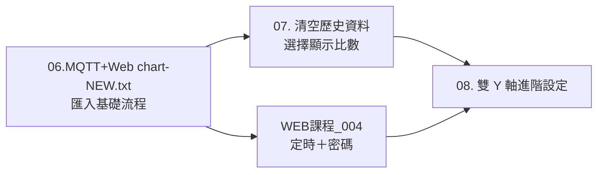

# Day5_20261103 子資料夾說明

> 父層：[Class-22-2026-11-05](../README.md)／教材庫總覽：[README.md](../../README.md)

| 項目 | 內容 |
|---|---|
| 屬性 | 上課當日（2026-11-03 製作、11-05 課堂沿用）的 Node-RED + MQTT 課程包 |
| 上課直播 | [2026-11-05](https://www.youtube.com/watch?v=8_-iuXGPXtk&list=PLKvXv11lxGbo)／[2026-11-03](https://www.youtube.com/watch?v=IDaHEhsdeMQ&list=PLKvXv11lxGbo) |
| 播放清單 | [工業4.0--工業4.0概論](https://www.youtube.com/playlist?list=PLKvXv11lxGbo) |

## 1. 重點

- **Node-RED MQTT 應用**：`06.MQTT+Web chart`（新版含 broker 双向）→ `07` 新增「清空歷史資料、選擇顯示比數」→ `08` 新增「雙 Y 軸進階設定」。
- **WEB 課程 004**：設定時間開／關機並**增加密碼**（20261103 版）。
- 進入點 PDF：`Node-RED MQTT應用_20261102.pdf`（先讀）、`MQTT教學二＿安裝MQTT伺服器MosquittoWindows系統篇.pdf`（環境）。

## 2. 檔案清單與用途

| 類型 | 檔名 | 用途 |
|---|---|---|
| 程式 | `06.MQTT+Web chart*.txt`（3 份） | Node-RED 流程：MQTT + Web 圖表（含 (2) 與 -NEW 版本） |
| 程式 | `07.新增清空歷史資料與選擇資料顯示比數*.txt` | 續作：UI 下拉與清除按鈕 |
| 程式 | `08.新增雙 Y 軸進階設定*.txt` | 續作：Chart 雙軸設定 |
| 程式 | `WEB課程_004.設計設定時間開啟或關閉增加密碼_20261103(2).txt` | 定時開關＋密碼流程 |
| 參考文件 | `Node-RED MQTT應用_20261102*.pdf` | 本節主要講義 |
| 參考文件 | `MQTT教學二＿安裝MQTT伺服器MosquittoWindows系統篇*.pdf` | Mosquitto 安裝教學 |
| 工具 | `mosquitto-1.6.12a-install-windows-x64*.exe` | MQTT Broker 安裝檔 |
| 工具 | `MQTT-Explorer-0.4.0-beta1*.exe` | MQTT 客戶端工具 |

> 依 Class-23 頻錄：匯入時先在 Node-RED 選單「匯入 → 選擇檔案」，再確認 broker 設定指向本機 1883。
