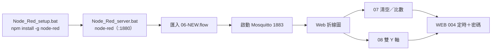

# Node-RED 網頁應用_Day5_20261103 子資料夾說明

> 父層：[Class-22-2026-11-05](../README.md)／教材庫總覽：[README.md](../../README.md)

| 項目 | 內容 |
|---|---|
| 屬性 | Node-RED 流程副本（Day5_20261103 精選版）＋ MQTT 支援工具 |
| 上課直播 | [2026-11-05](https://www.youtube.com/watch?v=8_-iuXGPXtk&list=PLKvXv11lxGbo) |
| 播放清單 | [工業4.0--工業4.0概論](https://www.youtube.com/playlist?list=PLKvXv11lxGbo) |

## 1. 內容與學習路線

| 類型 | 檔名 | 說明 |
|---|---|---|
| 程式 | [06.MQTT+Web chart.txt](06.MQTT%2BWeb%20chart.txt) | 基礎版：MQTT 訂閱資料轉換成 UI 折線圖 |
| 程式 | [06.MQTT+Web chart-NEW.txt](06.MQTT%2BWeb%20chart-NEW.txt) | 建議使用的新版流程 |
| 程式 | [07.新增清空歷史資料與選擇資料顯示比數.txt](07.%E6%96%B0%E5%A2%9E%E6%B8%85%E7%A9%BA%E6%AD%B7%E5%8F%B2%E8%B3%87%E6%96%99%E8%88%87%E9%81%B8%E6%93%87%E8%B3%87%E6%96%99%E9%A1%AF%E7%A4%BA%E6%AF%94%E6%95%B8.txt) | 加上清除鈕與顯示筆數選單 |
| 程式 | [08.新增雙 Y 軸進階設定.txt](08.%E6%96%B0%E5%A2%9E%E9%9B%99%20Y%20%E8%BB%B8%E9%80%B2%E9%9A%8E%E8%A8%AD%E5%AE%9A.txt) | Chart 進階：雙 Y 軸 |
| 程式 | [WEB課程_004.設計設定時間開啟或關閉增加密碼_20261103.txt](WEB%E8%AA%B2%E7%A8%8B_004.%E8%A8%AD%E8%A8%88%E8%A8%AD%E5%AE%9A%E6%99%82%E9%96%93%E9%96%8B%E5%95%9F%E6%88%96%E9%97%9C%E9%96%89%E5%A2%9E%E5%8A%A0%E5%AF%86%E7%A2%BC_20261103.txt) | 定時控制＋登入密碼 |
| 工具 | [mosquitto-1.6.12a-install-windows-x64.exe](mosquitto-1.6.12a-install-windows-x64.exe)、[MQTT-Explorer-0.4.0-beta1.exe](MQTT-Explorer-0.4.0-beta1.exe) | 環境重現 |
| 參考文件 | [Node-RED MQTT應用_20261102.pdf](Node-RED%20MQTT%E6%87%89%E7%94%A8_20261102.pdf) | 主要講義 |
| 參考文件 | [MQTT教學二＿安裝MQTT伺服器MosquittoWindows系統篇.pdf](MQTT%E6%95%99%E5%AD%B8%E4%BA%8C%EF%BC%BF%E5%AE%89%E8%A3%9DMQTT%E4%BC%BA%E6%9C%8D%E5%99%A8MosquittoWindows%E7%B3%BB%E7%B5%B1%E7%AF%87.pdf) | Broker 安裝 |
| 參考文件 | [WEB課程_004...(2).txt（副本）](../Day5_20261103/WEB%E8%AA%B2%E7%A8%8B_004.%E8%A8%AD%E8%A8%88%E8%A8%AD%E5%AE%9A%E6%99%82%E9%96%93%E9%96%8B%E5%95%9F%E6%88%96%E9%97%9C%E9%96%89%E5%A2%9E%E5%8A%A0%E5%AF%86%E7%A2%BC_20261103%20%282%29.txt) | 同上第 004 課副本（存於 Day5_20261103） |

## 2. 提醒

- 每個流程 TXT 需在 Node-RED「功能表 → 匯入 → JSON → 選擇檔案」載入；匯入後按「部署」。
- 流程內 broker 節點指向本機（localhost）1883；使用手機連線時改為電腦的區網 IP。
- 本資料夾為 [Day5_20261103](../Day5_20261103/) 的精選重組副本，完整原始檔與 exe 同時保留在父資料夾與 [MQTT 工具](../MQTT%20%E5%B7%A5%E5%85%B7/)。
