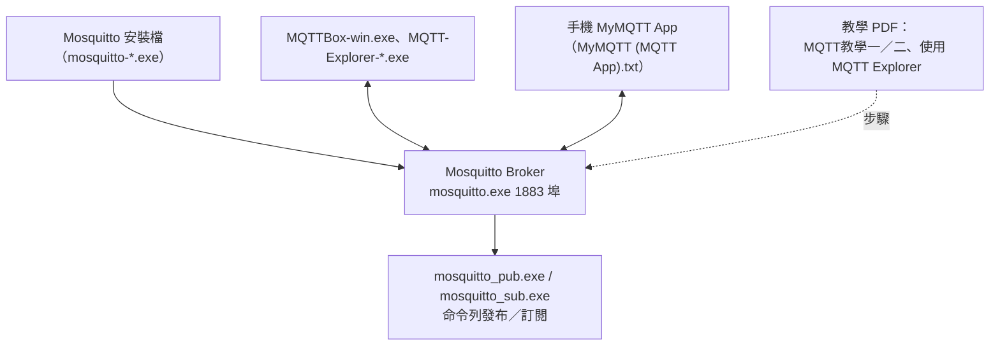

# MQTT 工具 子資料夾說明

> 父層：[Class-23-2026-11-05](../README.md)／教材庫總覽：[README.md](../../README.md)

| 項目 | 內容 |
|---|---|
| 屬性 | MQTT 教學與測試工具（Broker＋Client） |
| 上課直播 | [2026-11-05](https://www.youtube.com/watch?v=8_-iuXGPXtk&list=PLKvXv11lxGbo)／[Class-19（2026-10-22）初次安裝](https://www.youtube.com/watch?v=0YhJ1nQwPH4&list=PLKvXv11lxGbo) |
| 播放清單 | [工業4.0--工業4.0概論](https://www.youtube.com/playlist?list=PLKvXv11lxGbo) |

## 1. 內容

| 類型 | 項目 | 說明 |
|---|---|---|
| 工具 | [mosquitto-1.6.12a-install-windows-x64.exe](Mosquitto/mosquitto-1.6.12a-install-windows-x64.exe)（另有多版本與 x86/x64 選擇） | Mosquitto Broker 安裝程式 |
| 工具 | [Mosquitto/mosquitto/](Mosquitto/) | 已安裝完成的 Broker 執行檔（`mosquitto.exe`、`mosquitto_pub.exe`、`mosquitto_sub.exe` 等）與 `mosquitto.conf`、`readme.md` |
| 工具 | [Mosquitto/MQTT Client/MQTTBox-win.exe](Mosquitto/MQTT%20Client/MQTTBox-win.exe) | 桌機 MQTT 測試客戶端 |
| 工具 | [MQTT-Explorer-0.4.0-beta1.exe](MQTT-Explorer-0.4.0-beta1.exe) | 圖形化 MQTT 訊息總管 |
| 程式 | [MQTT GO.txt](MQTT%20GO.txt)、[mqtt_setup.txt](Mosquitto/mqtt_setup.txt) | 啟動／設定指令備忘（如 `net start mosquitto`） |
| 程式 | [MyMQTT (MQTT App).txt](MyMQTT%20%28MQTT%20App%29.txt) | 手機 App 測試流程筆記 |
| 參考文件 | [MQTT教學一＿認識MQTT.pdf](MQTT%E6%95%99%E5%AD%B8%E4%B8%80%EF%BC%BF%E8%AA%8D%E8%AD%98MQTT.pdf) | MQTT 基本觀念（QoS、broker/topic） |
| 參考文件 | [MQTT教學二＿安裝MQTT伺服器MosquittoWindows系統篇.pdf](MQTT%E6%95%99%E5%AD%B8%E4%BA%8C%EF%BC%BF%E5%AE%89%E8%A3%9DMQTT%E4%BC%BA%E6%9C%8D%E5%99%A8MosquittoWindows%E7%B3%BB%E7%B5%B1%E7%AF%87.pdf) | Windows 安裝與服務設定 |
| 參考文件 | [使用 MQTT Explorer.pdf](%E4%BD%BF%E7%94%A8%20MQTT%20Explorer.pdf) | Explorer 操作截圖說明 |

## 2. 建議步驟

1. 先安裝 `Win32OpenSSL_Light` 與 `vc_redist.x86.exe`（Mosquitto 相依），再安裝 mosquitto。
2. 檢查服務：`net start mosquitto`／`services.msc`，或執行 `Mosquitto/mosquitto/mosquitto.exe`。
3. 用 MQTT Explorer 連 `localhost:1883`，訂閱 `#` 驗證訊息。
