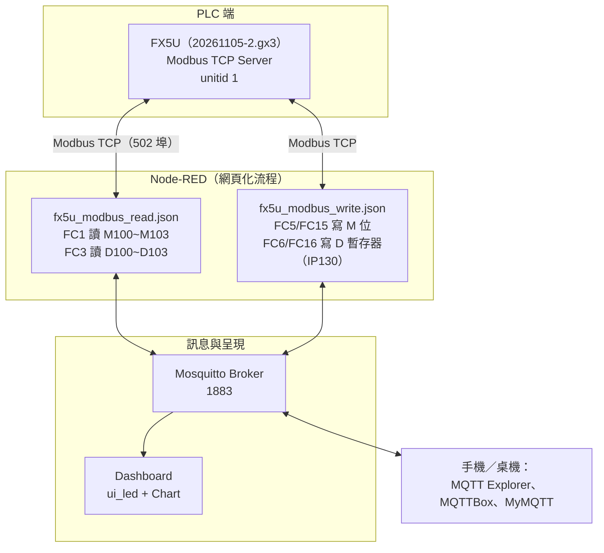
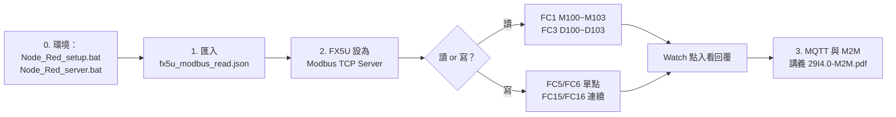

# Class-23 課程資料夾說明（2026-11-05）

> 本資料夾為 **2026-11-05**「工業 4.0／自動控制工程職類」上課教材：**FX5U Modbus TCP 通訊（讀／寫）與 M2M 應用**。
> 詳見 [教材庫總覽 README.md](../README.md)、[逐堂教材地圖 docs/COURSE-MAP.md](../docs/COURSE-MAP.md) 與架構圖 [docs/img/class23-modbus-mqtt.svg](../docs/img/class23-modbus-mqtt.svg)。

| 項目 | 內容 |
|---|---|
| 課次／日期 | Class-23／2026-11-05 |
| 主題 | FX5U Modbus TCP（FC1／FC3 讀、FC5／FC6／FC15／FC16 寫）＋ Node-RED ＋ MQTT／M2M |
| 上課直播 | <https://www.youtube.com/watch?v=8_-iuXGPXtk>（頻道存檔標題為 Class24-2026-11-05，係直播編號重排） |
| 播放清單 | [工業4.0--工業4.0概論（YouTube 播放清單）](https://www.youtube.com/playlist?list=PLKvXv11lxGbo) |

## 1. 上課影片

- **上課直播（YouTube）**：[工業4.0-2026-11-05-Class24-工業4.0概論](https://www.youtube.com/watch?v=8_-iuXGPXtk&list=PLKvXv11lxGbo)（videoId：`8_-iuXGPXtk`，2 小時 30 分鐘，直播）
- 同一播放清單內可對照前一堂：[Class-22（2026-11-03）](https://www.youtube.com/watch?v=IDaHEhsdeMQ&list=PLKvXv11lxGbo)
- 完整 23 堂課影片索引表格請見 [README.md 第 6 節](../README.md#6-上課影片播放清單)。

## 2. 本資料夾重點

本堂課把前兩週的 **Node-RED 網頁應用**與 **MQTT** 再往前推進到 **PLC 之間的標準通訊**：

1. **PLC 端**：以 GX Works3 撰寫並執行 FX5U 專案（`20261105-2.gx3`），將 FX5U 內建 Ethernet 設為 **Modbus TCP Server（unitid 1）**。
2. **Node-RED 端**：匯入兩份流程檔，用 Modbus 節點對 FX5U 讀寫：
   - `fx5u_modbus_read.json` — FC1（讀單個 M100、一次讀 M100~M103 4 點）、FC3（讀 D100、一次讀 D100~D103 4 暫存器），M0 對應 Modbus 位址 **8192**、M100=**8292**、D100=**100**。
   - `fx5u_modbus_write.json` — 對 IP130 主機：FC5（強制單一線圈 M100）、FC15（強制 M100~M103）、FC6（寫單一暫存器 D100）、FC16（一次寫 D100~D103）。
3. **M2M**：結合 MQQT topic 與 Web 儀錶板，讓手機 App（MyMQTT）、另一個 Flow、瀏覽器不需修改 PLC 程式即可交換狀態（詳見講義 `Class-23-2026-11-05-29I4.0-M2M.pdf` 第 29 頁）。

## 3. 子資料夾導覽

| 子資料夾 | 說明 |
|---|---|
| [Day5_20261103/](Day5_20261103/) | 上課流程原始檔、Mosquitto／MQTT Explorer 安裝檔與教學 PDF（同 Class-22 Day5 打包內容，本表另開 (2) 副本） |
| [MQTT 工具/](MQTT%20%E5%B7%A5%E5%85%B7/) | Mosquitto Broker 完整安裝檔與執行檔、MQTT Client（MQTTBox）、教學 PDF |
| [Node-RED 網頁應用_Day5_20261103/](Node-RED%20%E7%B6%B2%E9%A0%81%E6%87%89%E7%94%A8_Day5_20261103/) | 06~08 流程 TXT（MQTT+Web chart、清空資料／選擇比數、雙 Y 軸）與相關 PDF |

## 4. 筆記、參考文件與程式

- **筆記**：`Class-23-2026-11-05.doc`（本堂教師授課紀錄，Word 檔）。
- **參考文件**：`Class-23-2026-11-05-29I4.0-M2M.pdf`（M2M 講義第 29 頁起）、各子資料夾內 MQTT 教學 PDF、`使用 MQTT Explorer.pdf`。
- **程式**：
  - `20261105-2.gx3` — GX Works3 FX5U 專案（Modbus Server 設定）。
  - `fx5u_modbus_read.json` / `fx5u_modbus_write.json` — Node-RED Modbus TCP 讀／寫流程（可直接匯入 Node-RED）。
  - `Node_Red_setup.bat`（`npm install -g node-red`）、`Node_Red_server.bat`（`node-red`）。
  - `LED節點.txt` — 安裝 `node-red-contrib-ui-led` 儀錶板節點的記名。

## 5. 檔案清單

| 類型 | 檔名 | 大小 |
|---|---|--:|
| 程式／範例 | [20261105-2.gx3](20261105-2.gx3) | 456 KB |
| 筆記 | [Class-23-2026-11-05.doc](Class-23-2026-11-05.doc) | 11740 KB |
| 參考文件 | [Class-23-2026-11-05-29I4.0-M2M.pdf](Class-23-2026-11-05-29I4.0-M2M.pdf) | 1731 KB |
| 程式／範例 | [fx5u_modbus_read.json](fx5u_modbus_read.json) | 5 KB |
| 程式／範例 | [fx5u_modbus_write.json](fx5u_modbus_write.json) | 6 KB |
| 程式／範例 | [LED節點.txt](LED%E7%AF%80%E9%BB%9E.txt) | 0 KB |
| 程式／範例 | [Node_Red_server.bat](Node_Red_server.bat) | 0 KB |
| 程式／範例 | [Node_Red_setup.bat](Node_Red_setup.bat) | 0 KB |
| 工具／安裝檔 | [Day5_20261103.zip](Day5_20261103.zip) | 98363 KB |

> 安裝檔與壓縮包僅供教學重現環境；Day5_20261103.zip 已接近 GitHub 單檔上限（100 MB），更新請留意。

---

檔案整理：2026-11-05
