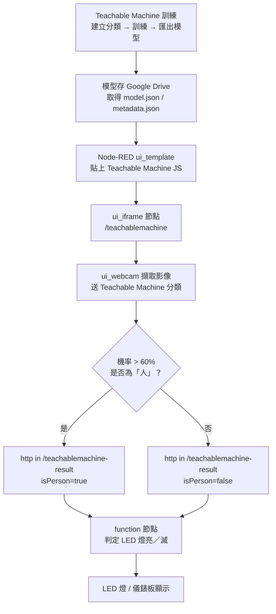

# Class-24 課程資料夾說明（2026-11-10）

> 本資料夾為 **2026-11-10**「工業 4.0／自動控制工程職類」上課教材：**Node-RED AI 應用（Ch9 Teachable Machine 訓練與 TensorFlow 影像分類模型）**。
> 詳見 [教材庫總覽 README.md](../README.md) 與 [逐堂教材地圖 docs/COURSE-MAP.md](../docs/COURSE-MAP.md)。

| 項目 | 內容 |
|---|---|
| 課次／日期 | Class-24／2026-11-10（Node-RED 線上課程 **Day 6**） |
| 主題 | Teachable Machine 訓練模型、TensorFlow.js 影像分類、Node-RED 內嵌 AI、攝影機辨識聯動 LED |
| 上課直播 | 播放清單尚未收錄（2026-11-05 之後上架，補上後更新本表） |
| 播放清單 | [工業4.0--工業4.0概論（YouTube 播放清單）](https://www.youtube.com/playlist?list=PLKvXv11lxGbo) |
| 對應章節 | Node-RED 程式設計 ─ AI 應用 ─ Ch9 |

## 1. 上課影片

- **播放清單**：[工業4.0--工業4.0概論](https://www.youtube.com/playlist?list=PLKvXv11lxGbo)（頻道：留五針）
- 2026-11-10 的直播／錄影尚未收錄於播放清單；可先對照前一堂 [Class-23（2026-11-05）](https://www.youtube.com/watch?v=8_-iuXGPXtk&list=PLKvXv11lxGbo)。
- 完整影片索引表格請見 [README.md 第 6 節](../README.md#6-上課影片播放清單)。

## 2. 本資料夾重點

本堂課把前幾週的 **Node-RED 網頁應用**推進到 **AI 影像分類**，並用攝影機做出「有人在／不在」的即時判斷：

1. **安裝相關節點**（本堂新增）：

   | 節點套件 | 提供節點 | 用途 |
   |---|---|---|
   | `node-red-contrib-browser-utils` | — | 瀏覽器工具（字型檔） |
   | `node-red-contrib-image-tools` | `image viewer`、`annotate image plus` | 影像預覽與註記 |
   | `node-red-annotate-image-plus` | `annotate image plus` | 影像分類框與機率標註 |
   | `node-red-node-ui-webcam` | `ui_webcam` | Dashboard 內嵌網路攝影機 |
   | `node-red-node-ui-iframe` | `ui_iframe` | Dashboard 內嵌 iframe（載入 Teachable Machine） |

2. **影像預覽與註記**：`image viewer` 節點預覽影像；`annotate image plus` 標註分類框與機率（例如 `fresh_apple (96.92%)`）。
3. **Teachable Machine 訓練**（<https://teachablemachine.withgoogle.com/>）：
   Step1 開啟網站 → Step2 建立分類並新增樣本影像 → Step3 訓練模型 → Step4 預覽測試與優化 →
   Step5 匯出模型並複製 JS 程式碼 → Step6 儲存模型至 Google Drive。
4. **在 Node-RED 使用模型**：以 `ui_iframe` 節點開 `http://localhost:1880/teachablemachine`，
   將 Teachable Machine 的 JS 程式碼貼入 `ui_template`，再以 `http in` 節點接收判斷結果。
5. **最終應用**：Webcam 判斷「有無人」→ 透過 HTTP 節點傳給後端 function 節點 → 控制 LED 燈亮／滅
   （對應流程檔 `06.webcam判斷有無人開啟LED燈(填訓練link).txt`）。

```mermaid
flowchart LR
    subgraph T["Teachable Machine 訓練流程"]
        T1["Step1 開啟網站"] --> T2["Step2 分類與樣本"]
        T2 --> T3["Step3 訓練"] --> T4["Step4 測試優化"]
        T4 --> T5["Step5 匯出＋複製 JS"] --> T6["Step6 存 Google Drive"]
    end
    subgraph N["Node-RED 實作"]
        N1["ch9-2-1／2-2<br/>file inject → image viewer"] --> N2["ch9-2-2a<br/>annotate image plus"]
        N2 --> N3["ch9-2-3<br/>ui_iframe + template"]
        N3 --> N4["ch9-2-4<br/>ui_webcam"]
        N4 --> N5["ch9-4-1<br/>/teachablemachine iframe"]
        N5 --> N6["ch9-4-2<br/>teachable machine 節點"]
    end
    T6 --> N1
```

## 3. 子資料夾導覽

| 項目 | 說明 |
|---|---|
| [Day6_20261110/](Day6_20261110/) | 上課流程包原始檔（解壓內容）：Ch9 講義、流程檔、範例頁、字型與測試影像 |
| [Day6_20261110.zip](Day6_20261110.zip) | 同一批流程包的壓縮原始檔（與 `Day5_20261103.zip` 同模式保留） |

### Day6_20261110 內容

| 檔名 | 說明 |
|---|---|
| `Node-RED AI_ch9.pdf` | Ch9 原始章節教材（25 頁，含圖文步驟） |
| `Node-RED AI應用_ch9_20261110.pdf` | 本堂中文講義／投影片（19 頁，節點安裝與訓練步驟） |
| `06.webcam判斷有無人開啟LED燈(填訓練link).txt` | Node-RED 匯出流程（JSON 陣列格式，可直接匯入）。含 `ui_template`（Teachable Machine 平滑判定）、`http in`(`/teachablemachine-result`)、`function`（LED 燈亮／滅判定）等節點 |
| `ch09-examples/teachablemachine.html` | Teachable Machine 範例頁 |
| `ch09-examples/SourceSansPro-Regular.ttf` | `node-red-contrib-browser-utils` 所需字型 |
| `ch09-examples/images/` | 測試用影像（`apple-01.jpg`、`cat.jpg`、`dog.jpg`、`Paper.jpg`、`Rock.jpg`、`Scissors.jpg`） |

### ch09-examples 範例流程

| 檔名 | 節點組合 | 用途 |
|---|---|---|
| `ch9-2-1.json` | `file inject` → `debug` | 讀入圖檔並於 Debug 面板檢視 |
| `ch9-2-2.json` | `file inject` → `image viewer` → `debug` | 以 `image viewer` 預覽圖檔 |
| `ch9-2-2a.json` | `inject` → `file in` → `change` → `image viewer` ×2 → `annotate image plus` | 以 `annotate image plus` 標註分類框與機率 |
| `ch9-2-3.json` | `ui_iframe` + `http in`(`/hello`) + `template` + `ui_group`／`ui_tab` | 於 Dashboard 內嵌自訂 HTML 頁 |
| `ch9-2-4.json` | `ui_webcam` → `image viewer` | 於 Dashboard 直接取用網路攝影機 |
| `ch9-4-1.json` | `ui_iframe` + `http in`(`/teachablemachine`) + `template` | 內嵌 Teachable Machine 分類頁 |
| `ch9-4-2.json` | `teachable machine` → `file inject` → `image viewer` → `debug` | 以 `teachable machine` 節點對圖檔分類 |

## 4. 筆記、參考文件與程式

- **筆記**：`Class-24-2026-11-10.doc`（本堂教師授課紀錄，含課堂截圖與上課用連結；與各堂 `Class-NN-YYYY-MM-DD.doc` 同一系列）。
- **參考文件**：見 [Day6_20261110/](Day6_20261110/) 內兩份 Ch9 PDF。
- **程式／流程**：
  - `06.webcam判斷有無人開啟LED燈(填訓練link).txt` ─ Node-RED 匯出流程（JSON 陣列格式，可直接匯入）。
  - `ch09-examples/teachablemachine.html` ─ Teachable Machine 範例頁。
  - `ch09-examples/SourceSansPro-Regular.ttf` ─ `node-red-contrib-browser-utils` 所需字型。
  - `ch09-examples/images/` ─ 測試用影像。
- **環境啟動腳本**（與 Class-21～23 同系列）：
  - `Node_Red_setup.bat` ─ `npm install -g node-red`
  - `Node_Red_server.bat` ─ `node-red`

> ⚠️ 匯入 `06.webcam…txt` 前，請把 `ui_template` 節點中的 `TM_CLOUD_URL`
> （`https://teachablemachine.withgoogle.com/models/xxxxxx/`）改成自己訓練並存到 Google Drive 的模型網址。

## 5. 檔案清單

| 類型 | 檔名 | 大小 |
|---|---|---:|
| 筆記 | [Class-24-2026-11-10.doc](Class-24-2026-11-10.doc) | 11740 KB |
| 工具／壓縮包 | [Day6_20261110.zip](Day6_20261110.zip) | 8339 KB |
| 參考文件 | [Node-RED AI_ch9.pdf](Node-RED%20AI_ch9.pdf) | 7035 KB |
| 參考文件 | [Node-RED AI應用_ch9_20261110.pdf](Node-RED%20AI%E6%87%89%E7%94%A8_ch9_20261110.pdf) | 2173 KB |
| 參考文件 | [Day6_20261110/Node-RED AI_ch9.pdf](Day6_20261110/Node-RED%20AI_ch9.pdf) | 7035 KB |
| 參考文件 | [Day6_20261110/Node-RED AI應用_ch9_20261110.pdf](Day6_20261110/Node-RED%20AI%E6%87%89%E7%94%A8_ch9_20261110.pdf) | 2173 KB |
| 程式／範例 | [Day6_20261110/06.webcam判斷有無人開啟LED燈(填訓練link).txt](Day6_20261110/06.webcam%E5%88%A4%E6%96%AD%E6%9C%89%E7%84%A1%E4%BA%BA%E9%96%8B%E5%95%9FLED%E7%87%88(%E5%A1%AB%E8%A8%93%E7%B7%B4link).txt) | 7 KB |
| 程式／範例 | `Day6_20261110/ch09-examples/`（7 個流程 JSON） | 16 KB |
| 程式／範例 | [Day6_20261110/ch09-examples/teachablemachine.html](Day6_20261110/ch09-examples/teachablemachine.html) | 3 KB |
| 工具／字型 | [Day6_20261110/ch09-examples/SourceSansPro-Regular.ttf](Day6_20261110/ch09-examples/SourceSansPro-Regular.ttf) | 116 KB |
| 測試影像 | `Day6_20261110/ch09-examples/images/`（6 張 JPG） | 103 KB |
| 程式／範例 | [Node_Red_setup.bat](Node_Red_setup.bat) | 1 KB |
| 程式／範例 | [Node_Red_server.bat](Node_Red_server.bat) | 1 KB |

> 兩份 Ch9 講義 PDF 同時置於資料夾根目錄與 `Day6_20261110/` 內，屬「單堂可獨立取用」的快照設計（見根 [README.md 第 7 節](../README.md#7-版本控制與檔案政策)）。
> 單檔最大為授課筆記 `Class-24-2026-11-10.doc`（11.7 MB），未達 GitHub 100 MB 單檔上限。

---

檔案整理：2026-11-10
