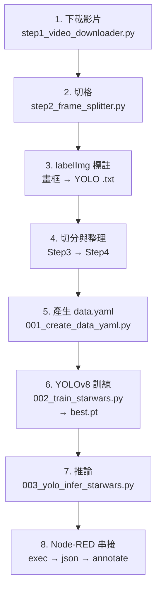
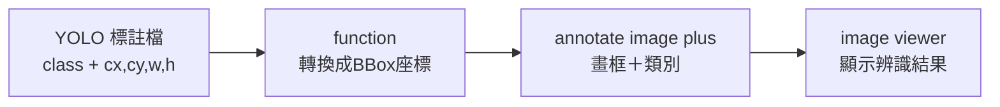

# Class-24 課程資料夾說明

> 本資料夾為 **2026-11-12**「工業 4.0／自動控制工程職類」上課教材：**Node-RED AI 應用（Ch10 YOLO 物件偵測模型訓練與推論）**。
> 詳見 [教材庫總覽 README.md](../README.md) 與 [逐堂教材地圖 docs/COURSE-MAP.md](../docs/COURSE-MAP.md)。

| 項目 | 內容 |
|---|---|
| 課次／日期 | Class-24／2026-11-12（Node-RED 線上課程 **Day 7**） |
| 主題 | YOLO 物件偵測：資料標註（labelImg）、資料集切分、YOLOv8 訓練、Node-RED 串接推論與標註顯示 |
| 上課直播 | [https://www.youtube.com/watch?v=j2wnkIvPIs4]（頻道存檔標題為 工業4.0-2026-11-12-Class24） |
| 播放清單 | [工業4.0--工業4.0概論（YouTube 播放清單）](https://www.youtube.com/playlist?list=PLKvXv11lxGbo) |
| 對應章節 | Node-RED 程式設計 ─ AI 應用 ─ Ch10 |

## 1. 上課影片

- **上課直播（YouTube）**：[工業4.0-2026-11-12-Class24-工業4.0概論](https://www.youtube.com/watch?v=j2wnkIvPIs4&list=PLKvXv11lxGbo)（videoId：`j2wnkIvPIs4`）
- 同一播放清單內可對照前一堂 [Class-23（2026-11-10）](https://www.youtube.com/watch?v=fJ018vU6Lp8&list=PLKvXv11lxGbo)。
- 完整影片索引表格請見 [README.md 第 6 節](../README.md#6-上課影片播放清單)。

## 2. 本資料夾重點

本堂課接續上一堂的 **Teachable Machine 影像分類（Ch9）**，把「分類」升級成「**物件偵測**」：不只判斷畫面屬於哪一類，而是用 **YOLO** 在影像上框出**物件的位置**。

1. **取得影片與切格**（`ch10-3-3/`）：
   - `step1_video_downloader.py` ─ 以 `yt-dlp` 下載 YouTube 影片。
   - `下載Youtube.py` ─ 下載單支影片的精簡版。
   - `step2_frame_splitter(中文字).py` ─ 以 OpenCV 將影片逐格轉成圖片（供標註使用）。
   - `starwars.mp4` ─ 課堂使用的範例影片（星際大戰）。
2. **標註工具**（`ch10-4-2/labelImg/`）：內含 labelImg 標註工具原始碼，於影像上畫框並輸出 YOLO 格式的 `.txt` 標註檔。
3. **資料集前處理**（`ch10-4-2/`，Step 1～5 依序執行）：
   - `Step1_labelimg_preclassifier.py` ─ 預先分類（依檔名把資料丟進暫存資料夾）。
   - `Step2_labelimg_launcher_(中文檔名).py` ─ 啟動 labelImg，並自動套用中文檔名預設路徑。
   - `Step3_dataset_splitter.py` ─ 將標註完成的資料**切分成 train／val**。
   - `Step4_dataset_organizer.py` ─ 整理成 YOLO 標準結構（`images/` 與 `labels/`）。
   - `Step5_annotation_image_viewer.py` ─ 以 OpenCV 檢視標註結果（含自然排序與類別配色）。
4. **訓練與推論**：
   - `001_create_data_yaml.py` ─ 產生 `data.yaml`（指定路徑、`train`／`val` 與類別名稱：Millennium Falcon、Tie Fighter）。
   - `002_train_starwars.py` ─ 以 `ultralytics` 的 **YOLOv8n** 訓練 50 epochs，輸出 `best.pt`。
   - `003_yolo_infer_starwars.py` ─ 載入訓練好的權重做推論，輸出 JSON 標註結果。
5. **在 Node-RED 使用模型**：
   - `05.yolo訓練.txt` ─ Node-RED 流程：`exec` 節點呼叫 Python 推論腳本 → `function` 將錯誤 Buffer 轉文字 → `json` 解析 → `switch` 判斷是否有偵測到物件 → `annotate image plus` 畫框 → `image viewer` 顯示。
   - `04.在Node-RED 顯示標註圖檔.txt` ─ Node-RED 流程：`file inject` 選圖 → `image-info` 取得尺寸 → `file in` 讀取 YOLO 標註檔 → `function` **轉換成 BBox 座標**（YOLO 正規化座標 → 像素 bbox）→ `annotate image plus` 標註 → `image viewer` 顯示。

> ⚠️ 腳本中的資料路徑為教師機上的絕對路徑（`D:\IIOT\課程資料\Node-RED AI 學習\...`），
> 使用前請改成自己的資料夾位置；`data.yaml` 的 `path:` 也需一併調整。

## 3. 子資料夾導覽

| 項目 | 說明 |
|---|---|
| [Day7_20261112/](Day7_20261112/) | 上課流程包原始檔（解壓內容）：兩份 Ch10 PDF 與 `ch10-examples/` 範例 |
| [Day7_20261112.zip](Day7_20261112.zip) | 同一批流程包的壓縮原始檔（**147 MB，超過 GitHub 單檔 100 MB 上限，未納入版控**；內容已由 `Day7_20261112/` 目錄完整保留） |

### Day7_20261112 內容

| 檔名 | 說明 |
|---|---|
| `Node-RED AI_ch10.pdf` | Ch10 原始章節教材（Ultralytics／YOLO 物件偵測章節） |
| `Node-RED AI應用_ch10_講義.pdf` | 本堂中文講義／投影片（標註、訓練、串接步驟） |

### ch10-examples 範例

| 檔名／資料夾 | 說明 |
|---|---|
| `ch10-2-1.py` | 第一支 Python 程式（環境測試） |
| `ch10-3-3/` | 影片下載與切格（3 支腳本 + `starwars.mp4`） |
| `ch10-4-2/` | 標註（labelImg）、資料集切分整理、`data.yaml`、訓練與推論腳本 |
| `ch10-4-2_己訓練/` | 已訓練完成的資料集與標註結果（含 `train/`、`val/` 與 labelImg） |
| `ch10-4-2_己訓練.zip` | 上課包好的已訓練資料集壓縮檔（84 MB） |
| `thonny-5.0.1-windows-portable-x64/`、`….zip` | Thonny 攜帶版 Python IDE（Windows，免安裝） |
| `04.在Node-RED 顯示標註圖檔.txt` | Node-RED 流程：顯示 YOLO 標註圖檔 |
| `05.yolo訓練.txt` | Node-RED 流程：呼叫 YOLO 模型推論 |
| `ch10-5.json` | 同上流程的 JSON 匯出檔 |
| `jpg_to_mp4_converter_20261104.py` | 圖片轉影片（YOLO 推論結果動畫化） |
| `apples Dataset - Overview.url`、`bourdakos1-…url` | 參考資料連結 |

## 4. 筆記、參考文件與程式

- **筆記**：`Class-24-2026-11-14.doc`（本堂教師授課紀錄，含課堂截圖與上課用連結；檔名沿用教師原始命名）。
- **參考文件**：見 [Day7_20261112/](Day7_20261112/) 內兩份 Ch10 PDF。
- **程式／流程**：
  - `ch10-3-3/step1_video_downloader.py`、`下載Youtube.py`、`step2_frame_splitter(中文字).py` ─ 影片下載與切格。
  - `ch10-4-2/Step1`～`Step5` ─ 標註、資料集切分與整理、標註檢視。
  - `ch10-4-2/001_create_data_yaml.py`、`002_train_starwars.py`、`003_yolo_infer_starwars.py` ─ 訓練與推論。
  - `04.在Node-RED 顯示標註圖檔.txt`、`05.yolo訓練.txt`、`ch10-5.json` ─ Node-RED 流程。
- **環境啟動腳本**（與 Class-20～23 同系列）：
  - `Node_Red_setup.bat` ─ `npm install -g node-red`
  - `Node_Red_server.bat` ─ `node-red`

## 5. 檔案清單

| 類型 | 檔名 | 大小 |
|---|---|--:|
| 筆記 | [Class-24-2026-11-14.doc](Class-24-2026-11-14.doc) | 11943 KB |
| 工具／壓縮包 | [Day7_20261112.zip](Day7_20261112.zip) | 150827 KB |
| 參考文件 | [Node-RED AI_ch10.pdf](Node-RED%20AI_ch10.pdf) | 8964 KB |
| 參考文件 | [Node-RED AI應用_ch10_講義.pdf](Node-RED%20AI%E6%87%89%E7%94%A8_ch10_%E8%AC%9B%E7%BE%A9.pdf) | 3335 KB |
| 參考文件 | [Day7_20261112/Node-RED AI_ch10.pdf](Day7_20261112/Node-RED%20AI_ch10.pdf) | 8964 KB |
| 參考文件 | [Day7_20261112/Node-RED AI應用_ch10_講義.pdf](Day7_20261112/Node-RED%20AI%E6%87%89%E7%94%A8_ch10_%E8%AC%9B%E7%BE%A9.pdf) | 3335 KB |
| 程式／範例 | [Node_Red_server.bat](Node_Red_server.bat) | 0 KB |
| 程式／範例 | [Node_Red_setup.bat](Node_Red_setup.bat) | 0 KB |

> `Day7_20261112.zip`（147 MB）超過 GitHub 單檔 100 MB 硬性上限，**不納入版控**；
> 課程內容已完整保留於 `Day7_20261112/` 目錄與 `ch10-examples/` 子資料夾。
> `thonny-5.0.1-windows-portable-x64/`（攜帶版 IDE，13,000+ 個檔案）與 `labelImg/`（第三方工具原始碼）
> 依第三方專案自己的 `.gitignore` 排除 `__pycache__`／`*.pyc` 等建置產物，其餘檔案照常納入。

---

檔案整理：2026-11-12
