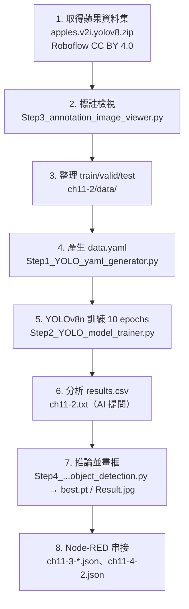
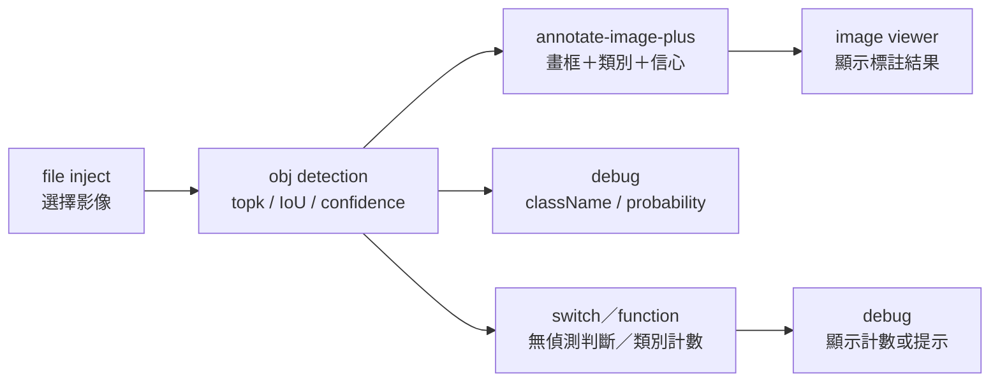

# Class-25 課程資料夾說明

> 本資料夾為 **2026-11-17**「工業 4.0／自動控制工程職類」上課教材：**Node-RED AI 應用（Ch11 蘋果 YOLO 物件偵測：資料集、模型訓練、訓練曲線分析與 Node-RED 推論流程）**。
> 詳見 [教材庫總覽 README.md](../README.md) 與 [逐堂教材地圖 docs/COURSE-MAP.md](../docs/COURSE-MAP.md)。

| 項目 | 內容 |
|---|---|
| 課次／日期 | Class-25／2026-11-17（Node-RED 線上課程 **Day 8**） |
| 主題 | YOLOv8 物件偵測：蘋果新鮮／腐爛分類（fresh_apple / rotten_apple）、資料集整理、模型訓練與評估、Node-RED `obj detection` 流程串接 |
| 上課直播 | [https://www.youtube.com/watch?v=I-IKRY3jts4](https://www.youtube.com/watch?v=I-IKRY3jts4)（頻道存檔標題為 工業4.0-2026-11-17-Class25） |
| 播放清單 | [工業4.0--工業4.0概論（YouTube 播放清單）](https://www.youtube.com/playlist?list=PLKvXv11lxGbo)（已更新為 26 段，Class01～Class25） |
| 對應章節 | Node-RED 程式設計 ─ AI 應用 ─ Ch11 |
| 教材規模 | 15,985 個檔案／約 342.0 MB（其中 Thonny 攜帶版 IDE 12,757 檔；教材本體 3,228 檔／197.1 MB） |

## 1. 上課影片

- **上課直播（YouTube）**：[工業4.0-2026-11-17-Class25-工業4.0概論](https://www.youtube.com/watch?v=I-IKRY3jts4&list=PLKvXv11lxGbo)（videoId：`I-IKRY3jts4`）
- 同一播放清單內可對照前一堂 [Class-24（2026-11-12，Ch10 YOLO 星際大戰物件偵測）](https://www.youtube.com/watch?v=j2wnkIvPIs4&list=PLKvXv11lxGbo)。
- 完整影片索引表格請見 [README.md 第 6 節](../README.md#6-上課影片播放清單)。

## 2. 本堂課重點

本堂課接續 Class-24 的 **YOLO 物件偵測（Ch10）**，把流程套用到「**蘋果新鮮度辨識**」的實作資料集，並進一步學習：

1. **讀取標註結果**（`ch11-1/Step3_annotation_image_viewer.py`）：將 YOLO 正規化標註還原成像素框，並在影像上疊加 `fresh_apple`／`rotten_apple` 類別文字。
2. **建立訓練設定**（`ch11-2/Step1_YOLO_yaml_generator.py`）：自動偵測 `train/`、`valid/`（或 `val/`）、`test/` 目錄，輸出 `data.yaml`（`nc: 2`、`names: ['fresh_apple', 'rotten_apple']`）。
3. **訓練與驗證**（`ch11-2/Step2_YOLO_model_trainer.py`）：以 `ultralytics` 的 **YOLOv8n**（`yolov8n.pt` 預訓練權重）訓練 10 epochs，批次 16、影像尺寸 640；輸出 `runs/detect/train*/weights/best.pt`，並印出 mAP50-95／mAP50／mAP75 與各分類 mAP。
4. **訓練曲線分析**（`ch11-2.txt`）：以表格中的 `results.csv`（epoch／loss／precision／recall／mAP）請 AI 判斷最佳訓練週期與是否需增加 epochs。10 個 epoch 的 mAP50-95 由 0.621 逐步提升到 0.860，最後一期仍在上升，代表可考慮增加訓練週期。
5. **單張影像推論**（`ch11-2/Step4_YOLO_model_object_detection.py`）：載入 `best.pt`，輸出座標、信心指數，並以 OpenCV 畫框存成 `Result.jpg`。
6. **Node-RED 視覺化推論**（`ch11-3-*.json`、`ch11-4-2.json`）：使用 `obj detection` 節點搭配 `annotate-image-plus`、`image viewer`、`debug`、`switch`、`function` 等節點，做到多物件標註、無偵測判斷與「指定類別＋信心門檻」計數。

> ⚠️ `ch11-4-2.json` 的 `modelPath` 指向教師機路徑 `C:\AIoT\ch11\AppleModel`；
> 實際使用前請把訓練好的模型放到本機對應目錄並修改該欄位（Repo 內的 `AppleModel/` 目前為空資料夾，
> 訓練權重另存於 `ch11-2/best.pt` 與 `ch11-2/runs/detect/train*/weights/best.pt`）。

## 3. 子資料夾與檔案導覽

| 項目 | 說明 |
|---|---|
| [Day8_20261117/](Day8_20261117/) | 上課流程包原始檔：Ch11 PDF 兩份與 `ch11-examples/` 範例、Thonny 攜帶版 IDE |
| [Class-25-2026-11-17.doc](Class-25-2026-11-17.doc) | 教師授課筆記（11.7 MB，含課堂截圖與操作連結；沿用教師原始命名） |
| [Node-RED AI_ch11.pdf](Node-RED%20AI_ch11.pdf) | Ch11 原始章節教材（8.3 MB） |
| [Node-RED AI應用_ch11_講義.pdf](Node-RED%20AI%E6%87%89%E7%94%A8_ch11_%E8%AC%9B%E7%BE%A9.pdf) | 本堂中文講義／投影片（2.9 MB） |
| [Node_Red_setup.bat](Node_Red_setup.bat) | `npm install -g node-red`（Node-RED 安裝） |
| [Node_Red_server.bat](Node_Red_server.bat) | `node-red`（啟動 Node-RED 伺服器） |

### ch11-examples 範例

| 檔名／資料夾 | 說明 |
|---|---|
| `ch11-1/` | 蘋果資料集與標註檢視：`apples.v2i.yolov8/`（971 train／200 test 檔，`data.yaml` 標明 `fresh_apple`、`rotten_apple`，來源 Roboflow `apples-daz2v` v2，CC BY 4.0）、`apples.v2i.yolov8.zip`（38.0 MB）、`Step3_annotation_image_viewer.py` |
| `ch11-2/` | 訓練與推論：`data/`（1,365 train／393 valid／200 test 檔）、`runs/detect/train`、`train-2`、`val`、`val-2`（曲線圖、混淆矩陣、`results.csv`、`args.yaml`、兩組 `best.pt`／`last.pt`）、`Step1`～`Step4` 腳本、`data.yaml`、`yolov8n.pt`（6.2 MB）、`best.pt`（6.2 MB）、`Result.jpg` |
| `ch11-2.pdf` | 訓練結果與問答截圖（0.3 MB） |
| `ch11-2.txt` | YOLO 訓練 `results.csv`＋AI 提問：「最佳的訓練周期是幾次？是否需增加訓練周期？」 |
| `classes.txt` | COCO 80 類名稱（`person`、`bicycle` … `toothbrush`），供 `obj detection` 預設模型對照 |
| `ch11-3-1.json` | Node-RED 基本流程：`fileinject → obj detection(topk=3, IoU=0.45, conf=0.25) → annotate + image viewer + debug` |
| `ch11-3-2.json` | 進階流程：`switch` 依 `annotations.length` 判斷有無偵測；有則顯示 `className`／`probability` 並畫框，無則輸出 `no detection` |
| `ch11-3-3.json` | 類別計數流程：`function` 依 `msg.topic`（類別，預設 `person`）與 `msg.prob`（信心門檻，預設 0.9）統計 `annotations` |
| `ch11-4-2.json` | 套用自訓模型：`modelPath = C:\AIoT\ch11\AppleModel`，其餘參數同上 |
| `AppleModel/` | 預留給 Node-RED `obj detection` 節點的模型資料夾（目前為空，請自行放入訓練模型） |
| `thonny-5.0.1-windows-portable-x64/` | Thonny 5.0.1 攜帶版 Python IDE（Windows，免安裝，12,757 檔／144.9 MB，含本堂所需套件） |

> `Day8_20261117/` 內也放了一份相同的 `Node-RED AI_ch11.pdf` 與中文講義 PDF，方便整個流程包單獨攜帶。

## 4. 筆記、參考文件與程式

- **筆記**：`Class-25-2026-11-17.doc`（本堂教師授課紀錄，含課堂截圖與上課用連結）。
- **參考文件**：見 [Day8_20261117/](Day8_20261117/) 內兩份 Ch11 PDF，以及 `ch11-examples/ch11-2.pdf`。
- **程式／流程**：
  - `ch11-1/Step3_annotation_image_viewer.py` ─ 標註框視覺化。
  - `ch11-2/Step1_YOLO_yaml_generator.py`、`Step2_YOLO_model_trainer.py`、`Step4_YOLO_model_object_detection.py` ─ YAML 產生、訓練／驗證、推論畫框。
  - `ch11-3-1.json`、`ch11-3-2.json`、`ch11-3-3.json`、`ch11-4-2.json` ─ Node-RED 推論流程。
- **環境啟動腳本**（與 Class-20～24 同系列）：`Node_Red_setup.bat`（安裝 Node-RED）、`Node_Red_server.bat`（啟動 Node-RED）。

## 5. 檔案清單

| 類型 | 檔名 | 大小 |
|---|---|--:|
| 筆記 | [Class-25-2026-11-17.doc](Class-25-2026-11-17.doc) | 12231 KB |
| 參考文件 | [Node-RED AI_ch11.pdf](Node-RED%20AI_ch11.pdf) | 8264 KB |
| 參考文件 | [Node-RED AI應用_ch11_講義.pdf](Node-RED%20AI%E6%87%89%E7%94%A8_ch11_%E8%AC%9B%E7%BE%A9.pdf) | 2989 KB |
| 參考文件 | [Day8_20261117/Node-RED AI_ch11.pdf](Day8_20261117/Node-RED%20AI_ch11.pdf) | 8264 KB |
| 參考文件 | [Day8_20261117/Node-RED AI應用_ch11_講義.pdf](Day8_20261117/Node-RED%20AI%E6%87%89%E7%94%A8_ch11_%E8%AC%9B%E7%BE%A9.pdf) | 2989 KB |
| 程式／範例 | [Node_Red_server.bat](Node_Red_server.bat) | 0 KB |
| 程式／範例 | [Node_Red_setup.bat](Node_Red_setup.bat) | 0 KB |

> 本堂單一最大檔案為 `apples.v2i.yolov8.zip`（38.0 MB），低於 GitHub 100 MB 上限，全數納入版控。
> Word 鎖定檔 `~$ass-25-2026-11-17.doc`、`__pycache__/`、`*.pyc` 依 `.gitignore` 排除。
> Class-24 課後額外安裝的 Thonny 套件（torch／ultralytics 等約 1.3 GB）亦已排除；Class-25 的 Thonny 完整保留。

---

檔案整理：2026-11-17
