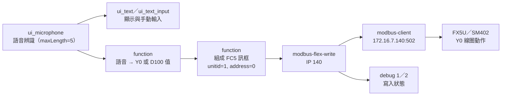
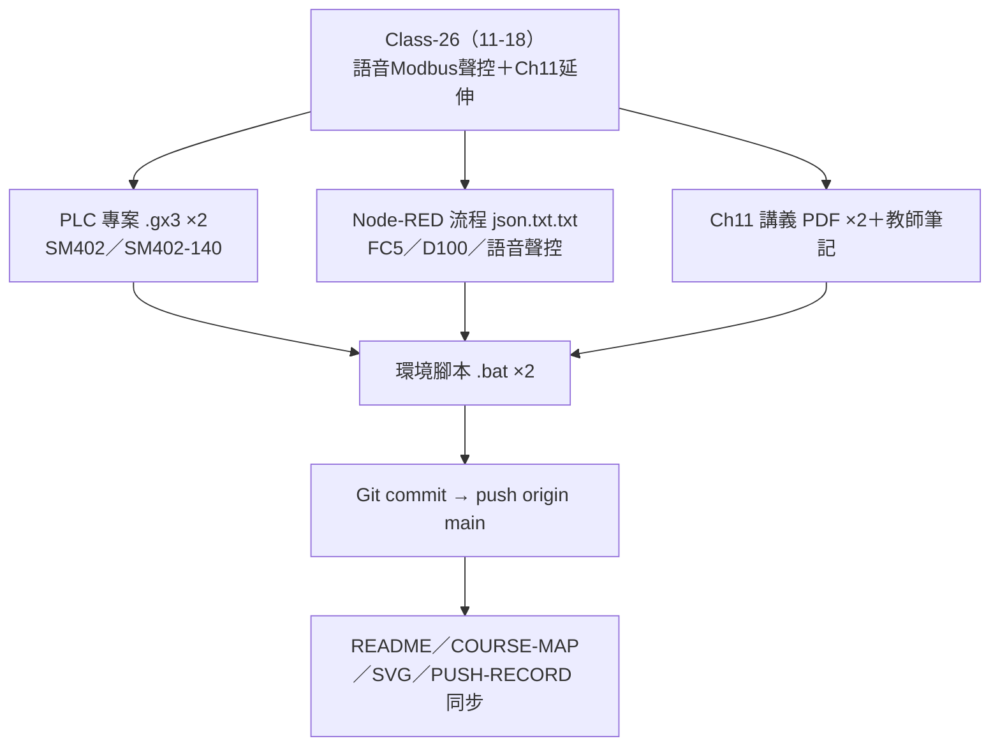

# Class-26 課程資料夾說明

> 本資料夾為 **2026-11-18（星期三）**「工業 4.0／自動控制工程職類」上課教材：**Node-RED Modbus TCP 語音聲控（IP 140／SM402）＋ Ch11 教材延伸與學期教材入庫**。
> 授課沿用 Ch11 講義，並新增兩份 PLC 專案（`.gx3`）與一份 Node-RED 流程匯出（`json.txt.txt`）；教師筆記末段新增 2026-11-18 紀錄並指向本教材庫。
> 詳見 [教材庫總覽 README.md](../README.md) 與 [逐堂教材地圖 docs/COURSE-MAP.md](../docs/COURSE-MAP.md)。

| 項目 | 內容 |
|---|---|
| 課次／日期 | Class-26／2026-11-18（星期三） |
| 主題 | Node-RED `ui_microphone` 語音辨識 → `function` 轉指令 → `modbus-flex-write` **FC5 強制單線圈（Y0）**，透過 Modbus TCP 控制 IP `172.16.7.140` 的 FX5U／SM402；並延伸 Ch11 教材與學期歸檔 |
| 上課直播 | [https://www.youtube.com/watch?v=3i-ECZ0QnoU](https://www.youtube.com/watch?v=3i-ECZ0QnoU)（頻道存檔標題為 工業4.0-2026-11-18-Class26） |
| 播放清單 | [工業4.0--工業4.0概論（YouTube 播放清單）](https://www.youtube.com/playlist?list=PLKvXv11lxGbo)（已更新為 27 段，Class01～Class26） |
| 對應章節 | Node-RED 程式設計 ─ Modbus TCP／M2M 應用（並延伸 AI 應用 ─ Ch11 教材） |
| 教材規模 | 11 個檔案／約 24.6 MB（含 `1118/` 補充流程包；Word 鎖定檔如出現由 `.gitignore` 排除） |

## 1. 上課影片

- **上課直播（YouTube）**：[工業4.0-2026-11-18-Class26-工業4.0概論](https://www.youtube.com/watch?v=3i-ECZ0QnoU&list=PLKvXv11lxGbo)（videoId：`3i-ECZ0QnoU`）
- 同播放清單可對照 [Class-25（2026-11-17，Ch11 蘋果 YOLO 訓練與推論）](https://www.youtube.com/watch?v=I-IKRY3jts4&list=PLKvXv11lxGbo)。
- 完整影片索引表格請見 [README.md 第 6 節](../README.md#6-上課影片播放清單)。

> Class-26 直播於 2026-11-18 當日上架，YouTube 尚在處理存檔（時長尚未固定）；Class-25 存檔時長已更新為 3:07:36。

## 2. 本堂課重點

1. **PLC 端（`20261118-1--SM402.gx3`、`20261118-1--SM402-140.gx3`）**：FX5U／SM402 專案與 IP 設定（`172.16.7.140`），做為 Modbus TCP Server。
2. **Node-RED 語音聲控（`json.txt.txt`）**：兩個 Flow 分頁 `20261118-1`（停用）／`20261118-2`（啟用），由 `ui_microphone` 進行語音辨識（`maxLength = 5`、`mode = recog`、點擊啟動）。
3. **指令轉換**：`function` 節點將語音文字轉為 Y0 布林值，或轉為 `D100 = 0x01 / 0x02 / 0x04`（不同語音指令對應不同值），再組成 Modbus 訊框。
4. **Modbus TCP 寫入**：`modbus-flex-write` 使用 **FC5（Force Single Coil）**，`unitid = 1`、`address = 0`（Y0）；`modbus-client` 連線至 `172.16.7.140:502`。
5. **人機介面與除錯**：`ui_text`、`ui_text_input`、`ui_group「語音聲控」`、`debug` 顯示語音內容與寫入狀態。
6. **教材延伸與入庫**：Ch11 講義沿用，完整 AI 流程與模型請參考 Class-25；本堂教材推送至 `yd7148/INDUSTRY-4.0`，同步根 README、COURSE-MAP、時間軸 SVG 與 PUSH-RECORD。

流程示意圖（SVG）：[docs/img/class26-modbus-voice.svg](../docs/img/class26-modbus-voice.svg)；教材入庫流程：[docs/img/class26-ch11-flow.svg](../docs/img/class26-ch11-flow.svg)

> ⚠️ Ch11 的工程流程檔、訓練權重與測試影像仍位於 [Class-25-2026-11-17](../Class-25-2026-11-17/)（`ch11-examples/`、`ch11-3-*.json`、`ch11-4-2.json`、`best.pt`、`02-images/`、`03-ch11-4-1_改/`）；本資料夾保留本堂 Modbus 語音聲控流程與 PLC 專案。

## 3. 子資料夾與檔案導覽

| 項目 | 說明 |
|---|---|
| [20261118-1--SM402.gx3](20261118-1--SM402.gx3) | FX5U／SM402 PLC 專案（471 KB，IP 140 設定版） |
| [20261118-1--SM402-140.gx3](20261118-1--SM402-140.gx3) | FX5U／SM402 PLC 專案（479 KB，IP 140） |
| [json.txt.txt](json.txt.txt) | Node-RED 流程匯出（8 KB）：`20261118-1`（停用）／`20261118-2`（啟用）兩分頁；`ui_microphone` 語音辨識、`function` 指令轉換、`modbus-flex-write` FC5、`modbus-client 172.16.7.140:502`、Dashboard「語音聲控」與 `debug` |
| [Class-26-2026-11-18.doc](Class-26-2026-11-18.doc) | 教師授課筆記（約 12.5 MB），累積 2026-08-25 ～ 2026-11-18 全部課次紀錄；末段 `@2026-11-18-WEDNESDAY` 指向本教材庫 |
| [Node-RED AI_ch11.pdf](Node-RED%20AI_ch11.pdf) | Ch11 原始章節教材（8.3 MB） |
| [Node-RED AI應用_ch11_講義.pdf](Node-RED%20AI%E6%87%89%E7%94%A8_ch11_%E8%AC%9B%E7%BE%A9.pdf) | Ch11 中文講義／投影片（2.9 MB） |
| [Node_Red_setup.bat](Node_Red_setup.bat) | `npm install -g node-red`（Node-RED 安裝） |
| [Node_Red_server.bat](Node_Red_server.bat) | `node-red`（啟動 Node-RED 伺服器） |
| [1118/](1118/) | 補充流程包：`flows.json`（5 KB，`ui_microphone` 語音聲控 Flow／Groups 版）與 `voice control.gx3`（477 KB，PLC 專案） |
| [README.md](README.md) | 本說明頁 |

> 兩份 Ch11 PDF 與 Class-25 重複，屬刻意的「單堂可獨立取用」設計，詳見 [COURSE-MAP.md 第 5 節](../docs/COURSE-MAP.md#5-重複與待整理項目)。

## 4. 筆記、參考文件與程式

- **筆記**：`Class-26-2026-11-18.doc`（教師授課紀錄，含累積課次重點與 11-18 紀錄）。
- **參考文件**：`Node-RED AI_ch11.pdf`、`Node-RED AI應用_ch11_講義.pdf`。
- **PLC 專案**：`20261118-1--SM402.gx3`、`20261118-1--SM402-140.gx3`（GX Works3 開啟）。
- **Node-RED 流程**：`json.txt.txt`（以文字編輯器全選複製，於 Node-RED 編輯器「Import → Clipboard」貼上）。
- **環境**：`Node_Red_setup.bat`（安裝）、`Node_Red_server.bat`（啟動，http://127.0.0.1:1880/）。
- **延伸教材**：Ch11 完整 AI 流程、Python 訓練／推論腳本、模型與測試影像見 [Class-25 README](../Class-25-2026-11-17/README.md)。

## 5. 檔案清單

| 類型 | 檔名 | 大小 |
|---|---|--:|
| PLC 專案 | [20261118-1--SM402.gx3](20261118-1--SM402.gx3) | 471 KB |
| PLC 專案 | [20261118-1--SM402-140.gx3](20261118-1--SM402-140.gx3) | 479 KB |
| Node-RED 流程 | [json.txt.txt](json.txt.txt) | 8 KB |
| 筆記 | [Class-26-2026-11-18.doc](Class-26-2026-11-18.doc) | 12,805 KB |
| 參考文件 | [Node-RED AI_ch11.pdf](Node-RED%20AI_ch11.pdf) | 8,068 KB |
| 參考文件 | [Node-RED AI應用_ch11_講義.pdf](Node-RED%20AI%E6%87%89%E7%94%A8_ch11_%E8%AC%9B%E7%BE%A9.pdf) | 2,920 KB |
| 程式／範例 | [Node_Red_setup.bat](Node_Red_setup.bat) | < 1 KB |
| 程式／範例 | [Node_Red_server.bat](Node_Red_server.bat) | < 1 KB |
| 補充流程 | [1118/flows.json](1118/flows.json) | 5 KB |
| PLC 專案 | [1118/voice control.gx3](1118/voice%20control.gx3) | 477 KB |
| 說明 | [README.md](README.md) | 7 KB |

> 資料夾合計 11 檔／25,814,060 bytes（約 24.6 MB），單檔最大為教師筆記 `.doc`（12.5 MB），低於 GitHub 100 MB 上限，全數納入版控。

---

檔案整理：2026-11-18（補上 Modbus 語音聲控流程與 PLC 專案）
