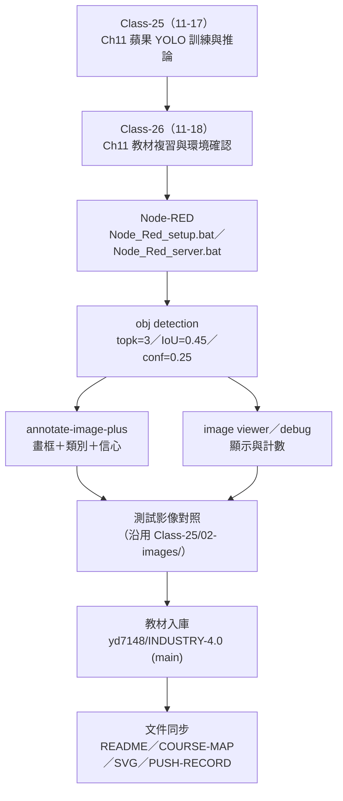
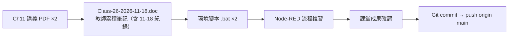

# Class-26 課程資料夾說明

> 本資料夾為 **2026-11-18（星期三）**「工業 4.0／自動控制工程職類」上課教材：**Node-RED AI 應用（Ch11 蘋果 YOLO 物件偵測）延續與學期教材總整理**。
> 授課沿用 Class-25 的 Ch11 講義，並由教師筆記新增 2026-11-18 紀錄（指向本教材庫），進行流程複習與成果歸檔。
> 詳見 [教材庫總覽 README.md](../README.md) 與 [逐堂教材地圖 docs/COURSE-MAP.md](../docs/COURSE-MAP.md)。

| 項目 | 內容 |
|---|---|
| 課次／日期 | Class-26／2026-11-18（星期三） |
| 主題 | Ch11 蘋果 YOLO 物件偵測流程複習：`obj detection` → `annotate-image-plus` → `image viewer`，以及學期教材入庫與文件同步 |
| 上課直播 | [https://www.youtube.com/watch?v=3i-ECZ0QnoU](https://www.youtube.com/watch?v=3i-ECZ0QnoU)（頻道存檔標題為 工業4.0-2026-11-18-Class26） |
| 播放清單 | [工業4.0--工業4.0概論（YouTube 播放清單）](https://www.youtube.com/playlist?list=PLKvXv11lxGbo)（已更新為 27 段，Class01～Class26） |
| 對應章節 | Node-RED 程式設計 ─ AI 應用 ─ Ch11（與 Class-25 同章節，屬延續／複習課） |
| 教材規模 | 6 個檔案／約 22.9 MB（不含 Word 鎖定檔 `~$ass-26-2026-11-18.doc`，該檔由 `.gitignore` 排除） |

## 1. 上課影片

- **上課直播（YouTube）**：[工業4.0-2026-11-18-Class26-工業4.0概論](https://www.youtube.com/watch?v=3i-ECZ0QnoU&list=PLKvXv11lxGbo)（videoId：`3i-ECZ0QnoU`）
- 同播放清單可對照前一堂 [Class-25（2026-11-17，Ch11 蘋果 YOLO 訓練與推論）](https://www.youtube.com/watch?v=I-IKRY3jts4&list=PLKvXv11lxGbo)。
- 完整影片索引表格請見 [README.md 第 6 節](../README.md#6-上課影片播放清單)。

> Class-26 直播於 2026-11-18 當日上架，YouTube 尚在處理存檔（時長尚未固定）；Class-25 存檔時長已更新為 3:07:36。

## 2. 本堂課重點

Class-26 延續 Class-25 的 **Ch11 蘋果 YOLOv8 物件偵測**，教材主體為同一份 Ch11 講義（原始章節 PDF 與中文講義 PDF），授課重點放在：

1. **複習 Ch11 完整流程**：資料集與標註 → `data.yaml` → YOLOv8n 訓練 → `results.csv` 訓練曲線分析 → 單張影像推論 → Node-RED `obj detection` 視覺化。
2. **Node-RED 推論流程操作**：以 `02-images/` 的測試影像（由 Class-25 沿用）搭配 `obj detection`（topk／IoU／confidence 參數）、`annotate-image-plus` 畫框、`image viewer` 顯示結果。
3. **環境確認**：`Node_Red_setup.bat`（安裝 Node-RED）、`Node_Red_server.bat`（啟動伺服器，http://127.0.0.1:1880/）。
4. **教材入庫與文件同步**：將本堂教材推送至 `yd7148/INDUSTRY-4.0`，並同步更新根 README、COURSE-MAP、時間軸 SVG 與 Class-26 說明。

> ⚠️ 本堂的工程流程檔、訓練權重與測試影像位於 [Class-25-2026-11-17](../Class-25-2026-11-17/)（`ch11-examples/`、`ch11-3-*.json`、`ch11-4-2.json`、`best.pt`、`02-images/`、`03-ch11-4-1_改/`）；
> 本資料夾僅保留「講義、教師筆記、環境啟動腳本」三類教材，避免重複入庫。

流程示意圖（SVG）：[docs/img/class26-ch11-flow.svg](../docs/img/class26-ch11-flow.svg)

## 3. 子資料夾與檔案導覽

| 項目 | 說明 |
|---|---|
| [Class-26-2026-11-18.doc](Class-26-2026-11-18.doc) | 教師授課筆記（約 12.5 MB），累積 2026-08-25 ～ 2026-11-18 全部課次紀錄；末段新增 `@2026-11-18-WEDNESDAY` 並指向本教材庫網址 |
| [Node-RED AI_ch11.pdf](Node-RED%20AI_ch11.pdf) | Ch11 原始章節教材（8.3 MB），與 Class-25 同一份 |
| [Node-RED AI應用_ch11_講義.pdf](Node-RED%20AI%E6%87%89%E7%94%A8_ch11_%E8%AC%9B%E7%BE%A9.pdf) | 本堂中文講義／投影片（2.9 MB），與 Class-25 同一份 |
| [Node_Red_setup.bat](Node_Red_setup.bat) | `npm install -g node-red`（Node-RED 安裝） |
| [Node_Red_server.bat](Node_Red_server.bat) | `node-red`（啟動 Node-RED 伺服器） |
| [README.md](README.md) | 本說明頁 |

> 兩份 Ch11 PDF 與 Class-25 重複，屬刻意的「單堂可獨立取用」設計，詳見 [COURSE-MAP.md 第 5 節](../docs/COURSE-MAP.md#5-重複與待整理項目)。

## 4. 筆記、參考文件與程式

- **筆記**：`Class-26-2026-11-18.doc`（教師授課紀錄，含權限 SSID／連結與累積課次重點；因 Word 仍開啟，鎖定檔 `~$ass-26-2026-11-18.doc` 不入版控）。
- **參考文件**：`Node-RED AI_ch11.pdf`、`Node-RED AI應用_ch11_講義.pdf`。
- **程式／環境**：`Node_Red_setup.bat`、`Node_Red_server.bat`。
- **延伸教材**：完整 Ch11 範例流程、Python 訓練／推論腳本、模型權重與測試影像請見 [Class-25 README](../Class-25-2026-11-17/README.md)。

## 5. 檔案清單

| 類型 | 檔名 | 大小 |
|---|---|--:|
| 筆記 | [Class-26-2026-11-18.doc](Class-26-2026-11-18.doc) | 12,472 KB |
| 參考文件 | [Node-RED AI_ch11.pdf](Node-RED%20AI_ch11.pdf) | 8,068 KB |
| 參考文件 | [Node-RED AI應用_ch11_講義.pdf](Node-RED%20AI%E6%87%89%E7%94%A8_ch11_%E8%AC%9B%E7%BE%A9.pdf) | 2,920 KB |
| 程式／範例 | [Node_Red_setup.bat](Node_Red_setup.bat) | < 1 KB |
| 程式／範例 | [Node_Red_server.bat](Node_Red_server.bat) | < 1 KB |
| 說明 | [README.md](README.md) | 12 KB |

> 資料夾合計 6 檔／24,037,352 bytes（約 22.9 MB），單檔最大為教師筆記 `.doc`（12.5 MB），低於 GitHub 100 MB 上限，全數納入版控。

---

檔案整理：2026-11-18
