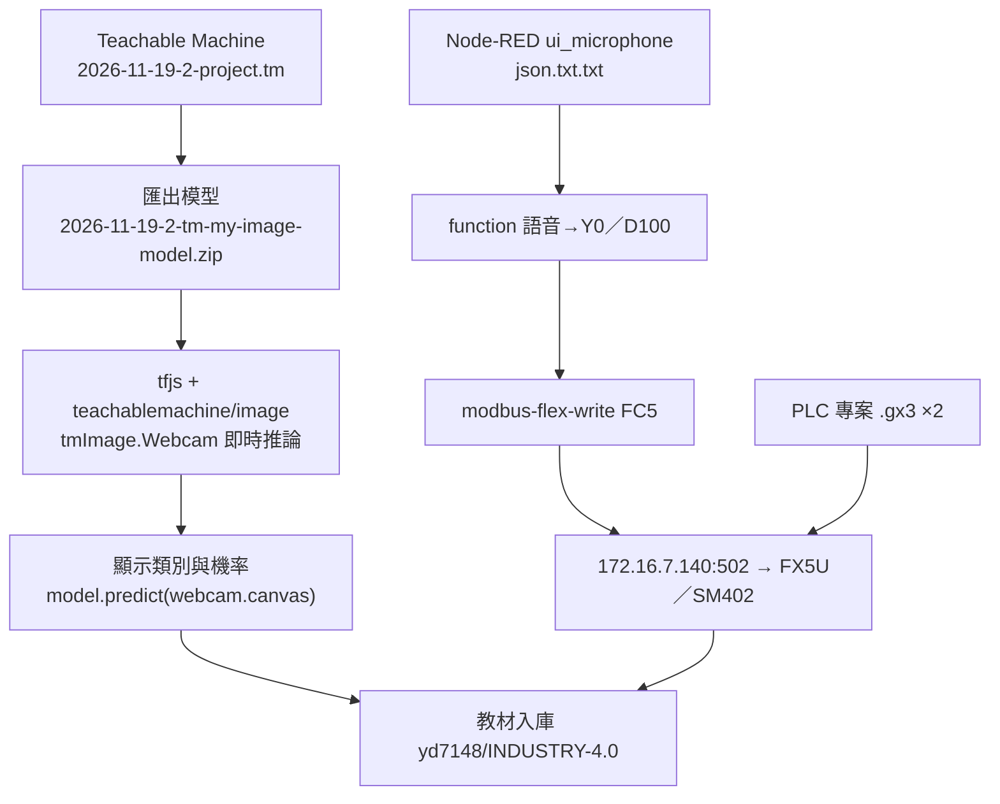
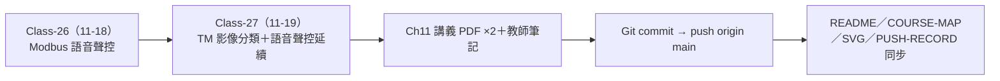

# Class-27 課程資料夾說明

> 本資料夾為 **2026-11-19（星期四）**「工業 4.0／自動控制工程職類」上課教材：**Teachable Machine 影像分類模型（`.tm` 專案＋匯出模型）＋ Modbus TCP 語音聲控延續（IP 140／SM402）**，並沿用 Ch11 講義。
> 詳細請見 [教材庫總覽 README.md](../README.md) 與 [逐堂教材地圖 docs/COURSE-MAP.md](../docs/COURSE-MAP.md)。

| 項目 | 內容 |
|---|---|
| 課次／日期 | Class-27／2026-11-19（星期四） |
| 主題 | Teachable Machine 影像分類模型訓練／匯出（_.tm / .zip_），並延續 Node-RED `ui_microphone` → FC5 → `172.16.7.140:502` 語音聲控；Ch11 講義為教材延伸 |
| 上課直播 | [https://www.youtube.com/watch?v=qsbAr0oddyU](https://www.youtube.com/watch?v=qsbAr0oddyU)（頻道存檔標題為 工業4.0-2026-11-19-Class27） |
| 播放清單 | [工業4.0--工業4.0概論（YouTube 播放清單）](https://www.youtube.com/playlist?list=PLKvXv11lxGbo)（已更新為 28 段，Class01～Class27） |
| 對應章節 | Node-RED 程式設計 ─ AI 影像分類（Teachable Machine）＋ Modbus TCP／M2M 應用 |
| 教材規模 | 11 個檔案／約 28.8 MB（Word 鎖定檔如出現由 `.gitignore` 排除） |

## 1. 上課影片

- **上課直播（YouTube）**：[工業4.0-2026-11-19-Class27-工業4.0概論](https://www.youtube.com/watch?v=qsbAr0oddyU&list=PLKvXv11lxGbo)（videoId：`qsbAr0oddyU`，時長 3:59:17）
- 同播放清單可對照 [Class-26（2026-11-18，Modbus 語音聲控）](https://www.youtube.com/watch?v=3i-ECZ0QnoU&list=PLKvXv11lxGbo)。
- 完整影片索引表格請見 [README.md 第 6 節](../README.md#6-上課影片播放清單)。

> 教師筆記`@2026-11-19-THURSDAY` 記錄 Teachable Machine 模型連結：
> <https://teachablemachine.withgoogle.com/models/RfDYSkt0A/>。

## 2. 本堂課重點

1. **Teachable Machine 模型**：`2026-11-19-2-project.tm`（2.1 MB）為專案檔，`2026-11-19-2-tm-my-image-model.zip`（2.1 MB）為匯出模型（`model.json`／`weights.bin`／`metadata.json`），可於 Teachable Machine 網站載入專案或直接匯入 Node-RED。
2. **瀏覽器端推論**：教材中的 `
Teachable Machine Image Model
` + `@tensorflow/tfjs` + `@teachablemachine/image` 程式碼，搭配 `tmImage.Webcam` 與 `model.predict(webcam.canvas)` 即時顯示各類別機率。
3. **Modbus 語音聲控延續**：`json.txt.txt` 與 [Class-26](../Class-26-2026-11-18/) 同系列——`ui_microphone` → `function`（語音轉 Y0／D100）→ `modbus-flex-write` FC5 → `modbus-client 172.16.7.140:502`。
4. **PLC 端**：`20261118-1--SM402.gx3`（沿用）與 `20261119-1--SM402-140.gx3`（更新）， FX5U／SM402 作為 Modbus TCP Server。
5. **教材延伸與入庫**：Ch11 講義沿用；完整 YOLO 訓練／推論流程見 [Class-25](../Class-25-2026-11-17/)；本堂教材推送至 `yd7148/INDUSTRY-4.0`。

流程示意圖（SVG）：[docs/img/class27-tm-modbus.svg](../docs/img/class27-tm-modbus.svg)

## 3. 子資料夾與檔案導覽

| 項目 | 說明 |
|---|---|
| [2026-11-19-2-project.tm](2026-11-19-2-project.tm) | Teachable Machine 專案檔（2.1 MB），可於 <https://teachablemachine.withgoogle.com/> 載入 Continues |
| [2026-11-19-2-tm-my-image-model.zip](2026-11-19-2-tm-my-image-model.zip) | 匯出的影像分類模型（2.1 MB，含 `model.json`／`weights.bin`／`metadata.json`） |
| [json.txt.txt](json.txt.txt) | Node-RED 流程匯出（8 KB）：語音辨識 → FC5 → `172.16.7.140:502`，含 Dashboard 與 `debug` |
| [20261118-1--SM402.gx3](20261118-1--SM402.gx3) | FX5U／SM402 PLC 專案（471 KB，沿用 Class-26） |
| [20261119-1--SM402-140.gx3](20261119-1--SM402-140.gx3) | FX5U／SM402 PLC 專案（480 KB，IP 140 更新版） |
| [Class-27-2026-11-19.doc](Class-27-2026-11-19.doc) | 教師授課筆記（約 12.9 MB），累積至 11-19 並記錄 TM 模型連結 |
| [Node-RED AI_ch11.pdf](Node-RED%20AI_ch11.pdf) | Ch11 原始章節教材（8.3 MB） |
| [Node-RED AI應用_ch11_講義.pdf](Node-RED%20AI%E6%87%89%E7%94%A8_ch11_%E8%AC%9B%E7%BE%A9.pdf) | Ch11 中文講義／投影片（2.9 MB） |
| [Node_Red_setup.bat](Node_Red_setup.bat) | `npm install -g node-red`（Node-RED 安裝） |
| [Node_Red_server.bat](Node_Red_server.bat) | `node-red`（啟動 Node-RED 伺服器） |
| [README.md](README.md) | 本說明頁 |

## 4. 筆記、參考文件與程式

- **筆記**：`Class-27-2026-11-19.doc`（教師授課紀錄，含 `@2026-11-19-THURSDAY` 的 Teachable Machine 模型連結）。
- **模型**：`2026-11-19-2-project.tm`（專案）、`2026-11-19-2-tm-my-image-model.zip`（匯出模型）。
- **Node-RED 流程**：`json.txt.txt`（Import → Clipboard 貼上即可）。
- **PLC 專案**：`20261118-1--SM402.gx3`、`20261119-1--SM402-140.gx3`（GX Works3）。
- **環境**：`Node_Red_setup.bat`、`Node_Red_server.bat`。
- **延伸教材**：Ch11 完整 AI 流程與 YOLO 模型見 [Class-25 README](../Class-25-2026-11-17/README.md)。

## 5. 檔案清單

| 類型 | 檔名 | 大小 |
|---|---|--:|
| AI 模型 | [2026-11-19-2-project.tm](2026-11-19-2-project.tm) | 2,185 KB |
| AI 模型 | [2026-11-19-2-tm-my-image-model.zip](2026-11-19-2-tm-my-image-model.zip) | 2,194 KB |
| Node-RED 流程 | [json.txt.txt](json.txt.txt) | 8 KB |
| PLC 專案 | [20261118-1--SM402.gx3](20261118-1--SM402.gx3) | 471 KB |
| PLC 專案 | [20261119-1--SM402-140.gx3](20261119-1--SM402-140.gx3) | 480 KB |
| 筆記 | [Class-27-2026-11-19.doc](Class-27-2026-11-19.doc) | 13,157 KB |
| 參考文件 | [Node-RED AI_ch11.pdf](Node-RED%20AI_ch11.pdf) | 8,068 KB |
| 參考文件 | [Node-RED AI應用_ch11_講義.pdf](Node-RED%20AI%E6%87%89%E7%94%A8_ch11_%E8%AC%9B%E7%BE%A9.pdf) | 2,920 KB |
| 程式／範例 | [Node_Red_setup.bat](Node_Red_setup.bat) | < 1 KB |
| 程式／範例 | [Node_Red_server.bat](Node_Red_server.bat) | < 1 KB |
| 說明 | [README.md](README.md) | 8 KB |

> 資料夾合計 11 檔／30,179,807 bytes（約 28.8 MB），單檔最大為教師筆記 `.doc`（12.9 MB），低於 GitHub 100 MB 上限，全數納入版控。

---

檔案整理：2026-11-19
