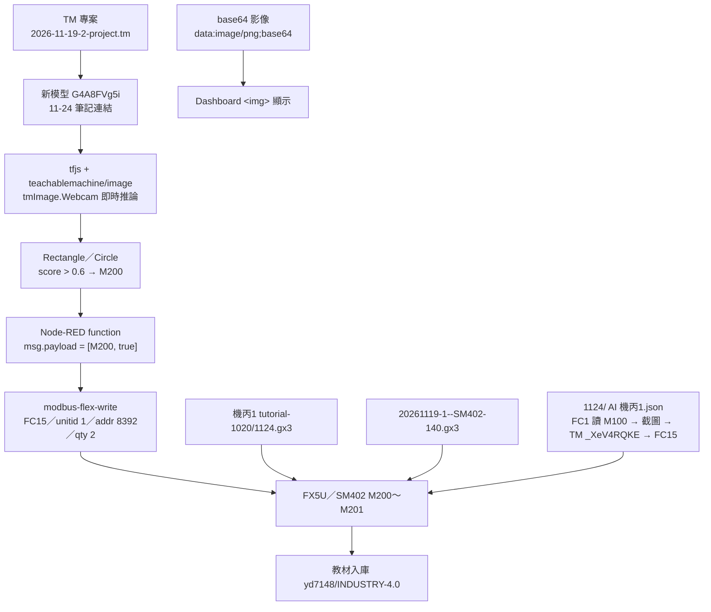

# Class-28 課程資料夾說明

> 本資料夾為 **2026-11-24（星期二）**「工業 4.0／自動控制工程職類」上課教材：**Teachable Machine 影像分類（Rectangle／Circle）→ Node-RED 推論 → Modbus TCP FC15 寫入 M200／M201**，並搭配機電整合丙級（機丙 1）PLC 練習。
> 詳細請見 [教材庫總覽 README.md](../README.md) 與 [逐堂教材地圖 docs/COURSE-MAP.md](../docs/COURSE-MAP.md)。

| 項目 | 內容 |
|---|---|
| 課次／日期 | Class-28／2026-11-24（星期二） |
| 主題 | Teachable Machine 影像分類（圓形／矩形）判讀結果，經 Node-RED `function` 轉為 M200，再以 `modbus-flex-write` **FC15** 寫入 FX5U／SM402；機丙 1 PLC 專案練習 |
| 上課直播 | [https://www.youtube.com/watch?v=C792O5ZDcqA](https://www.youtube.com/watch?v=C792O5ZDcqA)（頻道存檔標題為 工業4.0-2026-11-24-Class28） |
| 播放清單 | [工業4.0--工業4.0概論（YouTube 播放清單）](https://www.youtube.com/playlist?list=PLKvXv11lxGbo)（已更新為 31 段，Class01～Class30） |
| 對應章節 | Node-RED 程式設計 ─ AI 影像分類＋Modbus TCP／M2M 應用；機電整合丙級 PLC 實作 |
| 教材規模 | 11 個檔案／約 19.1 MB（含課後補入的 `1124/`；Word 鎖定檔如出現由 `.gitignore` 排除） |

## 1. 上課影片

- **上課直播（YouTube）**：[工業4.0-2026-11-24-Class28-工業4.0概論](https://www.youtube.com/watch?v=C792O5ZDcqA&list=PLKvXv11lxGbo)（videoId：`C792O5ZDcqA`，時長 3:02:40）
- 同播放清單可對照 [Class-27（2026-11-19，Teachable Machine 模型＋語音聲控）](https://www.youtube.com/watch?v=qsbAr0oddyU&list=PLKvXv11lxGbo) 與 [Class-26（2026-11-18，Modbus 語音聲控）](https://www.youtube.com/watch?v=3i-ECZ0QnoU&list=PLKvXv11lxGbo)。
- 完整影片索引表格請見 [README.md 第 6 節](../README.md#6-上課影片播放清單)。

> 教師筆記 `@2026-11-24-Class-TUESDAY` 記錄新的 Teachable Machine 模型連結：
> <https://teachablemachine.withgoogle.com/models/G4A8FVg5i/>（不同於 11-19 的 `RfDYSkt0A`）。

## 2. 本堂課重點

1. **模型與推論**：沿用 `2026-11-19-2-project.tm` 專案，搭配 11-24 新模型 `G4A8FVg5i`；瀏覽器端以 `
Teachable Machine Image Model
` + `@tensorflow/tfjs` + `@teachablemachine/image`，由 `tmImage.Webcam` 與 `model.predict(webcam.canvas)` 即時顯示類別與機率。
2. **影像顯示**：Node-RED Dashboard 以 `` 直接呈現 base64 影像。
3. **類別判定**：`function` 節點讀取 `msg.payload[0].class`／`.score`，在 `score > 0.6` 時將 `Circle` 轉為 `M200 = true`、`Rectangle` 轉為 `M200 = false`，輸出 `[M200, true]`（延續 11-19 的判斷邏輯）。
4. **Modbus TCP FC15**：`modbus-flex-write` 以 `fc: 15`、`unitid: 1`、`address: 8392`（8192 + 200，即 M200）、`quantity: 2` 一次寫入 **M200～M201**，PLC 端為 FX5U／SM402。
5. **機電整合丙級**：`機丙1 tutorial-1020.gx3`（10-20 版）與 `機丙1 tutorial-1124.gx3`（11-24 更新版）為 CIROS 機丙 1 的 PLC 練習專案。
6. **課後補充 `1124/`（AI 機丙 1）**：`20261124 AI機丙1.json` 以 `modbus-flex-getter` **FC1** 讀取 IP130（`172.16.7.130`）的 **M100**，由 `rbe`＋`switch`（OFF→ON）觸發 webcam 截圖；TM 線上模型 `_XeV4RQKE` 判讀 rect／circle（`score >= 0.8`）後，以 **FC15** 寫入 M200／M201（與主流程的 `G4A8FVg5i` 模型不同，保留兩版對照）。`AI 機丙1 tutorial-1124.gx3` 為對應 PLC 專案。
7. **沿用教材**：`json.txt.txt`（Class-26／27 系列的 Node-RED 流程匯出）、`20261119-1--SM402-140.gx3`（IP 140 版 PLC 專案）、`Node_Red_setup.bat`／`Node_Red_server.bat`（環境安裝與啟動）。

流程示意圖（SVG）：[docs/img/class28-tm-modbus-fc15.svg](../docs/img/class28-tm-modbus-fc15.svg)

## 3. 子資料夾與檔案導覽

| 項目 | 說明 |
|---|---|
| [2026-11-19-2-project.tm](2026-11-19-2-project.tm) | Teachable Machine 專案檔（2.1 MB），可於 <https://teachablemachine.withgoogle.com/> 載入 Continues |
| [json.txt.txt](json.txt.txt) | Node-RED 流程匯出（8 KB），含 base64 影像顯示、類別判定與 FC15 寫入 |
| [20261119-1--SM402-140.gx3](20261119-1--SM402-140.gx3) | FX5U／SM402 PLC 專案（471 KB，IP 140 版，沿用） |
| [機丙1 tutorial-1020.gx3](%E6%A9%9F%E4%B8%991%20tutorial-1020.gx3) | 機電整合丙級 PLC 練習專案（10-20 版，554 KB） |
| [機丙1 tutorial-1124.gx3](%E6%A9%9F%E4%B8%991%20tutorial-1124.gx3) | 機電整合丙級 PLC 練習專案（11-24 更新版，555 KB） |
| [1124/20261124 AI機丙1.json](1124/20261124%20AI%E6%A9%9F%E4%B8%991.json) | 課後補充流程（10 KB）：FC1 讀 M100 → 觸發截圖 → TM `_XeV4RQKE` → FC15 寫 M200／M201 |
| [1124/AI 機丙1 tutorial-1124.gx3](1124/AI%20%E6%A9%9F%E4%B8%991%20tutorial-1124.gx3) | 課後補充 PLC 專案（560 KB），對應 AI 機丙 1 流程 |
| [Class-28-2026-11-24.doc](Class-28-2026-11-24.doc) | 教師授課筆記（約 14.8 MB），含 `@2026-11-24-Class-TUESDAY`、模型 `G4A8FVg5i` 與 FC15 程式碼 |
| [Node_Red_setup.bat](Node_Red_setup.bat) | `npm install -g node-red`（Node-RED 安裝） |
| [Node_Red_server.bat](Node_Red_server.bat) | `node-red`（啟動 Node-RED 伺服器） |
| [README.md](README.md) | 本說明頁 |

## 4. 筆記、參考文件與程式

- **筆記**：`Class-28-2026-11-24.doc`（教師授課紀錄，含 `@2026-11-24-Class-TUESDAY` 的 TM 模型連結、base64 影像、class／score 判定與 FC15 寫入程式碼）。
- **模型**：`2026-11-19-2-project.tm`（TM 專案）；11-24 模型連結見 <https://teachablemachine.withgoogle.com/models/G4A8FVg5i/>。
- **Node-RED 流程**：`json.txt.txt`（Import → Clipboard 貼上即可）；影像以 `data:image/png;base64` 顯示。
- **PLC 專案**：`機丙1 tutorial-1020.gx3`、`機丙1 tutorial-1124.gx3`、`20261119-1--SM402-140.gx3`、`1124/AI 機丙1 tutorial-1124.gx3`（GX Works3）。
- **環境**：`Node_Red_setup.bat`、`Node_Red_server.bat`。
- **課後補充流程**：`1124/20261124 AI機丙1.json`（Import → Clipboard），以 IP130 的 M100 上升緣觸發 TM 判讀與 FC15 寫入。
- **延伸教材**：Teachable Machine 模型與 Ch11 完整 AI 流程見 [Class-27 README](../Class-27-2026-11-19/README.md) 與 [Class-25 README](../Class-25-2026-11-17/README.md)。

## 5. 檔案清單

| 類型 | 檔名 | 大小 |
|---|---|--:|
| AI 模型 | [2026-11-19-2-project.tm](2026-11-19-2-project.tm) | 2,185 KB |
| Node-RED 流程 | [json.txt.txt](json.txt.txt) | 8 KB |
| PLC 專案 | [20261119-1--SM402-140.gx3](20261119-1--SM402-140.gx3) | 471 KB |
| PLC 專案 | [機丙1 tutorial-1020.gx3](%E6%A9%9F%E4%B8%991%20tutorial-1020.gx3) | 554 KB |
| PLC 專案 | [機丙1 tutorial-1124.gx3](%E6%A9%9F%E4%B8%991%20tutorial-1124.gx3) | 555 KB |
| Node-RED 流程 | [1124/20261124 AI機丙1.json](1124/20261124%20AI%E6%A9%9F%E4%B8%991.json) | 10 KB |
| PLC 專案 | [1124/AI 機丙1 tutorial-1124.gx3](1124/AI%20%E6%A9%9F%E4%B8%991%20tutorial-1124.gx3) | 560 KB |
| 筆記 | [Class-28-2026-11-24.doc](Class-28-2026-11-24.doc) | 15,195 KB |
| 程式／範例 | [Node_Red_setup.bat](Node_Red_setup.bat) | < 1 KB |
| 程式／範例 | [Node_Red_server.bat](Node_Red_server.bat) | < 1 KB |
| 說明 | [README.md](README.md) | 7 KB |

> 資料夾合計 11 檔／20,014,995 bytes（約 19.1 MB，含課後補入的 `1124/` 兩檔；更新 README 前），單檔最大為教師筆記 `.doc`（14.8 MB），低於 GitHub 100 MB 上限，全數納入版控。

---

檔案整理：2026-11-24
