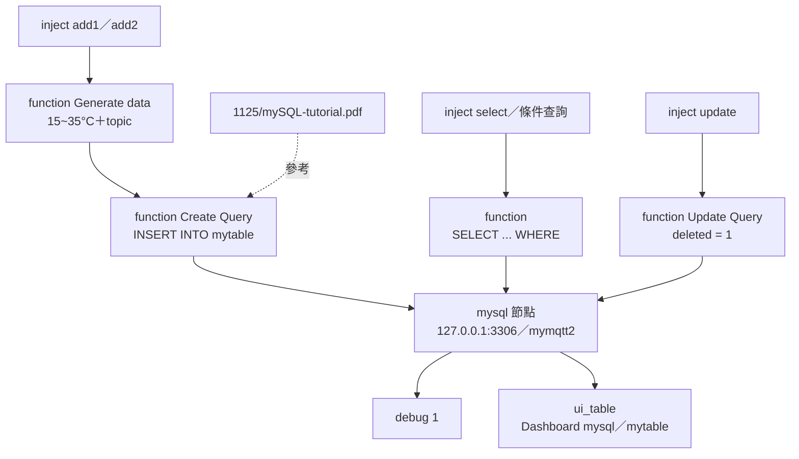

# Class-29 課程資料夾說明

> 本資料夾為 **2026-11-25（星期三）**「工業 4.0／自動控制工程職類」上課教材：**Node-RED 與 MySQL 資料庫整合**——以 `node-red-node-mysql` 將感測數值寫入 `mytable`，並用 `node-red-node-ui-table` 在 Dashboard 查詢、條件篩選與更新紀錄。
> 詳細請見 [教材庫總覽 README.md](../README.md) 與 [逐堂教材地圖 docs/COURSE-MAP.md](../docs/COURSE-MAP.md)。

| 項目 | 內容 |
|---|---|
| 課次／日期 | Class-29／2026-11-25（星期三） |
| 主題 | Node-RED → MySQL（`mytable`）寫入／查詢／條件篩選／軟刪除；Dashboard `ui_table` 呈現；延續 Teachable Machine→Modbus FC15 與機丙 1 PLC 教材 |
| 上課直播 | [https://www.youtube.com/watch?v=8VXwFDkzmqA](https://www.youtube.com/watch?v=8VXwFDkzmqA)（頻道存檔標題為 工業4.0-2026-11-25-Class29） |
| 播放清單 | [工業4.0--工業4.0概論（YouTube 播放清單）](https://www.youtube.com/playlist?list=PLKvXv11lxGbo)（已更新為 31 段，Class01～Class30） |
| 對應章節 | Node-RED 程式設計 ─ 資料庫（MySQL）存取與 Dashboard 表格；Modbus TCP／AI 影像分類延伸 |
| 教材規模 | 11 個檔案／約 20.7 MB（Word 鎖定檔如出現由 `.gitignore` 排除） |

## 1. 上課影片

- **上課直播（YouTube）**：[工業4.0-2026-11-25-Class29-工業4.0概論](https://www.youtube.com/watch?v=8VXwFDkzmqA&list=PLKvXv11lxGbo)（videoId：`8VXwFDkzmqA`，時長 1:08:11）
- 同播放清單可對照 [Class-28（2026-11-24，TM 影像分類→FC15）](https://www.youtube.com/watch?v=C792O5ZDcqA&list=PLKvXv11lxGbo) 與 [Class-30（2026-11-26，MySQL 延伸）](https://www.youtube.com/watch?v=UAx0M-blTvw&list=PLKvXv11lxGbo)。
- 完整影片索引表格請見 [README.md 第 6 節](../README.md#6-上課影片播放清單)。

> 教師筆記 `@2026-11-25-WEDNESDAY` 段落記錄兩版 Node-RED 流程：精簡版（寫入 `mymqtt`）與含 `ui_table` 的進階版（寫入 `mymqtt2`、條件查詢與更新）。

## 2. 本堂課重點

1. **MySQL 環境**：`1125/mySQL-tutorial.pdf`（1.5 MB）說明 MySQL 安裝、`mytable` 資料表與 SQL 語法（`INSERT`／`SELECT`／`UPDATE`、`WHERE ... BETWEEN`）。
2. **寫入流程**：兩個 `inject` 節點經 `function`（`Generate data1`／`Generate data2`）產生 15～35°C 隨機溫度，附加 `topic`（`topic_room1`／`mytopic`），再由 `Create Query` 組合 `INSERT INTO mytable (topic, payload, mdate, mtime, deleted) VALUES (...)`，交給 `mysql` 節點寫入並以 `debug` 檢視結果。
3. **查詢與表格**：`select * from mytable`、`where topic = 'mytopic'`、`where mtime between '11:51:00' and '13:20:00'` 等查詢，結果由 `ui_table` 以欄位 id／topic／payload／date／time／deleted 顯示於 Dashboard（`ui_tab: mysql`、`ui_group: mytable`）。
4. **更新（軟刪除）**：`Update Query` 產生 `update mytable set deleted = 1 where id = 5`，經 `mysql` 節點異動紀錄。
5. **節點與連線**：`node-red-node-mysql` 2.0.0、`node-red-node-ui-table` 0.4.5；`MySQLdatabase` 設定 `host: 127.0.0.1`、`port: 3306`、`db: mymqtt`（精簡版）／`mymqtt2`（進階版）、`charset: UTF8`。
6. **沿用教材**：`2026-11-19-2-project.tm`（TM 專案）、`json.txt.txt`（影像分類→FC15 流程）、`20261119-1--SM402-140.gx3`（IP 140 PLC 專案）、機丙 1 練習 `.gx3` ×2、`Node_Red_setup.bat`／`Node_Red_server.bat`（環境安裝與啟動）。

流程示意圖（SVG）：[docs/img/class29-mysql-flow.svg](../docs/img/class29-mysql-flow.svg)

## 3. 子資料夾與檔案導覽

| 項目 | 說明 |
|---|---|
| [1125/mySQL-tutorial.pdf](1125/mySQL-tutorial.pdf) | MySQL 安裝與 SQL 語法講義（1.5 MB） |
| [1125/mysql flows.json](1125/mysql%20flows.json) | Node-RED 流程匯出（8.6 KB）：寫入／查詢／條件篩選／更新＋`ui_table` |
| [2026-11-19-2-project.tm](2026-11-19-2-project.tm) | Teachable Machine 專案檔（2.1 MB，沿用） |
| [json.txt.txt](json.txt.txt) | Node-RED 影像分類→Modbus FC15 流程（8 KB，沿用） |
| [20261119-1--SM402-140.gx3](20261119-1--SM402-140.gx3) | FX5U／SM402 PLC 專案（471 KB，IP 140，沿用） |
| [機丙1 tutorial-1020.gx3](%E6%A9%9F%E4%B8%991%20tutorial-1020.gx3) | 機電整合丙級 PLC 練習（10-20 版，554 KB，沿用） |
| [機丙1 tutorial-1124.gx3](%E6%A9%9F%E4%B8%991%20tutorial-1124.gx3) | 機電整合丙級 PLC 練習（11-24 版，555 KB，沿用） |
| [Class-29-2026-11-25.doc](Class-29-2026-11-25.doc) | 教師授課筆記（約 15.5 MB），含 `@2026-11-25-WEDNESDAY`、兩版流程 JSON 與節點說明 |
| [Node_Red_setup.bat](Node_Red_setup.bat) | `npm install -g node-red`（安裝） |
| [Node_Red_server.bat](Node_Red_server.bat) | `node-red`（啟動） |
| [README.md](README.md) | 本說明頁 |

## 4. 筆記、參考文件與程式

- **筆記**：`Class-29-2026-11-25.doc`（教師授課紀錄，`@2026-11-25-WEDNESDAY` 段落附兩版 Node-RED 流程）。
- **參考**：`1125/mySQL-tutorial.pdf`；Node-RED 節點頁 [node-red-node-mysql](https://flows.nodered.org/node/node-red-node-mysql)、[node-red-node-ui-table](https://flows.nodered.org/node/node-red-node-ui-table)。
- **Node-RED 流程**：`1125/mysql flows.json`（Import → Clipboard 貼上即可；資料庫連線請依實際環境調整 host／db）。
- **PLC 專案**：`20261119-1--SM402-140.gx3`、`機丙1 tutorial-1020.gx3`、`機丙1 tutorial-1124.gx3`（GX Works3）。
- **延伸教材**：TM 影像分類→FC15 見 [Class-28 README](../Class-28-2026-11-24/README.md)；Modbus 語音聲控見 [Class-26 README](../Class-26-2026-11-18/README.md)。

## 5. 檔案清單

| 類型 | 檔名 | 大小 |
|---|---|---:|
| 參考講義 | [1125/mySQL-tutorial.pdf](1125/mySQL-tutorial.pdf) | 1,494 KB |
| Node-RED 流程 | [1125/mysql flows.json](1125/mysql%20flows.json) | 9 KB |
| AI 模型 | [2026-11-19-2-project.tm](2026-11-19-2-project.tm) | 2,185 KB |
| Node-RED 流程 | [json.txt.txt](json.txt.txt) | 8 KB |
| PLC 專案 | [20261119-1--SM402-140.gx3](20261119-1--SM402-140.gx3) | 471 KB |
| PLC 專案 | [機丙1 tutorial-1020.gx3](%E6%A9%9F%E4%B8%991%20tutorial-1020.gx3) | 554 KB |
| PLC 專案 | [機丙1 tutorial-1124.gx3](%E6%A9%9F%E4%B8%991%20tutorial-1124.gx3) | 555 KB |
| 筆記 | [Class-29-2026-11-25.doc](Class-29-2026-11-25.doc) | 15,897 KB |
| 程式／範例 | [Node_Red_setup.bat](Node_Red_setup.bat) | < 1 KB |
| 程式／範例 | [Node_Red_server.bat](Node_Red_server.bat) | < 1 KB |
| 說明 | [README.md](README.md) | 9 KB |

> 含 README 共 11 檔、約 20.7 MB（21,689,496 bytes，更新 README 前），低於 GitHub 100 MB 單檔上限，全數納入版控。

---

檔案整理：2026-11-26
