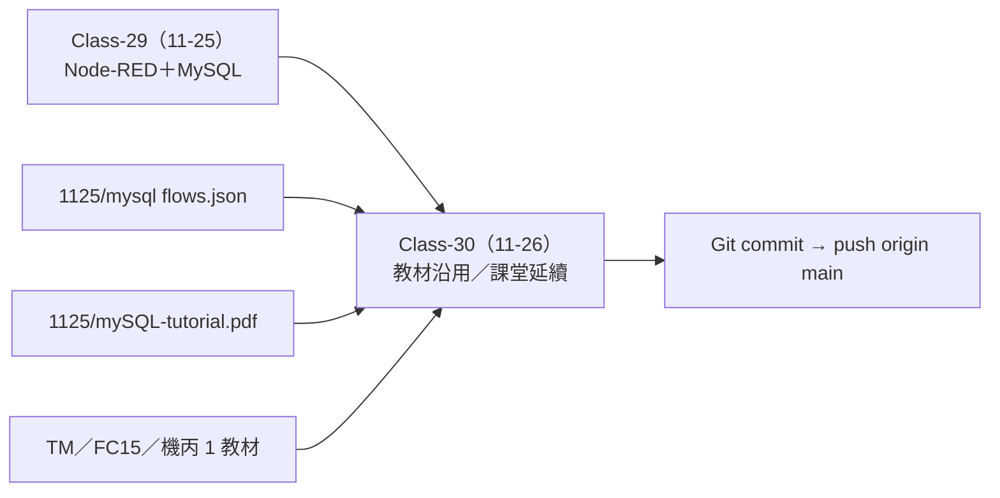

# Class-30 課程資料夾說明

> 本資料夾為 **2026-11-26（星期四）**「工業 4.0／自動控制工程職類」上課教材資料夾：目前收錄的檔案為 **11-25（Class-29）MySQL／Node-RED 教材的延續副本**（`1125/` 的 `mysql flows.json`＋`mySQL-tutorial.pdf`，以及 Teachable Machine／Modbus FC15、機丙 1 PLC 系列教材）。教師筆記檔名已改為 `Class-30-2026-11-26.doc`，但內容仍沿用 `@2026-11-25-WEDNESDAY` 段落，尚無 `@2026-11-26` 新增紀錄。
> 詳細請見 [教材庫總覽 README.md](../README.md) 與 [逐堂教材地圖 docs/COURSE-MAP.md](../docs/COURSE-MAP.md)。

| 項目 | 內容 |
|---|---|
| 課次／日期 | Class-30／2026-11-26（星期四） |
| 主題 | 延續 Node-RED → MySQL 資料寫入／查詢（Class-29）；AI 影像分類→Modbus FC15 與機丙 1 PLC 教材沿用 |
| 上課直播 | [https://www.youtube.com/watch?v=UAx0M-blTvw](https://www.youtube.com/watch?v=UAx0M-blTvw)（頻道存檔標題為 工業4.0-2026-11-26-Class30；上傳當日仍為直播／處理中，`lengthSeconds = 0`） |
| 播放清單 | [工業4.0--工業4.0概論（YouTube 播放清單）](https://www.youtube.com/playlist?list=PLKvXv11lxGbo)（已更新為 31 段，Class01～Class30） |
| 對應章節 | Node-RED 程式設計 ─ MySQL 資料庫存取；Modbus TCP／AI 影像分類延伸 |
| 教材規模 | 11 個檔案／約 20.7 MB（Word 鎖定檔 `~$ass-30-2026-11-26.doc` 由 `.gitignore` 排除） |

## 1. 上課影片

- **上課直播（YouTube）**：[工業4.0-2026-11-26-Class30-工業4.0概論](https://www.youtube.com/watch?v=UAx0M-blTvw&list=PLKvXv11lxGbo)（videoId：`UAx0M-blTvw`，上傳時 `lengthSeconds = 0`，YouTube 處理完成後再更新時長）。
- 同播放清單可對照 [Class-29（2026-11-25，Node-RED＋MySQL）](https://www.youtube.com/watch?v=8VXwFDkzmqA&list=PLKvXv11lxGbo) 與 [Class-28（2026-11-24，TM 影像分類→FC15）](https://www.youtube.com/watch?v=C792O5ZDcqA&list=PLKvXv11lxGbo)。
- 完整影片索引表格請見 [README.md 第 6 節](../README.md#6-上課影片播放清單)。

> 本堂課資料夾於 2026-11-26 建立，教材先沿用 11-25 的 MySQL 流程包；若後續有新教材或筆記更新，請直接補入本資料夾並同步本說明頁與 [PUSH-RECORD.md](../docs/PUSH-RECORD.md)。

## 2. 本堂課重點（沿用教材）

1. **MySQL 流程**：`1125/mysql flows.json` 以 `inject` → `function` 產生 15～35°C 數值 → `Create Query`（`INSERT INTO mytable ...`）→ `mysql` 節點寫入；另有 `SELECT`、`WHERE topic = 'mytopic'`、`WHERE mtime BETWEEN ...` 條件查詢與 `UPDATE ... SET deleted = 1`，結果以 `ui_table` 顯示。
2. **講義**：`1125/mySQL-tutorial.pdf`（1.5 MB）為 MySQL 安裝與 SQL 語法參考。
3. **AI→Modbus**：`json.txt.txt`（影像分類→FC15 寫入 M200／M201）、`2026-11-19-2-project.tm`（TM 專案）、`20261119-1--SM402-140.gx3`（IP 140 PLC 專案）。
4. **機電整合**：`機丙1 tutorial-1020.gx3`、`機丙1 tutorial-1124.gx3`（CIROS 機丙 1 PLC 練習）。
5. **環境**：`Node_Red_setup.bat`／`Node_Red_server.bat`（Node-RED 安裝與啟動）。

流程示意圖（同 Class-29）：[docs/img/class29-mysql-flow.svg](../docs/img/class29-mysql-flow.svg)

## 3. 子資料夾與檔案導覽

| 項目 | 說明 |
|---|---|
| [1125/mySQL-tutorial.pdf](1125/mySQL-tutorial.pdf) | MySQL 安裝與 SQL 語法講義（1.5 MB，沿用 11-25） |
| [1125/mysql flows.json](1125/mysql%20flows.json) | Node-RED MySQL 流程匯出（8.6 KB，沿用 11-25） |
| [2026-11-19-2-project.tm](2026-11-19-2-project.tm) | Teachable Machine 專案檔（2.1 MB，沿用） |
| [json.txt.txt](json.txt.txt) | Node-RED 影像分類→Modbus FC15 流程（8 KB，沿用） |
| [20261119-1--SM402-140.gx3](20261119-1--SM402-140.gx3) | FX5U／SM402 PLC 專案（471 KB，IP 140，沿用） |
| [機丙1 tutorial-1020.gx3](%E6%A9%9F%E4%B8%991%20tutorial-1020.gx3) | 機電整合丙級 PLC 練習（10-20 版，554 KB，沿用） |
| [機丙1 tutorial-1124.gx3](%E6%A9%9F%E4%B8%991%20tutorial-1124.gx3) | 機電整合丙級 PLC 練習（11-24 版，555 KB，沿用） |
| [Class-30-2026-11-26.doc](Class-30-2026-11-26.doc) | 教師授課筆記（約 15.5 MB）；現行內容仍為 `@2026-11-25-WEDNESDAY` 段落 |
| [Node_Red_setup.bat](Node_Red_setup.bat) | `npm install -g node-red` |
| [Node_Red_server.bat](Node_Red_server.bat) | `node-red` |
| [README.md](README.md) | 本說明頁 |

## 4. 筆記、參考文件與程式

- **筆記**：`Class-30-2026-11-26.doc`（目前沿用 11-25 內容，`@2026-11-26` 段落待教師補入）。
- **參考**：`1125/mySQL-tutorial.pdf`；11-25 版流程詳見 [Class-29 README](../Class-29-2026-11-25/README.md)。
- **Node-RED 流程**：`1125/mysql flows.json`（Import → Clipboard 貼上即可）。
- **PLC 專案**：`20261119-1--SM402-140.gx3`、`機丙1 tutorial-1020.gx3`、`機丙1 tutorial-1124.gx3`。
- **環境**：`Node_Red_setup.bat`、`Node_Red_server.bat`。

## 5. 檔案清單

| 類型 | 檔名 | 大小 |
|---|---|---:|
| 參考講義 | [1125/mySQL-tutorial.pdf](1125/mySQL-tutorial.pdf) | 1,494 KB |
| Node-RED 流程 | [1125/mysql flows.json](1125/mysql%20flows.json) | 9 KB |
| AI 模型 | [2026-11-19-2-project.tm](2026-11-19-2-project.tm) | 2,185 KB |
| Node-RED 流程 | [json.txt.txt](json.txt.txt) | 8 KB |
| PLC 專案 | [20261119-1--SM402-140.gx3](20261119-1--SM402-140.gx3) | 471 KB |
| PLC 專案 | [機丙1 tutorial-1020.gx3](%E6%A9%9F%E4%B8%991%20tutorial-1020.gx3) | 554 KB |
| PLC 專案 | [機丙1 tutorial-1124.gx3](%E6%A9%9F%E4%B8%991%20tutorial-1124.gx3) | 555 KB |
| 筆記 | [Class-30-2026-11-26.doc](Class-30-2026-11-26.doc) | 15,897 KB |
| 程式／範例 | [Node_Red_setup.bat](Node_Red_setup.bat) | < 1 KB |
| 程式／範例 | [Node_Red_server.bat](Node_Red_server.bat) | < 1 KB |
| 說明 | [README.md](README.md) | 8 KB |

> 含 README 共 11 檔、約 20.7 MB（21,689,496 bytes，更新 README 前）；`~$ass-30-2026-11-26.doc` 為 Word 鎖定檔，不入版控。

---

檔案整理：2026-11-26
