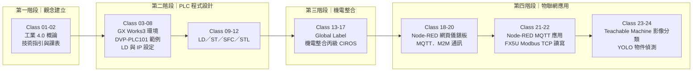
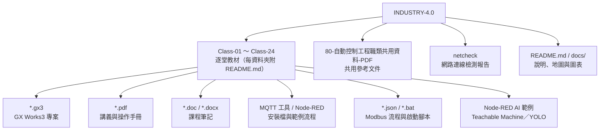
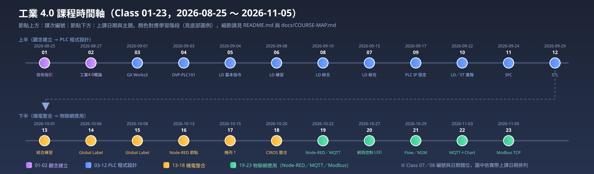
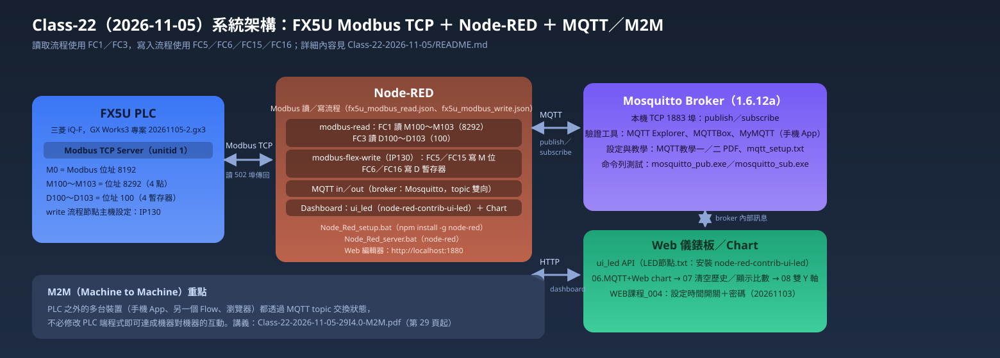
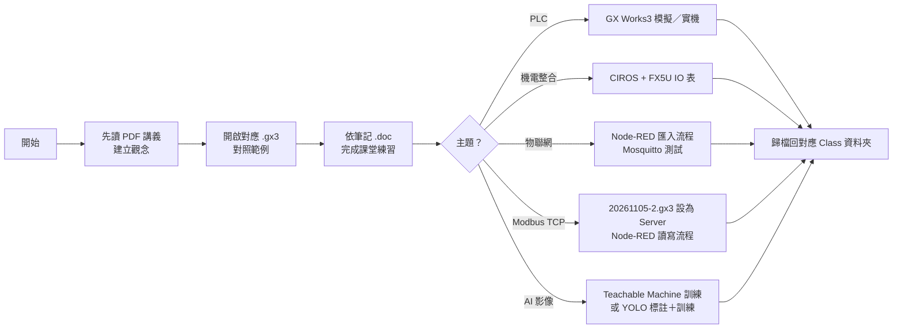
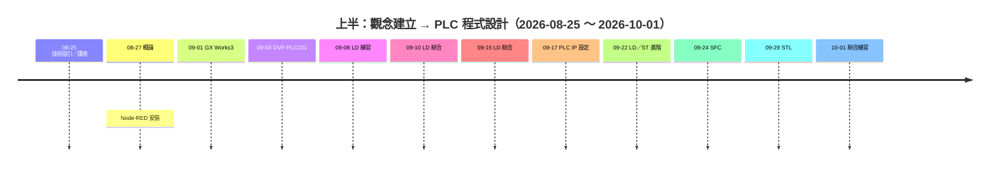
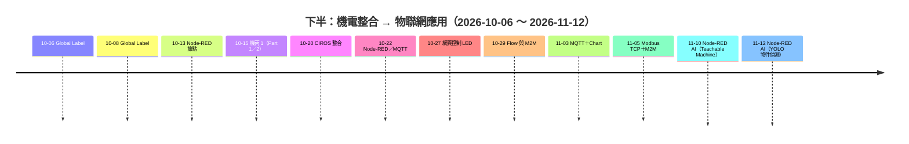
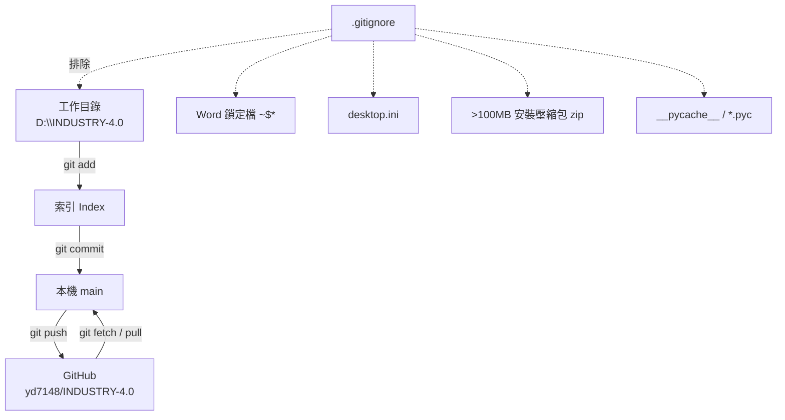

# 工業 4.0 自動控制工程職類｜課程教材庫

本倉庫收錄 **2026-08-25 ～ 2026-11-12** 期間「工業 4.0／自動控制工程職類」課程的教材、範例程式與課後補充資料，共 **24 堂課**、四大主題（PLC 程式設計、機電整合、Node-RED／MQTT 物聯網應用、FX5U Modbus TCP／M2M 通訊與 Node-RED AI 影像分類／YOLO 物件偵測）與一份網路檢測報告。

| 項目 | 內容 |
|---|---|
| 線上倉庫 | <https://github.com/yd7148/INDUSTRY-4.0> |
| 預設分支 | `main` |
| 課程期間 | 2026-08-25 ～ 2026-11-12（24 堂） |
| 主要工具 | GX Works3、DVP-PLC101、Node-RED、Mosquitto、MQTT Explorer、FX5U Modbus TCP、Teachable Machine、YOLO（Ultralytics）、labelImg、Thonny |
| 上課影片播放清單 | [工業4.0--工業4.0概論（YouTube）](https://www.youtube.com/playlist?list=PLKvXv11lxGbo) |
| 文件語言 | 繁體中文 |

> 本文件只做「索引與導覽」。每堂課的完整檔案清單請見 [docs/COURSE-MAP.md](docs/COURSE-MAP.md)；
> 各 Class 資料夾各自附有 README.md（上課 YT 連結、筆記、參考文件與程式說明）；
> 版本控制與推送檢核紀錄請見 [docs/PUSH-RECORD.md](docs/PUSH-RECORD.md)。

---

## 1. 課程主題地圖





### 課程時間軸（SVG）



> SVG 原檔：[docs/img/course-timeline.svg](docs/img/course-timeline.svg)。Class-22 的 Modbus＋MQTT 系統架構圖：[docs/img/class22-modbus-mqtt.svg](docs/img/class22-modbus-mqtt.svg)。
> Class-24 的 YOLO 訓練與推論流程見該資料夾 [README.md](Class-24-2026-11-12/README.md)。



---

## 2. 課程索引

| # | 日期 | 主題 | 代表教材 |
|:--:|---|---|---|
| 01 | 2026-08-25 | 工業 4.0 技術指引與課程說明 | `0825-teacher-I4.0-技術指引_V1.1.pdf`、`115-2 I4.0課表.pdf` |
| 02 | 2026-08-27 | 工業 4.0 概論、Node-RED 環境安裝 | `01-工業4.0概論_20260827.pdf`、`Node_Red_setup.zip` |
| 03 | 2026-09-01 | GX Works3 安裝與 PLC 基礎 | `GX-Works3 Operating Manual_cht.pdf`、`20260901-test1.gx3` |
| 04 | 2026-09-03 | DVP-PLC101 範例、階梯圖（LD）練習 | `01-DVP-PLC101samples_tc.pdf`、`EX101-LD-20260903.gx3` |
| 05 | 2026-09-08 | LD 程式延續與課堂練習 | `20260908-test3.gx3`、`2026-09-08-2.gx3` |
| 06 | 2026-09-10 | LD 綜合練習 | `2026-09-10-1.gx3`、`Class-06-2026-09-10-notes.doc` |
| 07 | 2026-09-15 | LD 綜合練習 | `2026-09-10-1.gx3`、`Class-06-2026-09-10-notes.doc` |
| 08 | 2026-09-17 | PLC IP 設定與專案範本 | `PLC-IP-SET.gx3`、`2026-09-15-IP145-template.gx3` |
| 09 | 2026-09-22 | 基本 LD／ST 與 ST 進階 | `0922-teacher-115-2 ST Advance.gx3`、`0922-teacher-115-2 basic ST.gx3` |
| 10 | 2026-09-24 | SFC 順序控制流程 | `01-Class-10-2026-09-24-PLC  SFC.pdf`、`Class-10-2026-09-24-ST.gx3` |
| 11 | 2026-09-29 | STL 指令與 EX101 應用 | `0929-teacher-EX101 STL.gx3`、`2026-09-29.gx3` |
| 12 | 2026-10-01 | PLC 綜合程式練習 | `2026-10-01-.gx3`、`2026-10-01-2.gx3` |
| 13 | 2026-10-06 | Global Label 與程式整理 | `2026-10-06-01.gx3`、`global label.jpg` |
| 14 | 2026-10-08 | Global Label 應用 | `2026-10-08-1.gx3`、`Class-14-2026-10-08.doc` |
| 15 | 2026-10-13 | Node-RED 基本節點與儀錶板 | `Day2_20261013/Node-RED教材_基本節點.pdf` |
| 16 | 2026-10-15 | 機電整合丙級（機丙 1）與 IP 練習 | `機丙1 tutorial-2026-10-15.gx3`、`2026-10-15-11.gx3` |
| 17 | 2026-10-20 | CIROS 機電整合丙 1 整合實作 | `IP133 20261020 CIROS_機電整合丙1_2.gx3`、`2026-1020-2100-IP-AAA-no10.gx3` |
| 18 | 2026-10-22 | Node-RED 網頁應用、MQTT 工具安裝 | `Node-RED教材_儀錶板.pdf`、`MQTT 工具/` |
| 19 | 2026-10-27 | Node-RED 網頁控制 LED、定時與圖表 | `Node-RED 網頁應用_20261027.pdf`、`Node-RED 網頁應用_20261027/` |
| 20 | 2026-10-29 | Node-RED Flow 設計與 M2M 應用 | `Node-RED _ Flow 2.html`、`Class-20-2026-10-29I4.0-M2M.pdf` |
| 21 | 2026-11-03 | Node-RED MQTT 應用、Web Chart 進階 | `01-Node-RED MQTT應用_20261102.pdf`、`Day5_20261103.zip` |
| 22 | 2026-11-05 | FX5U Modbus TCP 讀寫與 M2M 應用 | `Class-22-2026-11-05-29I4.0-M2M.pdf`、`fx5u_modbus_read.json`、`20261105-2.gx3` |
| 23 | 2026-11-10 | Node-RED AI：Teachable Machine 影像分類與攝影機聯動 LED | `Node-RED AI_ch9.pdf`、`06.webcam判斷有無人開啟LED燈(填訓練link).txt`、`ch09-examples/` |
| 24 | 2026-11-12 | Node-RED AI：YOLO 物件偵測訓練與推論 | `Node-RED AI_ch10.pdf`、`05.yolo訓練.txt`、`ch10-examples/ch10-4-2/` |

> 課次編號已與 YouTube 頻道存檔標題一致（Class01＝2026-08-25 … Class24＝2026-11-12）。
> Class-06 與 Class-07 為同一堂 LD 綜合練習的兩份素材快照；Class-05 同時收錄 09-04 與 09-08 兩次授課筆記。

---

## 3. 目錄結構

```text
INDUSTRY-4.0/
├─ Class-01-2026-08-25/          # 工業 4.0 概論、課表
├─ Class-02-2026-08-27/          # 概論、Node-RED 安裝包
├─ Class-03-2026-09-01/          # GX Works3、PLC 基礎
├─ ...
├─ Class-21-2026-11-03/          # Node-RED MQTT 應用、Web Chart 進階
├─ Class-22-2026-11-05/          # FX5U Modbus TCP 讀寫、M2M
│  ├─ Day5_20261103/             # 上課流程包原始檔（含 README）
│  ├─ MQTT 工具/                 # Mosquitto Broker 與 Client 工具（含 README）
│  └─ Node-RED 網頁應用_Day5_20261103/  # 06~08 流程副本（含 README）
├─ Class-23-2026-11-10/          # Node-RED AI：Teachable Machine 影像分類
│  └─ Day6_20261110/             # Ch9 講義、流程檔與範例
├─ Class-24-2026-11-12/          # Node-RED AI：YOLO 物件偵測訓練與推論
│  └─ Day7_20261112/             # Ch10 講義與 ch10-examples/
├─ 80-自動控制工程職類共用資料-PDF/
│  ├─ Delta/                     # DVP-PLC、ISPSoft 手冊
│  ├─ FX5U/                      # FX5U、GX Works3、ST 指南
│  └─ CIROS/                     # 機電丙規範與 IO 表
├─ docs/
│  ├─ COURSE-MAP.md              # 逐堂教材清單與技能矩陣
│  ├─ PUSH-RECORD.md             # 推送流程與檢核紀錄
│  └─ img/
│     ├─ course-timeline.svg     # 24 堂課時間軸圖
│     └─ class22-modbus-mqtt.svg # Class-22 Modbus＋MQTT 架構圖
├─ netcheck/                     # 網路連線／Port／測速檢測
├─ README.md
└─ .gitignore
```

> 每個 `Class-XX-…` 資料夾（以及 Class-22 的三個子資料夾）都附有 **README.md**，
> 說明該堂課的 **上課 YouTube 直播連結、課堂筆記、參考文件與程式檔案**。

---

## 4. 教材類型與建議閱讀順序

| 類型 | 副檔名 | 用途 | 建議工具 |
|---|---|---|---|
| PLC 專案 | `.gx3` | 課堂範例、練習與解答 | GX Works3 |
| 講義／手冊 | `.pdf` | 觀念說明與操作步驟 | 任意 PDF 閱讀器 |
| 課程筆記 | `.doc`、`.docx` | 教師授課重點 | Word 或 LibreOffice |
| Node-RED 流程 | `.txt`、`.json` | 匯入節點流程 | Node-RED 編輯器 |
| AI 範例流程 | `.json`、`.html`、`.ttf` | Teachable Machine／YOLO 分類與物件偵測 | Node-RED 編輯器 |
| Python 腳本 | `.py` | 影片切格、資料集處理、YOLO 訓練與推論 | Thonny／Python |
| 工具安裝檔 | `.exe`、`.zip` | MQTT／Node-RED／Thonny 環境 | 詳見各資料夾說明 |
| 檢測腳本 | `.ps1`、`.md` | 網路診斷與報告 | PowerShell |



---

## 5. 環境與工具

| 工具 | 用途 | 相關資料夾 |
|---|---|---|
| GX Works3 | 三菱 FX5U PLC 程式編輯與模擬 | `Class-03` 起、`80-.../FX5U` |
| ISPSoft | 台達 DVP-PLC 程式編輯 | `80-.../Delta` |
| Node-RED | 網頁化流程與儀錶板 | `Class-15`、`Class-18`～`Class-24` |
| Mosquitto | MQTT Broker | `Class-18/MQTT 工具`、`Class-19/MQTT 工具`、`Class-21/MQTT 工具`、`Class-22/MQTT 工具` |
| MQTT Explorer／MQTTBox | MQTT 訊息測試 | 同上 |
| FX5U Modbus TCP | PLC 資料讀寫（FC1/3/5/6/15/16） | `Class-22` |
| CIROS | 機電整合虛擬機台 | `80-.../CIROS`、`Class-17` |
| Teachable Machine／TensorFlow.js | 影像分類模型訓練與瀏覽器端推論 | `Class-23` |
| Ultralytics YOLOv8 | 物件偵測模型訓練與推論 | `Class-24` |
| labelImg | 影像標註工具（產生 YOLO 格式標註檔） | `Class-24` |
| Thonny | 攜帶版 Python IDE（執行 AI 腳本） | `Class-24` |
| node-red-contrib-image-tools、node-red-node-ui-webcam、node-red-node-ui-iframe | 影像預覽／註記、攝影機、iframe 嵌入 | `Class-23`、`Class-24` |

> 教材內的 `.exe`、`.zip` 為課堂教學用安裝檔，僅供教學參考；安裝前請自行確認來源與授權。

---

## 6. 上課影片播放清單

所有上課直播收錄於 YouTube 播放清單，頻道：**留五針**。頻道存檔標題的課次編號已與本庫資料夾編號一致。

| 項目 | 內容 |
|---|---|
| 清單名稱 | **工業4.0--工業4.0概論**（I-4.0; Industrial-4.0） |
| 影片數 | **25 段直播**（涵蓋 2026-08-25 ～ 2026-11-12，共 24 堂課；Class-16 拆 Part-1／Part-2） |
| 觀看方式 | 下方「播放清單網址」一次看完，或逐段點擊下表影片連結 |
| 播放清單網址 | <https://www.youtube.com/playlist?list=PLKvXv11lxGbo> |





| 上課日期 | 本庫資料夾 | 影片 | 長度 |
|---|---|---|--:|
| 2026-08-25 | Class-01 | [工業4.0-2026-08-25](https://www.youtube.com/watch?v=18ot0-nbHtM&list=PLKvXv11lxGbo) | 2:54:37 |
| 2026-08-27 | Class-02 | [工業4.0-2026-08-27](https://www.youtube.com/watch?v=cr5l5oebU7I&list=PLKvXv11lxGbo) | 2:52:40 |
| 2026-09-01 | Class-03 | [工業4.0-2026-09-01](https://www.youtube.com/watch?v=bW0NWtQxCJA&list=PLKvXv11lxGbo) | 3:03:51 |
| 2026-09-03 | Class-04 | [工業4.0-2026-09-03](https://www.youtube.com/watch?v=rHOddBbdj-4&list=PLKvXv11lxGbo) | 2:30:57 |
| 2026-09-08 | Class-05 | [工業4.0-2026-09-08](https://www.youtube.com/watch?v=APUDDFnRhRY&list=PLKvXv11lxGbo) | 2:58:32 |
| 2026-09-10 | Class-06 | [工業4.0-2026-09-10](https://www.youtube.com/watch?v=f29rsBUVOM8&list=PLKvXv11lxGbo) | 2:58:35 |
| 2026-09-15 | Class-07 | [工業4.0-2026-09-15](https://www.youtube.com/watch?v=IIvgYmmdBQQ&list=PLKvXv11lxGbo) | 3:09:33 |
| 2026-09-17 | Class-08 | [工業4.0-2026-09-17](https://www.youtube.com/watch?v=PnkD23eItPw&list=PLKvXv11lxGbo) | 2:50:59 |
| 2026-09-22 | Class-09 | [工業4.0-2026-09-22](https://www.youtube.com/watch?v=YvLJYoDYwQE&list=PLKvXv11lxGbo) | 2:57:39 |
| 2026-09-24 | Class-10 | [工業4.0-2026-09-24](https://www.youtube.com/watch?v=_6sBSa4dwEk&list=PLKvXv11lxGbo) | 2:54:57 |
| 2026-09-29 | Class-11 | [工業4.0-2026-09-29](https://www.youtube.com/watch?v=hyQsr6LRrXU&list=PLKvXv11lxGbo) | 3:03:37 |
| 2026-10-01 | Class-12 | [工業4.0-2026-10-01](https://www.youtube.com/watch?v=plvnBD65rQs&list=PLKvXv11lxGbo) | 3:04:49 |
| 2026-10-06 | Class-13 | [工業4.0-2026-10-06](https://www.youtube.com/watch?v=BW0T8RQLV0s&list=PLKvXv11lxGbo) | 3:01:39 |
| 2026-10-08 | Class-14 | [工業4.0-2026-10-08](https://www.youtube.com/watch?v=VAJEc1f5dSs&list=PLKvXv11lxGbo) | 3:05:13 |
| 2026-10-13 | Class-15 | [工業4.0-2026-10-13](https://www.youtube.com/watch?v=GGhErkxavAs&list=PLKvXv11lxGbo) | 2:42:48 |
| 2026-10-15 | Class-16 | [工業4.0-2026-10-15 Part-1](https://www.youtube.com/watch?v=LOBq3CMpvFg&list=PLKvXv11lxGbo) | 0:49:46 |
| 2026-10-15 | Class-16 | [工業4.0-2026-10-15 Part-2](https://www.youtube.com/watch?v=r7HuMHnCCu4&list=PLKvXv11lxGbo) | 1:56:42 |
| 2026-10-20 | Class-17 | [工業4.0-2026-10-20](https://www.youtube.com/watch?v=7Skj8dwFkRY&list=PLKvXv11lxGbo) | 2:53:03 |
| 2026-10-22 | Class-18 | [工業4.0-2026-10-22](https://www.youtube.com/watch?v=0YhJ1nQwPH4&list=PLKvXv11lxGbo) | 2:57:21 |
| 2026-10-27 | Class-19 | [工業4.0-2026-10-27](https://www.youtube.com/watch?v=QoYQ7r5mEaU&list=PLKvXv11lxGbo) | 2:49:31 |
| 2026-10-29 | Class-20 | [工業4.0-2026-10-29](https://www.youtube.com/watch?v=_vi7SMZXi6A&list=PLKvXv11lxGbo) | 2:51:04 |
| 2026-11-03 | Class-21 | [工業4.0-2026-11-03](https://www.youtube.com/watch?v=IDaHEhsdeMQ&list=PLKvXv11lxGbo) | 2:30:03 |
| 2026-11-05 | Class-22 | [工業4.0-2026-11-05](https://www.youtube.com/watch?v=8_-iuXGPXtk&list=PLKvXv11lxGbo) | 2:49:30 |
| 2026-11-10 | Class-23 | [工業4.0-2026-11-10](https://www.youtube.com/watch?v=fJ018vU6Lp8&list=PLKvXv11lxGbo) | 2:55:06 |
| 2026-11-12 | Class-24 | [工業4.0-2026-11-12](https://www.youtube.com/watch?v=j2wnkIvPIs4&list=PLKvXv11lxGbo) | 直播中 |

> 2026-11-12 的 Class-24 為當日直播（頻道仍在直播，時長尚未固定），存檔上架後再更新本表。

---

## 7. 版本控制與檔案政策



- **分支策略**：單一 `main` 分支，線性提交，每次上課或整理教材一個 commit。
- **排除項目**：Word 鎖定檔（`~$*`）、`desktop.ini`、超過 GitHub 100 MB 上限的安裝壓縮檔、Python 位元組碼快取。
- **大型檔案**：`Class-21`／`Class-22` 的 MQTT 安裝檔合計約 200 MB，`Day5_20261103.zip` 約 96 MB；
  `Class-24` 的 `Day7_20261112.zip` 為 **147 MB，超過 GitHub 100 MB 硬性上限，已排除**，內容完整保留於 `Day7_20261112/` 目錄。
  若後續要長期保存，建議改用 Git LFS 或 Releases。
- **重複教材**：多堂課保留同一份 PDF 快照（例如 `DVP-PLC101samples_tc.pdf`），
  這是刻意的「單堂可獨立取用」設計，不在版控中做去重。
- **授課工具**：本機以 MinGit（可攜版）操作版控，並以 GitHub Device Flow 授權；完整流程見
  [docs/PUSH-RECORD.md](docs/PUSH-RECORD.md) 第 3 節。

---

## 8. 文件索引

| 文件 | 說明 |
|---|---|
| [README.md](README.md) | 本頁：專案總覽、課程索引、播放清單、環境與版控政策 |
| [docs/COURSE-MAP.md](docs/COURSE-MAP.md) | 逐堂教材清單、學習路徑、技能矩陣 |
| [docs/PUSH-RECORD.md](docs/PUSH-RECORD.md) | 推送流程、指令、檢核清單與結果紀錄 |
| [docs/img/course-timeline.svg](docs/img/course-timeline.svg) | 24 堂課時間軸圖（SVG） |
| [docs/img/class22-modbus-mqtt.svg](docs/img/class22-modbus-mqtt.svg) | Class-22 Modbus＋MQTT 系統架構圖（SVG） |
| [Class-XX/README.md](docs/COURSE-MAP.md) | 各堂課資料夾說明：YT 連結、筆記、參考文件與程式 |
| [netcheck/REPORT.md](netcheck/REPORT.md) | 對外網路連線測試報告 |
| [netcheck/network-check-report.md](netcheck/network-check-report.md) | 網路連線詳細檢測 |
| [netcheck/quark-block-report.md](netcheck/quark-block-report.md) | 特定網站連線受阻分析 |

---

*文件最後更新：2026-11-12（課次編號全面對齊 YouTube 頻道存檔標題、新增 Class-24（2026-11-12，Node-RED AI Ch10／YOLO 物件偵測）、播放清單更新為 25 段）*
