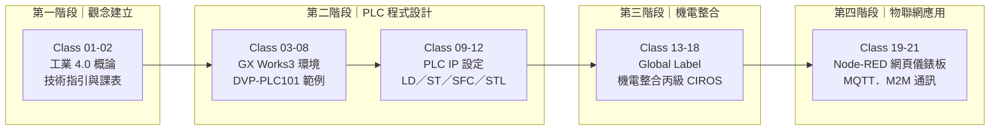
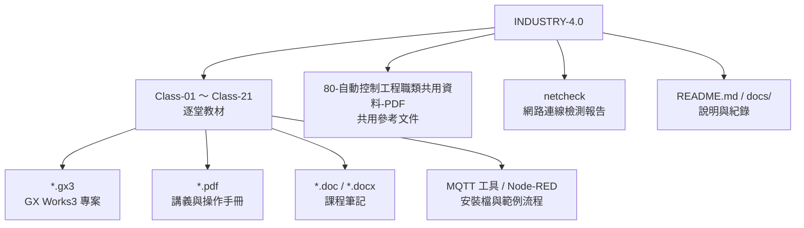
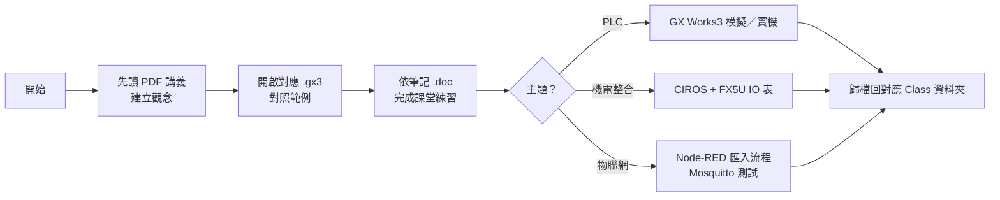
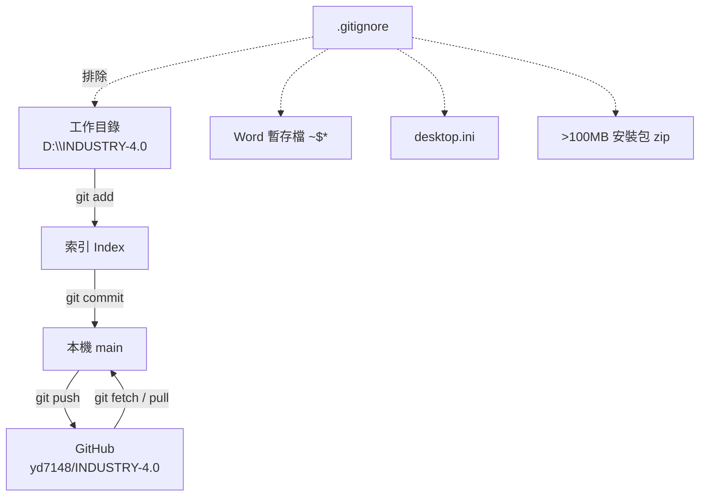

# 工業 4.0 自動控制工程職類｜課程教材庫

本倉庫收錄 **2026-08-25 ～ 2026-10-29** 期間「工業 4.0／自動控制工程職類」課程的教材、範例程式與課後補充資料，共 **21 堂課**、三大主題（PLC 程式設計、機電整合、Node-RED／MQTT 物聯網應用）與一份網路檢測報告。

| 項目 | 內容 |
|---|---|
| 線上倉庫 | <https://github.com/yd7148/INDUSTRY-4.0> |
| 預設分支 | `main` |
| 課程期間 | 2026-08-25 ～ 2026-10-29（21 堂） |
| 主要工具 | GX Works3、DVP-PLC、Node-RED、Mosquitto、MQTT Explorer |
| 文件語言 | 繁體中文 |

> 本文件只做「索引與導覽」。每堂課的完整檔案清單請見 [docs/COURSE-MAP.md](docs/COURSE-MAP.md)；
> 版本控制與推送檢核紀錄請見 [docs/PUSH-RECORD.md](docs/PUSH-RECORD.md)。

---

## 1. 課程主題地圖





---

## 2. 課程索引

| # | 日期 | 主題 | 代表教材 |
|:--:|---|---|---|
| 01 | 2026-08-25 | 工業 4.0 技術指引與課程說明 | `0825-teacher-I4.0-技術指引_V1.1.pdf`、`115-2 I4.0課表.pdf` |
| 02 | 2026-08-27 | 工業 4.0 概論、Node-RED 環境安裝 | `01-工業4.0概論_20260827.pdf`、`Node_Red_setup.zip` |
| 03 | 2026-09-01 | GX Works3 安裝與 PLC 基礎 | `GX-Works3 Operating Manual_cht.pdf`、`20260901-test1.gx3` |
| 04 | 2026-09-03 | DVP-PLC101 範例、階梯圖練習 | `DVP-PLC101samples_tc.pdf`、`EX101-LD-20260903.gx3` |
| 05 | 2026-09-04 | 基本指令與 LD 程式實作 | `Class-05-2026-09-04-notes.doc`、多個 `*.gx3` |
| 06 | 2026-09-08 | LD 程式延續與課堂練習 | `20260908-test3.gx3`、`Class-05-2026-09-04-notes.doc` |
| 07 | 2026-09-15 | LD 綜合練習 | `2026-09-10-1.gx3`、`Class-05-2026-09-10-notes.doc` |
| 08 | 2026-09-10 | LD 綜合練習（與 Class-07 教材重疊） | `2026-09-10-1.gx3` |
| 09 | 2026-09-17 | PLC IP 設定與專案範本 | `PLC-IP-SET.gx3`、`2026-09-15-IP145-template.gx3` |
| 10 | 2026-09-22 | 基本 LD／ST 與 ST 進階 | `0922-teacher-115-2 basic LD.gx3`、`0922-teacher-115-2 ST Advance.gx3` |
| 11 | 2026-09-24 | SFC 順序控制流程 | `01-Class-10-2026-09-24-PLC SFC.pdf`、`Class-09-2026-09-24-ST.gx3` |
| 12 | 2026-09-29 | STL 指令與 EX101 應用 | `0929-teacher-EX101 STL.gx3`、`2026-09-29.gx3` |
| 13 | 2026-10-01 | 綜合程式練習 | `2026-10-01-.gx3`、`2026-10-01-2.gx3` |
| 14 | 2026-10-06 | Global Label 與程式整理 | `2026-10-06-01.gx3`、`global label.jpg` |
| 15 | 2026-10-08 | Global Label 應用 | `2026-10-08-1.gx3` |
| 16 | 2026-10-13 | Node-RED 基本節點與儀錶板 | `Day2_20261013/Node-RED教材_基本節點.pdf` |
| 17 | 2026-10-15 | 機電整合丙級（機丙 1）與 IP 練習 | `機丙1 tutorial-2026-10-15.gx3` |
| 18 | 2026-10-20 | CIROS 機電整合丙 1 整合實作 | `IP133 20261020 CIROS_機電整合丙1_2.gx3` |
| 19 | 2026-10-22 | Node-RED 網頁應用、MQTT 工具 | `Node-RED 網頁應用/`、`MQTT 工具/` |
| 20 | 2026-10-27 | Node-RED 網頁控制 LED、定時與圖表 | `Node-RED 網頁應用_20261027/`、`Class-20-2026-10-27.doc` |
| 21 | 2026-10-29 | Node-RED Flow 設計與 M2M 應用 | `Node-RED _ Flow 2.html`、`Class-21-2026-10-29I4.0-M2M.pdf`、`2026-10-29-template-1.gx3` |

> 主題依資料夾名稱與教材檔名歸納；Class-07 與 Class-08 的資料夾編號與日期曾因課程重新編號而錯位，
> 表中以實際資料夾為準。Class-07／08 內容高度重複，屬同一堂課的兩份快照。

---

## 3. 目錄結構

```text
INDUSTRY-4.0/
├─ Class-01-2026-08-25/          # 工業 4.0 概論、課表
├─ Class-02-2026-08-27/          # 概論、Node-RED 安裝包
├─ Class-03-2026-09-01/          # GX Works3、PLC 基礎
├─ ...
├─ Class-20-2026-10-27/          # Node-RED 網頁應用、MQTT 工具
├─ Class-21-2026-10-29/          # Node-RED Flow、M2M 應用
├─ 80-自動控制工程職類共用資料-PDF/
│  ├─ Delta/                     # DVP-PLC、ISPSoft 手冊
│  ├─ FX5U/                      # FX5U、GX Works3、ST 指南
│  └─ CIROS/                     # 機電丙規範與 IO 表
├─ netcheck/                     # 網路連線／Port／測速檢測
├─ docs/
│  ├─ COURSE-MAP.md              # 逐堂教材清單與技能矩陣
│  └─ PUSH-RECORD.md             # 推送流程與檢核紀錄
├─ README.md
└─ .gitignore
```

---

## 4. 教材類型與建議閱讀順序

| 類型 | 副檔名 | 用途 | 建議工具 |
|---|---|---|---|
| PLC 專案 | `.gx3` | 課堂範例、練習與解答 | GX Works3 |
| 講義／手冊 | `.pdf` | 觀念說明與操作步驟 | 任意 PDF 閱讀器 |
| 課程筆記 | `.doc`、`.docx` | 教師授課重點 | Word 或 LibreOffice |
| Node-RED 流程 | `.txt`、`.json` | 匯入節點流程 | Node-RED 編輯器 |
| 工具安裝檔 | `.exe`、`.zip` | MQTT／Node-RED 環境 | 詳見各資料夾說明 |
| 檢測腳本 | `.ps1`、`.md` | 網路診斷與報告 | PowerShell |



---

## 5. 環境與工具

| 工具 | 用途 | 相關資料夾 |
|---|---|---|
| GX Works3 | 三菱 FX5U PLC 程式編輯與模擬 | `Class-03` 起、`80-.../FX5U` |
| ISPSoft | 台達 DVP-PLC 程式編輯 | `80-.../Delta` |
| Node-RED | 網頁化流程與儀錶板 | `Class-16`、`Class-19`、`Class-20` |
| Mosquitto | MQTT Broker | `Class-19/MQTT 工具`、`Class-20/MQTT 工具` |
| MQTT Explorer／MQTTBox | MQTT 訊息測試 | 同上 |
| CIROS | 機電整合虛擬機台 | `80-.../CIROS`、`Class-18` |

> 教材內的 `.exe`、`.zip` 為課堂教學用安裝檔，僅供教學參考；安裝前請自行確認來源與授權。

---

## 6. 版本控制與檔案政策



- **分支策略**：單一 `main` 分支，線性提交，每次上課或整理教材一個 commit。
- **排除項目**：Word 鎖定檔（`~$*`）、`desktop.ini`、超過 GitHub 100 MB 上限的安裝壓縮檔。
- **大型檔案**：`Class-19`／`Class-20` 的 MQTT 安裝檔合計約 200 MB，已接近 GitHub 單檔上限，
  若後續要長期保存，建議改用 Git LFS 或 Releases。
- **重複教材**：多堂課保留同一份 PDF 快照（例如 `DVP-PLC101samples_tc.pdf`），
  這是刻意的「單堂可獨立取用」設計，不在版控中做去重。

---

## 7. 文件索引

| 文件 | 說明 |
|---|---|
| [README.md](README.md) | 本頁：專案總覽、課程索引、環境與版控政策 |
| [docs/COURSE-MAP.md](docs/COURSE-MAP.md) | 逐堂教材清單、學習路徑、技能矩陣 |
| [docs/PUSH-RECORD.md](docs/PUSH-RECORD.md) | 推送流程、指令、檢核清單與結果紀錄 |
| [netcheck/REPORT.md](netcheck/REPORT.md) | 對外網路連線測試報告 |
| [netcheck/network-check-report.md](netcheck/network-check-report.md) | 網路連線詳細檢測 |
| [netcheck/quark-block-report.md](netcheck/quark-block-report.md) | 特定網站連線受阻分析 |

---

*文件最後更新：2026-10-29*
