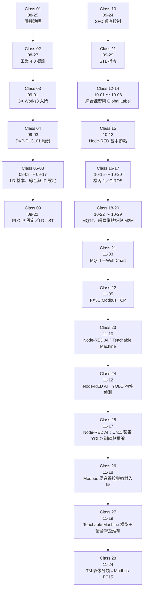
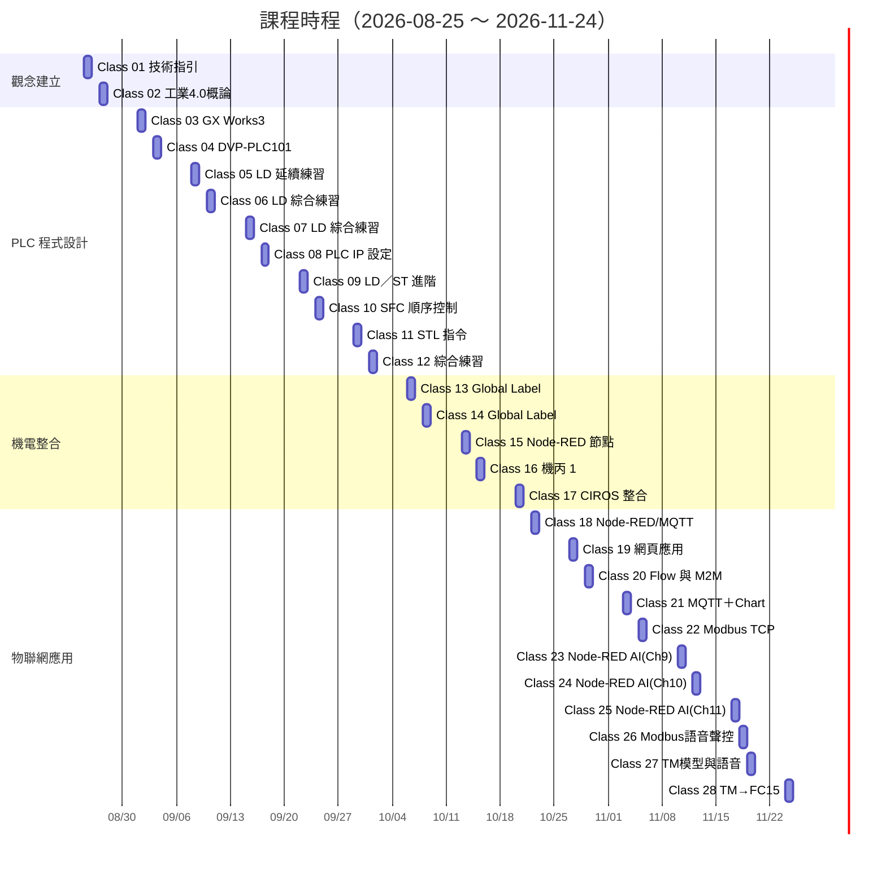
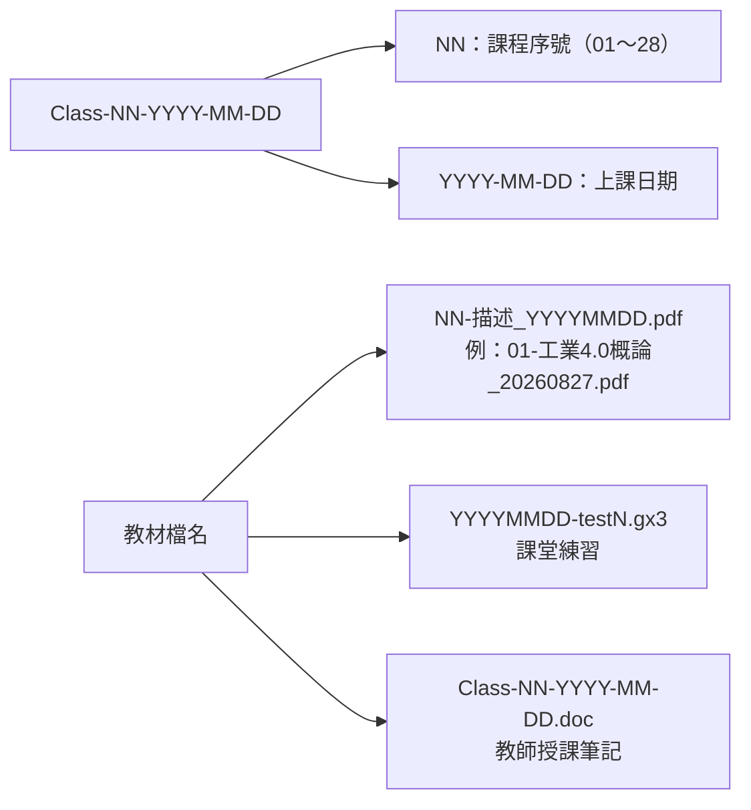

# 課程教材地圖（Course Map）

本文件逐一列出 28 堂課的資料夾、檔案數量、容量與主要教材，作為快速查找與點名核對的依據。
統計時間：2026-11-24；僅計入工作目錄實體檔案（含被 `.gitignore` 排除的大型壓縮檔）。Class-24 的數字為 2026-11-12 盤點基準，課後本機加裝的 Thonny 套件不列入。

---

## 1. 學習路徑

---

## 2. 逐堂教材清單

| # | 資料夾 | 日期 | 檔案數 | 容量 | 主要教材 |
|:--:|---|---|--:|--:|---|
| 01 | `Class-01-2026-08-25` | 2026-08-25 | 4 | 3.0 MB | 工業 4.0 技術指引、Basic 講義、115-2 課表 |
| 02 | `Class-02-2026-08-27` | 2026-08-27 | 6 | 84.8 MB | 工業 4.0 概論、Node-RED Server／Setup 壓縮檔、共用 PDF 壓縮檔 |
| 03 | `Class-03-2026-09-01` | 2026-09-01 | 17 | 1,800.6 MB | GX Works3 手冊、GX Works3 更新包（1.69 GB，未納版控）、`20260901-test1.gx3` |
| 04 | `Class-04-2026-09-03` | 2026-09-03 | 7 | 1,714.2 MB | DVP-PLC101 範例、`EX101-LD-20260903.gx3`、更新包（未納版控） |
| 05 | `Class-05-2026-09-08` | 2026-09-08 | 22 | 119.3 MB | 基本指令講義、6 個課堂 `.gx3`、09-04／09-08 兩次授課筆記 |
| 06 | `Class-06-2026-09-10` | 2026-09-10 | 15 | 94.0 MB | `2026-09-10-1.gx3`、LD 綜合筆記 |
| 07 | `Class-07-2026-09-15` | 2026-09-15 | 15 | 94.0 MB | 同 Class-06 素材的另一份快照 |
| 08 | `Class-08-2026-09-17` | 2026-09-17 | 17 | 96.1 MB | `PLC-IP-SET.gx3`、IP145 範本、Class-07 筆記 |
| 09 | `Class-09-2026-09-22` | 2026-09-22 | 21 | 98.5 MB | 基本 LD／ST 講義、ST Advance 範例、Class-08 筆記 |
| 10 | `Class-10-2026-09-24` | 2026-09-24 | 15 | 19.8 MB | SFC 講義與選單章節、ST／FN 範例、6 張操作截圖 |
| 11 | `Class-11-2026-09-29` | 2026-09-29 | 4 | 7.8 MB | EX101 STL 範例、`2026-09-29.gx3`、Class-11 筆記 |
| 12 | `Class-12-2026-10-01` | 2026-10-01 | 7 | 15.6 MB | 兩個綜合練習 `.gx3`、Class-12 筆記、2 張截圖 |
| 13 | `Class-13-2026-10-06` | 2026-10-06 | 7 | 16.1 MB | `2026-10-06-01.gx3`、Global Label 說明圖 |
| 14 | `Class-14-2026-10-08` | 2026-10-08 | 4 | 11.6 MB | `2026-10-08-1.gx3`、Class-14 筆記 |
| 15 | `Class-15-2026-10-13` | 2026-10-13 | 30 | 21.9 MB | Node-RED 基本節點／儀錶板 PDF、Day2 教材、switch + change 練習素材 |
| 16 | `Class-16-2026-10-15` | 2026-10-15 | 33 | 23.7 MB | 機丙 1 教學範例、IP 練習、Node-RED 教材 |
| 17 | `Class-17-2026-10-20` | 2026-10-20 | 36 | 25.6 MB | CIROS 機電整合丙 1 整合、IP133 範例、教師版 tutorial |
| 18 | `Class-18-2026-10-22` | 2026-10-22 | 79 | 173.6 MB | Node-RED 網頁應用 4 個範例、MQTT 工具（Mosquitto／Explorer／MQTTBox） |
| 19 | `Class-19-2026-10-27` | 2026-10-27 | 57 | 162.8 MB | Node-RED 網頁控制 LED、定時開關、Chart、Ngrok 轉址、MQTT 工具 |
| 20 | `Class-20-2026-10-29` | 2026-10-29 | 73 | 39.0 MB | Node-RED Flow 1／2 匯出頁面、M2M 講義、PLC 範本 `2026-10-29-template-1.gx3` |
| 21 | `Class-21-2026-11-03` | 2026-11-03 | 76 | 548.1 MB | Node-RED MQTT 應用 PDF、`06~08` 流程（Web Chart／清空資料／雙 Y 軸）、`Day5_20261103.zip` |
| 22 | `Class-22-2026-11-05` | 2026-11-05 | 81 | 548.7 MB | FX5U Modbus TCP 讀／寫流程 JSON、`20261105-2.gx3`、M2M 講義、`Day5_20261103.zip` |
| 23 | `Class-23-2026-11-10` | 2026-11-10 | 28 | 38.1 MB | Teachable Machine 訓練、Ch9 講義 PDF、`ch09-examples/` 7 個範例流程、Webcam 判斷 LED 流程 |
| 24 | `Class-24-2026-11-12` | 2026-11-12 | 14,506 | 581.3 MB | Ch10 講義 PDF、`ch10-examples/`（YOLO 標註、訓練、推論腳本）、Thonny 攜帶版 IDE、labelImg 工具 |
| 25 | `Class-25-2026-11-17` | 2026-11-17 | 16,010 | 383.9 MB | Ch11 講義 PDF、`ch11-examples/`（蘋果資料集、YOLOv8 訓練／推論腳本、訓練曲線與 Node-RED 流程）、`02-images/` 測試影像、`03-ch11-4-1_改/`（ONNX 匯出與自製 `node-red-contrib-yolov8`）、Thonny 攜帶版 IDE |
| 26 | `Class-26-2026-11-18` | 2026-11-18 | 11 | 24.6 MB | Node-RED `json.txt.txt`（`ui_microphone` → FC5 → `172.16.7.140:502`）、`20261118-1--SM402*.gx3` PLC 專案、補充包 `1118/`（`flows.json`＋`voice control.gx3`）、Ch11 講義 PDF ×2、教師筆記 `.doc`、環境 `.bat` ×2 |
| 27 | `Class-27-2026-11-19` | 2026-11-19 | 11 | 28.8 MB | Teachable Machine `2026-11-19-2-project.tm`（2.1 MB）與 `2026-11-19-2-tm-my-image-model.zip`（2.1 MB）、Node-RED `json.txt.txt` 語音聲控、`20261119-1--SM402-140.gx3` 等 PLC 專案 ×2、Ch11 講義 PDF ×2、教師筆記 `.doc`、環境 `.bat` ×2 |
| 28 | `Class-28-2026-11-24` | 2026-11-24 | 9 | 18.5 MB | Teachable Machine 專案（沿用 11-19）、Node-RED 影像分類→FC15 寫入 M200／M201 流程、機丙 1 PLC 練習 `1020`／`1124`、教師筆記（11-24 模型 `G4A8FVg5i`） |
| — | `80-自動控制工程職類共用資料-PDF` | — | 11 | 85.9 MB | Delta／FX5U／CIROS 共用手冊與規範 |
| — | `netcheck` | — | 24 | 0.2 MB | 網路 Port、測速、網站連線診斷腳本與報告 |

> 容量以資料夾實體檔案計算，包含未納入 Git 的 1.69 GB 更新包，因此 Class-03／04 的數字遠高於其他堂課。
> Class-24 的容量含 Thonny 攜帶版 IDE（13,325 個檔案）與 labelImg 工具原始碼；
> `Day7_20261112.zip`（147 MB）超過 GitHub 單檔上限，已排除於版控之外，內容由 `Day7_20261112/` 目錄完整保留。
> Class-25 的 16,010 檔中含 Thonny 攜帶版 IDE 12,757 檔（144.9 MB）；教材本體 3,253 檔／239.0 MB，
> 其中課後補充的 `02-images/`（9 檔／0.4 MB）與 `03-ch11-4-1_改/`（16 檔／41.6 MB）已於 2026-11-17 補推送入庫。
> 最大單檔 `apples.v2i.yolov8.zip` 為 38.0 MB，低於 100 MB 上限。
> Class-26 共 11 檔／25,814,060 bytes（24.6 MB），單檔最大為教師筆記 `.doc`（12.5 MB）；`1118/` 為 11-18 補充流程包（`flows.json`＋`voice control.gx3`）。
> `json.txt.txt` 為 Node-RED 流程匯出（8 KB），含 `modbus-client 172.16.7.140:502`、`modbus-flex-write` FC5（`unitid=1`、`address=0`）與 Dashboard「語音聲控」，搭配兩份 FX5U／SM402 `.gx3` 專案；另兩份 Ch11 PDF 為教材延伸，AI 流程本體仍見 Class-25。
> Class-27 共 11 檔／30,179,807 bytes（28.8 MB）：`.tm` 專案與匯出模型 zip 各 2.1 MB，教師筆記 `.doc` 12.9 MB；11-19 筆記記錄 Teachable Machine 模型連結 <https://teachablemachine.withgoogle.com/models/RfDYSkt0A/>。
> Class-28 共 9 檔／19,431,336 bytes（18.5 MB）：教師筆記 `.doc` 14.8 MB、TM 專案 2.1 MB、機丙 1 專案 ×2 各約 0.54 MB；11-24 筆記記錄模型 <https://teachablemachine.withgoogle.com/models/G4A8FVg5i/>，判定 Circle／Rectangle（`score > 0.6`）後以 Modbus FC15（`unitid=1`、`address=8392`、`quantity=2`）寫入 M200／M201。

> 註：Class-05 同時收錄 2026-09-04 與 2026-09-08 兩次授課筆記；Class-06 與 Class-07 為 LD 綜合練習的兩份素材快照。

---

## 3. 技能矩陣

| 能力項目 | 對應課程 | 教材證據 |
|---|---|---|
| 工業 4.0 概念與職能範圍 | 01、02 | 技術指引、概論講義、課表 |
| GX Works3 操作與專案管理 | 03～09 | 操作手冊、`.gx3` 專案 |
| 階梯圖（LD）設計 | 04～09 | `EX101-LD`、多個練習 `.gx3` |
| PLC 網路與 IP 設定 | 08、16、17 | `PLC-IP-SET.gx3`、`2026-09-15-IP145-template.gx3` |
| 結構化文本（ST） | 09、10、11 | `basic ST`、`ST Advance`、`STL` |
| 順序控制（SFC） | 10 | SFC 講義與選單章節 |
| 標籤化程式設計 | 13、14 | Global Label 教材與範例 |
| 機電整合丙級實作 | 16、17、28 | 機丙 1 tutorial、CIROS IO 表與規範 |
| Node-RED 流程設計 | 15、18～28 | 基本節點、儀錶板、Chart、LED 控制、Flow 匯出、`obj detection` 推論流程、Modbus 語音聲控 |
| MQTT／M2M 通訊 | 18、19、20、21、22 | Mosquitto 安裝檔、MQTT Explorer、M2M 講義、Web Chart 進階 |
| Modbus TCP PLC 通訊 | 22、26、28 | `fx5u_modbus_read.json`／`fx5u_modbus_write.json`、`20261105-2.gx3`；Class-26 `json.txt.txt`（FC5／Y0／`172.16.7.140:502`）與 `20261118-1--SM402*.gx3`；Class-28 FC15（`address=8392`／`quantity=2`，M200～M201） |
| AI 影像分類（Teachable Machine） | 23、27、28 | Ch9 講義、`ch09-examples/` 範例流程、Webcam 判斷 LED 流程；Class-27 `.tm` 專案與匯出模型 zip（`tfjs` 格式），瀏覽器端 `tmImage` 即時推論；Class-28 模型 `G4A8FVg5i` 的 Rectangle／Circle 分類→FC15 |
| AI 物件偵測（YOLO） | 24、25（26 僅講義延伸） | Ch10／Ch11 講義、labelImg 標註、`001`～`003` 訓練推論腳本、`ch10-examples/`、`ch11-examples/` |
| Python 影像處理與模型訓練 | 24、25 | `step2_frame_splitter.py`、`Step3`～`Step5`、`002_train_starwars.py`、`ch11-2/Step1`～`Step4` |
| 訓練結果分析與模型調參 | 25 | `ch11-2.txt`（results.csv＋AI 提問）、`runs/detect/train*/results.csv` 與 mAP 曲線 |
| Node-RED AI 推論應用 | 25（26 僅講義延伸） | `ch11-3-1/2/3.json`、`ch11-4-2.json`（topk／IoU／信心門檻、類別計數） |
| Node-RED 語音聲控（Modbus） | 26、28（沿用） | `json.txt.txt`：`ui_microphone` → `function` → `modbus-flex-write` FC5 → `172.16.7.140:502`，搭配 FX5U／SM402 PLC 專案 |
| 網路診斷 | netcheck | Port 測試、測速、網站連線報告 |

---

## 4. 檔案命名規則

| 模式 | 意義 | 範例 |
|---|---|---|
| `Class-NN-YYYY-MM-DD/` | 單堂課資料夾 | `Class-22-2026-11-05/` |
| `NN-描述_YYYYMMDD.pdf` | 依課堂順序編號的講義 | `01-工業4.0概論_20260827.pdf` |
| `YYYYMMDD-testN.gx3` | 當日第 N 個練習 | `20260908-test3.gx3` |
| `Class-NN-YYYY-MM-DD.doc` | 教師授課筆記 | `Class-22-2026-11-05.doc` |
| `json.txt.txt` | Node-RED 流程匯出（文字，可貼入 Import／Clipboard） | `Class-26/json.txt.txt` |
| `YYYYMMDD-1--*.gx3` | 當日 PLC 專案（含 IP 標記） | `20261118-1--SM402-140.gx3` |
| `*teacher*.gx3` | 教師示範版 | `0929-teacher-EX101 STL.gx3` |

> **課次編號對應**：課次編號已與 YouTube 頻道存檔標題一致（Class01＝2026-08-25 … Class25＝2026-11-17、Class26＝2026-11-18、Class27＝2026-11-19、Class28＝2026-11-24）。
> 授課筆記的檔名沿用原始命名（例如 `Class-05-2026-09-04-notes.doc` 為 09-04 該次授課的筆記），
> 與所在資料夾的編號不一定相同，請以檔案內容的日期為準。

---

## 5. 重複與待整理項目

| 項目 | 狀況 | 建議 |
|---|---|---|
| `Class-06`／`Class-07` | LD 綜合練習的兩份素材快照，內容幾乎相同 | 保留現狀（歷史紀錄），於本文件註明 |
| `Class-05` | 同時含 09-04 與 09-08 兩次授課筆記 | 保留現狀，檔名已標明日期 |
| `DVP-PLC101samples_tc.pdf` | 出現於 Class-04～09、12、13 | 可改為連結共用 `80-.../Delta` 版本，縮減容量 |
| `80-自動控制工程職類共用資料-PDF` | Class-03、05、06、07、08、09 各有一份完整複本 | 同上，長期可考慮以符號連結或文件索引取代 |
| `MQTT 工具` | Class-18／19／21／22 各一份，含 93 MB 安裝檔重複副本 | 若需長期保存，改用 Git LFS 或 GitHub Releases |
| `90-sw1dnd-gxw3-e_117x(update).zip` | 1.69 GB × 2，已被 `.gitignore` 排除 | 維持排除，避免超過 GitHub 單檔 100 MB 限制 |
| `Day5_20261103.zip` | Class-21／22 各一份（約 96 MB，接近單檔上限） | 維持現狀；若需更新改用 Git LFS／Releases |
| `Day7_20261112.zip` | Class-24 一份（**147 MB，超過 GitHub 100 MB 硬性上限**） | **已排除於版控**；內容完整保留於 `Day7_20261112/` 目錄與 `ch10-examples/` |
| `thonny-5.0.1-windows-portable-x64/` | 攜帶版 Python IDE；Class-24 為 13,325 檔基準，Class-25 為 12,757 檔 | 依專案需求保留；Class-24 課後本機加裝套件已由 `.gitignore` 排除，Class-25 完整入庫 |
| `labelImg/` | 第三方標註工具原始碼 | 保留（Ch10 實作需要）；其自身 `.gitignore` 已排除 `__pycache__`／`*.pyc` |
| `Class-25/AppleModel/` | Node-RED `obj detection` 節點預留的模型資料夾，目前為空 | 保留空資料夾並於該堂 README 註明；實際權重位於 `ch11-2/best.pt` 與 `runs/detect/train*/weights/best.pt`，使用前需複製並修改 `modelPath` |
| `Class-25/03-ch11-4-1_改/` | 課後改良流程：自訓模型匯出 ONNX、自製 `node-red-contrib-yolov8` 節點；與 `ch11-4-2.json` 的 PyTorch 作法互補 | 保留；`best.onnx`（11.7 MB）為蘋果自訓模型，`lib/model/yolov8n.onnx`（12.2 MB）為 COCO 預訓練模型 |
| `Class-25/02-images/` | 9 張推論測試影像（蘋果、貓、狗、馬、人物） | 保留，供 Node-RED `obj detection` 流程驗證 |
| `Class-25` Ch11 PDF | root 與 `Day8_20261117/` 各一份 | 刻意保留，方便流程包單獨攜帶 |
| `Class-26` Ch11 PDF ×2 | 與 `Class-25` root 的兩份 PDF 完全相同 | 刻意保留（單堂可獨立取用）；AI 流程與模型仍以 Class-25 為準，詳見 Class-26 README |
| `Class-26` Word 鎖定檔 | `~$ass-26-2026-11-18.doc`（Word 開啟時產生，現已關閉） | 已由 `.gitignore` 的 `~$*.*` 規則排除，不入版控 |
| `Class-26` Modbus 語音聲控流程 | `json.txt.txt` + 兩份 `20261118-1--SM402*.gx3` | 與 Class-22 的 Modbus TCP 讀寫流程主題相近但實作不同（FC5 語音聲控）；保留為獨立教材 |
| `Class-26/1118/` | `flows.json`（Groups 版語音流程）與 `voice control.gx3`，與根目錄 `json.txt.txt`／`SM402.gx3` 相近 | 保留為同一堂課的兩版素材快照 |
| `Class-27` Ch11 PDF ×2 與 `json.txt.txt` | 與 Class-25／26 的 Ch11 PDF、Node-RED 流程重複 | 刻意保留（單堂可獨立取用）；TM 模型為本堂新增重點 |
| `Class-27` PLC 專案 | `20261118-1--SM402.gx3` 與 Class-26 同名同內容 | 保留於兩堂課，方便單堂取用；更新版為 `20261119-1--SM402-140.gx3` |
| `Class-28` 教材 | TM 專案、`json.txt.txt` 與 `20261119-1--SM402-140.gx3` 沿用 Class-27／26 | 刻意保留（單堂可獨立取用）；11-24 新增的是模型 `G4A8FVg5i`、base64 影像顯示、FC15 寫入 M200／M201 與兩份機丙 1 專案 |

---

*本文件由教材目錄自動盤點後人工整理（最近盤點：2026-11-24，新增 Class-28 共 9 檔／18.5 MB）；若新增課程，請同步更新本表與 [README.md](../README.md) 的課程索引。*
