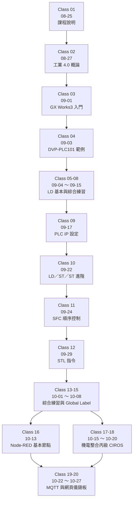
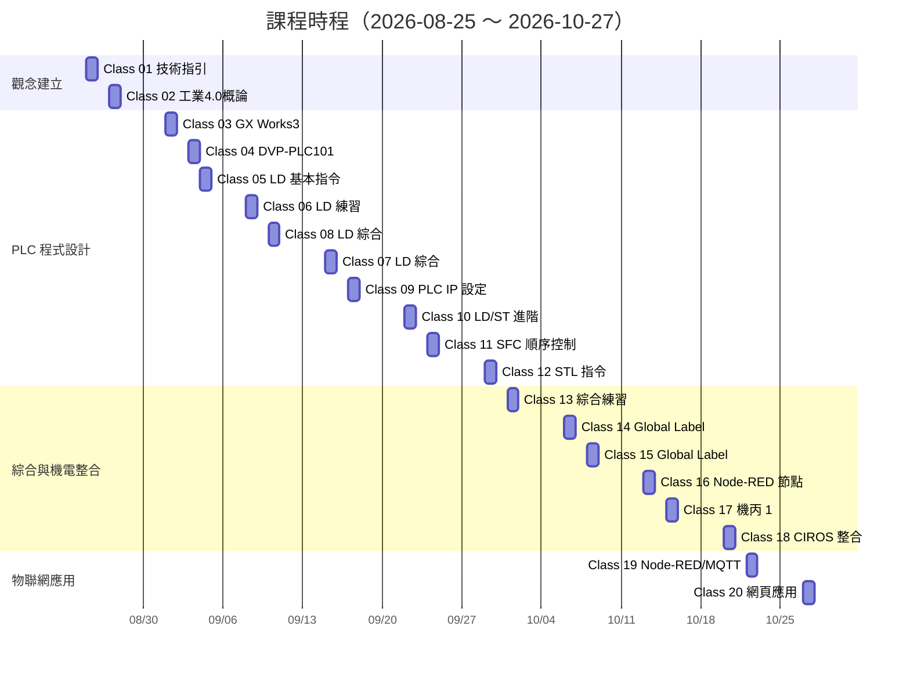
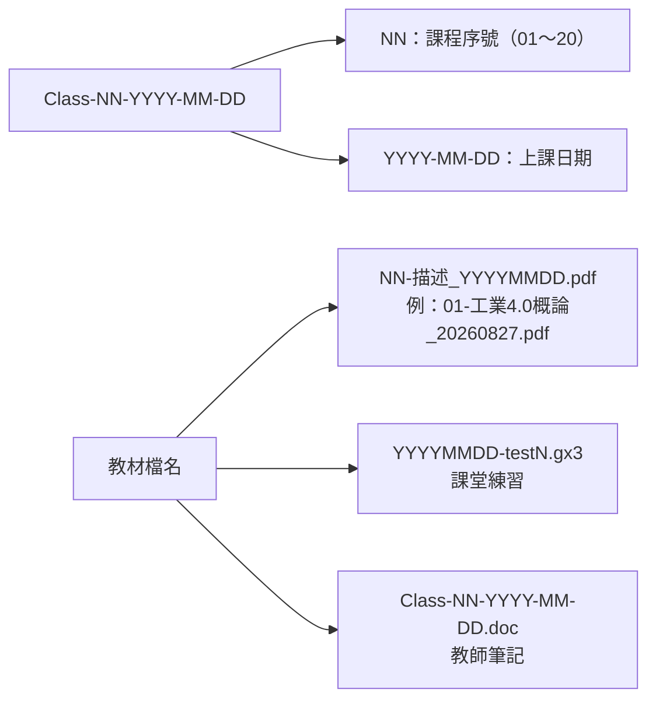

# 課程教材地圖（Course Map）

本文件逐一列出 20 堂課的資料夾、檔案數量、容量與主要教材，作為快速查找與點名核對的依據。
統計時間：2026-10-29；僅計入工作目錄實體檔案（含被 `.gitignore` 排除的大型壓縮檔）。

---

## 1. 學習路徑

---

## 2. 逐堂教材清單

| # | 資料夾 | 日期 | 檔案數 | 容量 | 主要教材 |
|:--:|---|---|--:|--:|---|
| 01 | `Class-01-2026-08-25` | 2026-08-25 | 3 | 3.0 MB | 工業 4.0 技術指引、Basic 講義、115-2 課表 |
| 02 | `Class-02-2026-08-27` | 2026-08-27 | 5 | 84.8 MB | 工業 4.0 概論、Node-RED Server／Setup 壓縮檔、共用 PDF 壓縮檔 |
| 03 | `Class-03-2026-09-01` | 2026-09-01 | 16 | 1,800.6 MB | GX Works3 手冊、GX Works3 更新包（1.69 GB，未納版控）、`20260901-test1.gx3` |
| 04 | `Class-04-2026-09-03` | 2026-09-03 | 6 | 1,714.2 MB | DVP-PLC101 範例、`EX101-LD-20260903.gx3`、更新包（未納版控） |
| 05 | `Class-05-2026-09-04` | 2026-09-04 | 21 | 119.3 MB | 基本指令講義、6 個課堂 `.gx3`、GX Works3 手冊 |
| 06 | `Class-06-2026-09-08` | 2026-09-08 | 21 | 119.3 MB | 延續 Class-05 教材，新增 `20260908-test3.gx3` |
| 07 | `Class-07-2026-09-15` | 2026-09-15 | 14 | 94.0 MB | `2026-09-10-1.gx3`、LD 練習筆記 |
| 08 | `Class-08-2026-09-10` | 2026-09-10 | 14 | 94.0 MB | 與 Class-07 同內容（資料夾重新編號前的快照） |
| 09 | `Class-09-2026-09-17` | 2026-09-17 | 16 | 96.1 MB | `PLC-IP-SET.gx3`、IP145 範本、Class-07 筆記 |
| 10 | `Class-10-2026-09-22` | 2026-09-22 | 20 | 98.5 MB | 基本 LD／ST、ST 進階、Class-08 範例 |
| 11 | `Class-11-2026-09-24` | 2026-09-24 | 14 | 19.7 MB | SFC 講義與選單章節、ST／FN 範例、6 張操作截圖 |
| 12 | `Class-12-2026-09-29` | 2026-09-29 | 3 | 7.8 MB | EX101 STL 範例、`2026-09-29.gx3`、Class-11 筆記 |
| 13 | `Class-13-2026-10-01` | 2026-10-01 | 6 | 15.6 MB | 兩個綜合練習 `.gx3`、Class-12 筆記、2 張截圖 |
| 14 | `Class-14-2026-10-06` | 2026-10-06 | 6 | 16.1 MB | `2026-10-06-01.gx3`、Global Label 說明圖 |
| 15 | `Class-15-2026-10-08` | 2026-10-08 | 3 | 11.6 MB | `2026-10-08-1.gx3`、Class-14 筆記 |
| 16 | `Class-16-2026-10-13` | 2026-10-13 | 29 | 21.9 MB | Node-RED 基本節點／儀錶板 PDF、Day2 教材、switch + change 練習素材 |
| 17 | `Class-17-2026-10-15` | 2026-10-15 | 32 | 23.7 MB | 機丙 1 教學範例、IP 練習、Node-RED 教材 |
| 18 | `Class-18-2026-10-20` | 2026-10-20 | 35 | 25.6 MB | CIROS 機電整合丙 1 整合、IP133 範例、教師版 tutorial |
| 19 | `Class-19-2026-10-22` | 2026-10-22 | 78 | 173.6 MB | Node-RED 網頁應用 4 個範例、MQTT 工具（Mosquitto／Explorer／MQTTBox） |
| 20 | `Class-20-2026-10-27` | 2026-10-27 | 56 | 162.8 MB | Node-RED 網頁控制 LED、定時開關、Chart、Ngrok 轉址、MQTT 工具 |
| — | `80-自動控制工程職類共用資料-PDF` | — | 11 | 85.9 MB | Delta／FX5U／CIROS 共用手冊與規範 |
| — | `netcheck` | — | 24 | 0.2 MB | 網路 Port、測速、網站連線診斷腳本與報告 |

> 容量以資料夾實體檔案計算，包含未納入 Git 的 1.69 GB 更新包，因此 Class-03／04 的數字遠高於其他堂課。

> 註：Class-07（09-15）與 Class-08（09-10）的編號與日期錯位，Gantt 圖依實際日期排列。

---

## 3. 技能矩陣

| 能力項目 | 對應課程 | 教材證據 |
|---|---|---|
| 工業 4.0 概念與職能範圍 | 01、02 | 技術指引、概論講義、課表 |
| GX Works3 操作與專案管理 | 03～06 | 操作手冊、`.gx3` 專案 |
| 階梯圖（LD）設計 | 04～09 | `EX101-LD`、多個練習 `.gx3` |
| PLC 網路與 IP 設定 | 09、17、18 | `PLC-IP-SET.gx3`、`IP145-template.gx3` |
| 結構化文本（ST） | 10、11、12 | `basic ST`、`ST Advance`、`STL` |
| 順序控制（SFC） | 11 | SFC 講義與選單章節 |
| 標籤化程式設計 | 14、15 | Global Label 教材與範例 |
| 機電整合丙級實作 | 17、18 | 機丙 1 tutorial、CIROS IO 表與規範 |
| Node-RED 流程設計 | 16、19、20 | 基本節點、儀錶板、Chart、LED 控制 |
| MQTT 通訊與 Broker 架設 | 19、20 | Mosquitto 安裝檔、MQTT Explorer、教學 PDF |
| 網路診斷 | netcheck | Port 測試、測速、網站連線報告 |

---

## 4. 檔案命名規則

| 模式 | 意義 | 範例 |
|---|---|---|
| `Class-NN-YYYY-MM-DD/` | 單堂課資料夾 | `Class-20-2026-10-27/` |
| `NN-主題_YYYYMMDD.pdf` | 依課堂順序編號的講義 | `01-工業4.0概論_20260827.pdf` |
| `YYYYMMDD-testN.gx3` | 當日第 N 個練習 | `20260908-test3.gx3` |
| `Class-NN-...-notes.doc` | 教師授課筆記 | `Class-05-2026-09-04-notes.doc` |
| `*teacher*.gx3` | 教師示範版 | `0929-teacher-EX101 STL.gx3` |

---

## 5. 重複與待整理項目

| 項目 | 狀況 | 建議 |
|---|---|---|
| `Class-07`／`Class-08` | 兩資料夾內容幾乎相同，日期與編號錯位 | 保留現狀（歷史紀錄），於本文件註明 |
| `DVP-PLC101samples_tc.pdf` | 出現於 Class-04～10、13、14 | 可改為連結共用 `80-.../Delta` 版本，縮減容量 |
| `80-自動控制工程職類共用資料-PDF` | 各堂課另有一份完整複本 | 同上，長期可考慮以符號連結或文件索引取代 |
| `MQTT 工具` | Class-19／20 各一份，含 97 MB 安裝檔 | 若需長期保存，改用 Git LFS 或 GitHub Releases |
| `90-sw1dnd-gxw3-e_117x(update).zip` | 1.69 GB × 2，已被 `.gitignore` 排除 | 維持排除，避免超過 GitHub 單檔 100 MB 限制 |

---

*本文件由教材目錄自動盤點後人工整理；若新增課程，請同步更新本表與 [README.md](../README.md) 的課程索引。*
