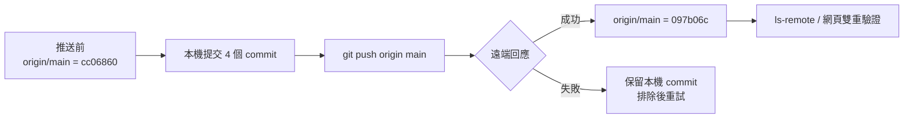
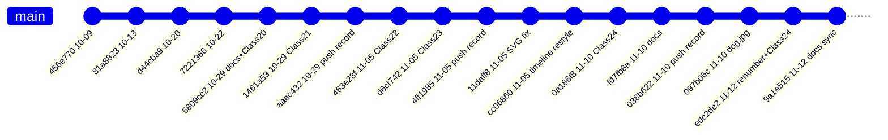
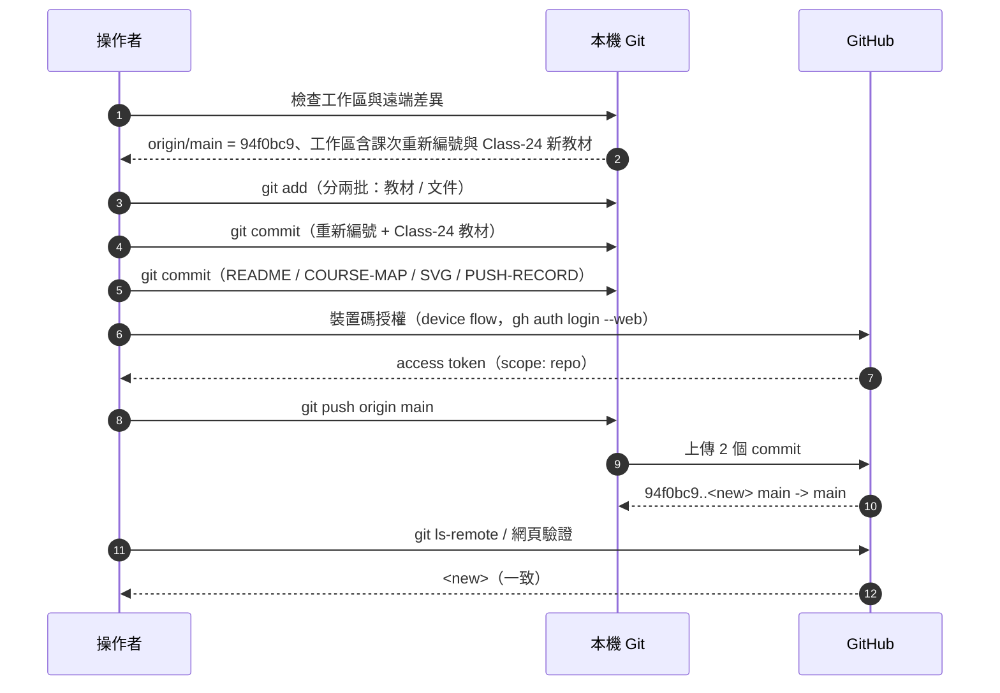
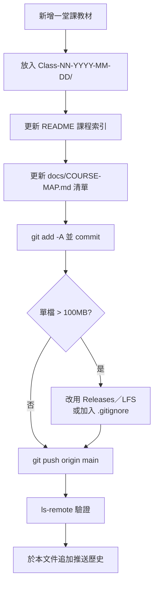

# 推送紀錄與檢核報告（Push Record）

本文件記錄 `D:\INDUSTRY-4.0` 推送至 GitHub 的完整過程、驗證結果與後續維護注意事項。
每次重大推送請在文末「推送歷史」追加一列。

---

## 1. 本次推送摘要

| 項目 | 內容 |
|---|---|
| 執行時間 | 2026-11-12（UTC+08:00） |
| 來源路徑 | `D:\INDUSTRY-4.0` |
| 遠端倉庫 | <https://github.com/yd7148/INDUSTRY-4.0> |
| 分支 | `main` → `origin/main` |
| 推送前遠端 | `94f0bc9`（2026-11-10） |
| 推送後遠端 | `9a1e5155` |
| 推送範圍 | `94f0bc9..`（課次重新編號 + Class-24 新教材 + 文件同步） |
| 本次新增 | **課次編號全面重新編號**（Class-01～Class-24，與 YouTube 頻道存檔標題一致）、`Class-24-2026-11-12`（Node-RED AI Ch10／YOLO 物件偵測，Day 7）、Class-22 Modbus 架構圖更名、根 README／COURSE-MAP／SVG 全面更新 |
| 傳輸結果 | **成功**；GitHub 回報 `94f0bc9a..9a1e5155  main -> main` |
| 遠端驗證 | `git ls-remote origin main` 回傳 `9a1e5155`，與本機 HEAD 一致；GitHub 網頁 `/commits/main` 亦已可見 |
| 工作區狀態 | clean，`main` 與 `origin/main` 同點 |


---

## 2. 提交歷史



| Commit | 日期時間 | 說明 |
|---|---|---|
| `456e770` | 2026-10-09 12:56 | 推送前遠端最新（Class-14） |
| `81a8823` | 2026-10-13 19:37 | 課程重新編號、新增 Class-16 |
| `d44cba9` | 2026-10-20 21:39 | 新增 Class-17、Class-18 |
| `7221366` | 2026-10-22 21:24 | 新增 Class-19（Node-RED、MQTT） |
| `5809cc2` | 2026-10-29 18:47 | 新增 Class-20、`README.md`、`docs/COURSE-MAP.md` |
| `1461a53` | 2026-10-29 21:24 | 新增 Class-21（Node-RED Flow、M2M） |
| `aaac432` | 2026-10-29 21:40 | 新增 `docs/PUSH-RECORD.md` |
| `463e28f` | 2026-11-05 | 新增 Class-22 Day5 壓縮包 |
| `d6cf742` | 2026-11-05 | 新增 Class-23 教材、各堂 README、SVG 圖表 |
| `4ff1985` | 2026-11-05 | 推送紀錄補上 Class-23 該列 |
| `11daff8` | 2026-11-05 | 修正 SVG 文字溢出、改為兩列版面 |
| `cc06860` | 2026-11-05 | 播放清單時間軸拆成上下半兩段 |
| `0a186f8` | 2026-11-10 18:51 | **新增 Class-24-2026-11-10（Node-RED AI／Teachable Machine）**，更新 Class-23 `20261105-2.gx3` |
| `fd7fb8a` | 2026-11-10 18:51 | 更新根 README、`docs/COURSE-MAP.md`、`docs/img/course-timeline.svg`（23 → 24 堂，播放清單 19 → 23 段） |
| `038b622` | 2026-11-10 18:53 | 推送紀錄補上 2026-11-10 該列與新的環境準備／檢核流程 |
| `097b06c` | 2026-11-10 18:59 | 補上 Class-24 測試影像 `dog.jpg`，同步更新該資料夾檔案清單 |
| `edc2de2` | 2026-11-12 | **課次重新編號**（Class-01～Class-24，與 YouTube 頻道存檔標題一致）、新增 `Class-24-2026-11-12`（Node-RED AI Ch10／YOLO 物件偵測）、同步各堂教材檔名 |
| `9a1e515` | 2026-11-12 | 更新根 `README.md`、`docs/COURSE-MAP.md`、`docs/PUSH-RECORD.md`、24 堂各堂 `README.md`、SVG 時間軸與 Modbus 架構圖 |

> 本次推送前本機與遠端同點（`94f0bc9`），推送範圍為本次新增的 2 個 commit。

---

## 3. 執行流程



### 3.1 環境準備

本機未安裝 Git（`git` 不在 PATH），因此使用可攜版：

| 元件 | 版本 | 位置 |
|---|---|---|
| MinGit（可攜） | 2.56.1 64-bit | `%LOCALAPPDATA%\Temp\opencode\mingit` |
| GitHub CLI | 2.103.3 | `%LOCALAPPDATA%\Temp\opencode\gh` |
| 授權方式 | OAuth Device Flow（`gh auth login --web`） | scope `repo`，token 存放於 Windows 憑證管理員 |

> 本機 `git` 不在 PATH，`cmdkey` 無 GitHub 憑證，也沒有 SSH key；一律走 HTTPS。
> MinGit 自帶 `git-credential-manager`，但本機改用 `gh auth setup-git` 讓 git 透過 `gh` 取用 token。

### 3.2 實際指令

```powershell
# 0. 準備可攜版 git / gh（解壓即用）
$env:PATH = "$env:LOCALAPPDATA\Temp\opencode\mingit\cmd;$env:LOCALAPPDATA\Temp\opencode\gh\bin;$env:PATH"

# 1. 檢視狀態（含被忽略的大型檔案）
git -C D:\INDUSTRY-4.0 -c core.quotepath=false status --short --branch
git -C D:\INDUSTRY-4.0 rev-list --left-right --count origin/main...HEAD

# 2. 授權（裝置碼；token 進 Windows 憑證管理員，不落地到 repo）
gh auth login --web --hostname github.com --git-protocol https
gh auth setup-git

# 3. 加入與提交（教材與文件分兩批）
git -C D:\INDUSTRY-4.0 add -- "Class-24-2026-11-10" "Class-23-2026-11-05/20261105-2.gx3"
git -C D:\INDUSTRY-4.0 -c user.name="yd7148" -c user.email="yd7148@users.noreply.github.com" commit -m "..."
git -C D:\INDUSTRY-4.0 add -- "README.md" "docs/COURSE-MAP.md" "docs/img/course-timeline.svg"
git -C D:\INDUSTRY-4.0 -c user.name="yd7148" -c user.email="yd7148@users.noreply.github.com" commit -m "..."

# 4. 推送
$env:GIT_TERMINAL_PROMPT = "0"
git -C D:\INDUSTRY-4.0 push origin main

# 5. 驗證
git -C D:\INDUSTRY-4.0 ls-remote origin main
git -C D:\INDUSTRY-4.0 status --short --branch
```

---

## 4. 檢核清單

| # | 檢核項目 | 方法 | 結果 |
|:--:|---|---|:--:|
| 1 | 提交內容完整 | `git status --short` 無殘留未追蹤教材 | ✅ |
| 2 | 暫存檔未入庫 | `git status --ignored` 確認 `~$*.doc`、`desktop.ini`、`__pycache__`、`*.pyc` 被排除 | ✅（`~$ass-24-2026-11-14.doc` 未入庫） |
| 3 | 超過 100 MB 的檔案未入庫 | `git ls-tree -r -l` 檢查，最大為 96.06 MB | ✅ |
| 4 | 大型安裝包已排除 | 兩個 1.69 GB 的 GX Works3 更新包、147 MB 的 `Day7_20261112.zip` 被 `.gitignore` 排除 | ✅ |
| 5 | Mermaid 語法可渲染 | 以 Mermaid 11 實際渲染 `README.md`、`COURSE-MAP.md`、`PUSH-RECORD.md`、Class-24 README | ✅ 15/15 |
| 6 | 文件無 TODO／佔位符 | 關鍵字掃描 `TODO`、`FIXME`、`待補` | ✅ |
| 7 | 遠端 HEAD 與本機一致 | `git ls-remote origin main` vs `git rev-parse HEAD` | ✅（皆為 `fd7fb8a`） |
| 8 | GitHub 網頁可見新 commit | 讀取 `/commits/main` 頁面 | ✅ |
| 9 | 推送後工作區乾淨 | `git status` | ✅ clean |
| 10 | 憑證未寫入版控 | 檢查 `.git/config`、`.git-credentials` | ✅（token 存於 Windows 憑證管理員） |
| 11 | 上課影片清單與實況一致 | 解析 YouTube 播放清單 `ytInitialData` 取得 25 段影片，逐支以 oEmbed 驗證可存取 | ✅ |
| 12 | 新增檔案已附說明 | 每個 `Class-XX` 資料夾均有 `README.md` | ✅（24 堂全數具備） |
| 13 | 課次編號與頻道一致 | 逐支比對播放清單影片標題的 `ClassNN` 與資料夾編號 | ✅（Class01～Class24 全數相符） |
| 14 | 文件內部連結有效 | 掃描全部 `*.md` 的相對連結，逐一驗證目標存在 | ✅（除 `netcheck/staging` 指向外部 skill 倉庫的既有關聯） |
| 15 | 各堂檔案清單與實體一致 | 由檔案系統重新產生 Class-01～Class-21 的檔案清單表 | ✅ |

### 4.1 檔案規模

| 指標 | 數值 |
|---|---:|
| 追蹤檔案數 | 17,800（含 Thonny 攜帶版 IDE 與 labelImg 工具原始碼） |
| 追蹤內容合計 | 約 3.5 GB |
| commit 總數 | 34 |
| 單檔最大 | 96.06 MB（`Class-21／22/Day5_20261103.zip`） |
| 本次推送檔案數 | 17,000+（含課次重新編號之大量檔名變更） |

---

## 5. 已知警告與限制

| 項目 | 說明 | 建議 |
|---|---|---|
| 大檔案警告 `GH001` | GitHub 建議單檔 ≤ 50 MB；`Day5_20261103.zip` 為 96.02 MB（仍低於硬性上限 100 MB） | 後續同類工具改用 Releases 或 Git LFS |
| 倉庫總量 | 約 2.58 GB，已超出 GitHub 建議的 1 GB～5 GB 區間中段 | 定期清除重複 PDF，或改以文件索引取代複本 |
| 重複教材 | 多堂課各存一份相同 PDF／工具 | 見 [COURSE-MAP.md](COURSE-MAP.md) 第 5 節 |
| 憑證 | 本次使用 `gh` 裝置碼授權，token 存放於 Windows 憑證管理員 | 如需長期免互動，改用 Git Credential Manager 持久化 |
| Class-23 講義 PDF 重複 | `Node-RED AI_ch9.pdf`、`Node-RED AI應用_ch9_20261110.pdf` 同時存在於 `Class-23-2026-11-10/` 根目錄與 `Day6_20261110/` 內 | 根目錄副本當時被 PDF-XChange Viewer 鎖定無法刪除；檢視器關閉後可刪除根目錄副本 |
| `Day7_20261112.zip` 超過 100 MB | 147.29 MB，超過 GitHub 單檔硬性上限，無法推送 | 已加至 `.gitignore`；內容完整保留於 `Day7_20261112/` 目錄與 `ch10-examples/` 子資料夾 |
| 課次重新編號 | 原 Class-05～Class-24 的編號與日期錯位（例：舊 Class-05-2026-09-04 與 Class-06-2026-09-08 內容重複） | 已全面重新編號為 Class-01～Class-24，與 YouTube 頻道存檔標題（Class01～Class24）一一相符 |
| 授課筆記檔名與資料夾編號不一致 | 例如 `Class-24-2026-11-12/Class-24-2026-11-14.doc`（教師原始命名） | 保留教師原始命名，並於 `docs/COURSE-MAP.md` 第 4 節註明以檔案內容日期為準 |

> 本次 `git push` 在 PowerShell 中因遠端進度輸出到 stderr 而顯示為錯誤物件，
> 但實際傳輸成功（`cc06860..fd7fb8a`），已用 `ls-remote` 與 GitHub 網頁雙重確認。

---

## 6. 推送歷史

| 日期 | 範圍 | 結果 | 備註 |
|---|---|---|---|
| 2026-10-29 | `456e770..1461a53` | 成功 | 新增 Class-20、Class-21、README 與 docs |
| 2026-10-29 | `1461a53..aaac432` | 成功 | 新增 `docs/PUSH-RECORD.md` |
| 2026-10-29 | `aaac432..`（本文件修訂） | 成功 | 更新最終 HEAD 與推送歷史 |
| 2026-11-05 | `463e28f..d6cf742` | 成功 | 上傳 Class-23-2026-11-05 完整教材（Modbus TCP／M2M）、Class-22 遺漏流程檔、23 份 Class README、根 README／COURSE-MAP 更新、docs/img 兩張 SVG 圖表（共 108 檔） |
| 2026-11-10 | `cc06860..fd7fb8a` | 成功 | 新增 Class-24-2026-11-10（Node-RED AI／Teachable Machine，26 檔）、更新 Class-23 `20261105-2.gx3`、根 README／COURSE-MAP／SVG 同步更新（29 檔） |
| 2026-11-10 | `fd7fb8a..097b06c` | 成功 | 補上推送紀錄更新與 Class-24 測試影像 `dog.jpg`（2 個 commit） |
| 2026-11-12 | `94f0bc9a..9a1e5155` | 成功 | 課次重新編號（Class-01～Class-24）＋ 新增 Class-24（2026-11-12，Node-RED AI Ch10／YOLO）＋ 全部文件同步 | 課次重新編號（Class-01～Class-24）＋ 新增 Class-24（2026-11-12，Node-RED AI Ch10／YOLO）＋ 全部文件同步 |

---

## 7. 後續維護



- 每次推送前後各執行一次 `git status --short --branch`。
- 新增教材後同步更新 `README.md` 的課程表與 `docs/COURSE-MAP.md`。
- 若加入 `.exe`、`.zip`，先確認大小；超過 100 MB 一律不進 Git。

---

*紀錄建立：2026-10-29｜最近更新：2026-11-12*
