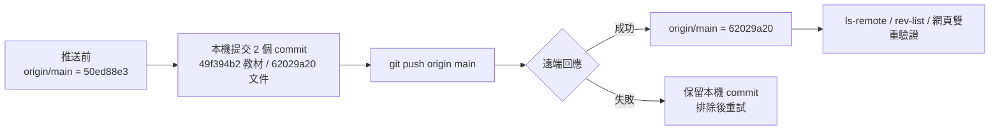
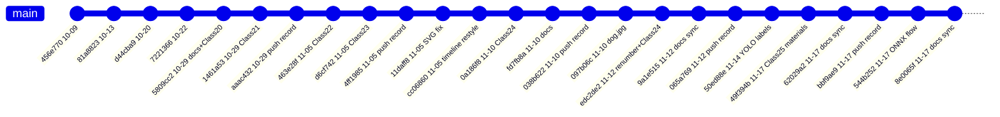
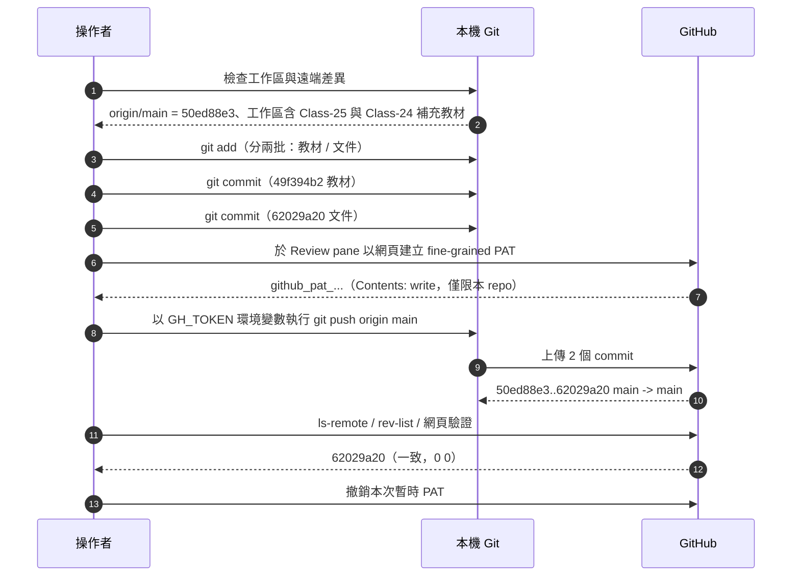
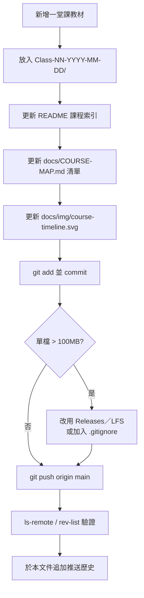

# 推送紀錄與檢核報告（Push Record）

本文件記錄 `D:\INDUSTRY-4.0` 推送至 GitHub 的完整過程、驗證結果與後續維護注意事項。
每次重大推送請在文末「推送歷史」追加一列。

---

## 1. 本次推送摘要

| 項目 | 內容 |
|---|---|
| 執行時間 | 2026-11-17（UTC+08:00） |
| 來源路徑 | `D:\INDUSTRY-4.0` |
| 遠端倉庫 | <https://github.com/yd7148/INDUSTRY-4.0> |
| 分支 | `main` → `origin/main` |
| 推送前遠端 | `50ed88e3`（Add YOLO annotation labels for Ch10 star-wars dataset） |
| 推送後遠端 | `62029a20` |
| 推送範圍 | `50ed88e3..62029a20`（2 個 commit） |
| 本次新增 | **Class-25-2026-11-17**（Day 8／Ch11 蘋果 YOLOv8 物件偵測）、Class-24 Ch10 課後補充教材（BBox 標註、frames、train/val、yolov8n.pt、ch10-4/、`runs/`）、根 README／COURSE-MAP／SVG 同步更新（25 堂、26 段影片） |
| 提交內容 | `49f394b2` 教材（16,196 檔）、`62029a20` 文件（3 檔） |
| 授權方式 | 於 OpenCode Review pane 以 GitHub 網頁建立 fine-grained PAT（`Contents: Read and write`、`Metadata: Read-only`，僅限 `yd7148/INDUSTRY-4.0`，有效期至 2026-12-17），僅作為本次 `GH_TOKEN` 環境變數使用，未寫入 repo |
| 傳輸結果 | **成功**；GitHub 回報 `50ed88e3..62029a20  main -> main` |
| 遠端驗證 | `git ls-remote origin main` 回傳 `62029a208df3ba7905e247933f248109071b1683`，與本機 HEAD 完全一致；`git rev-list --left-right --count origin/main...HEAD` 為 `0 0` |
| 工作區狀態 | 教材與文件均已入庫；另有教師原始 `.doc` 講義因 Word 仍開啟而於推送後產生本機微幅變動（見第 5 節） |



### 1.1 補充推送（同日晚間）

首次推送後，於 `Class-25-2026-11-17/` 又發現兩批新增教材與已穩定的教師筆記，故再補一次推送：

| 項目 | 內容 |
|---|---|
| 提交 | `544b252b`（教材 26 檔）→ `8e0065f0`（文件 3 檔）→ 本文件定稿 commit |
| 新增教材 | `02-images/`（9 檔／約 0.4 MB，蘋果／貓／狗／馬／人物推論測試影像）；`03-ch11-4-1_改/`（16 檔／約 41.6 MB，`Step2_convert2onnx.py`、自訓 `best.pt`／`best.onnx`、`classes.txt`、`node-red-contrib-yolov8` 節點原始碼與 ONNX 模型） |
| 更新檔案 | `Class-25-2026-11-17.doc`（12,607,522 → 12,769,362 bytes）；Word 已關閉、鎖定檔 `~$ass-25-2026-11-17.doc` 已消失，內容穩定後入庫 |
| 同步文件 | Class-25 `README.md`（新增 ONNX 流程章節、Mermaid 圖、檔案清單）、根 `README.md`（目錄結構與說明）、`docs/COURSE-MAP.md`（檔數容量與特殊資料夾註記） |
| 規模變化 | Class-25 由 15,985 檔／342.0 MB 增至 **16,010 檔／383.9 MB**；全庫追蹤檔案由 34,223 增至 34,249 |
| 與既有流程的關係 | `03-ch11-4-1_改/` 為 Ch11-4-1 課後改良版：把 PyTorch 權重轉成 ONNX，透過自製 `node-red-contrib-yolov8` 以 onnxruntime 推論，與 `ch11-4-2.json` 的 PyTorch 做法互補 |

---

## 2. 提交歷史



| Commit | 日期時間 | 說明 |
|---|---|---|
| `456e770` | 2026-10-09 12:56 | 推送前遠端最新（Class-14） |
| `81a8823` | 2026-10-13 19:37 | 課程重新編號、新增 Class-16 |
| `d44cba9` | 2026-10-20 21:39 | 新增 Class-17、Class-18 |
| `7221366` | 2026-10-22 21:24 | 新增 Class-19（Node-RED、MQTT） |
| `5809cc2` | 2026-10-29 18:47 | 新增 Class-20、`README.md`、`docs/COURSE-MAP.md` |
| `1461a53` | 2026-10-29 21:24 | 新增 Class-21（Node-RED Flow、M2M） |
| `aaac432` | 2026-10-29 21:40 | 新增 `docs/PUSH-RECORD.md` |
| `463e28f` | 2026-11-05 | 新增 Class-22 Day5 壓縮包 |
| `d6cf742` | 2026-11-05 | 新增 Class-23 教材、各堂 README、SVG 圖表 |
| `4ff1985` | 2026-11-05 | 推送紀錄補上 Class-23 該列 |
| `11daff8` | 2026-11-05 | 修正 SVG 文字溢出、改為兩列版面 |
| `cc06860` | 2026-11-05 | 播放清單時間軸拆成上下半兩段 |
| `0a186f8` | 2026-11-10 18:51 | 新增 Class-24-2026-11-10（Node-RED AI／Teachable Machine） |
| `fd7fb8a` | 2026-11-10 18:51 | 更新根 README、`docs/COURSE-MAP.md`、SVG（23 → 24 堂） |
| `038b622` | 2026-11-10 18:53 | 推送紀錄補上 2026-11-10 該列 |
| `097b06c` | 2026-11-10 18:59 | 補上 Class-24 測試影像 `dog.jpg` |
| `edc2de2` | 2026-11-12 | 課次重新編號（Class-01～Class-24）、新增 `Class-24-2026-11-12`（Ch10 YOLO） |
| `9a1e515` | 2026-11-12 | 更新根 README、COURSE-MAP、PUSH-RECORD、24 堂 README、SVG |
| `065a769` | 2026-11-12 | 推送紀錄定稿（補上重新編號推送範圍與 commit 清單） |
| `50ed88e` | 2026-11-14 | 補上 Ch10 star-wars 資料集 YOLO 標註檔（本次推送前遠端 HEAD） |
| `49f394b` | 2026-11-17 | **新增 Class-25-2026-11-17（Ch11 蘋果 YOLOv8 物件偵測）完整教材**、Class-24 Ch10 課後補充檔、`runs/`、`.gitignore` 排除規則；共 16,196 檔 |
| `62029a2` | 2026-11-17 | 更新根 `README.md`、`docs/COURSE-MAP.md`、`docs/img/course-timeline.svg`（24 → 25 堂、25 → 26 段影片、圖例加入 YOLO）；共 3 檔 |
| `bbf9ae9` | 2026-11-17 | 推送紀錄定稿（寫入實際 hash、檢核結果、PAT 授權與撤銷說明） |
| `544b252` | 2026-11-17 | 補上 Class-25 `02-images/`（9 檔）、`03-ch11-4-1_改/`（16 檔，ONNX 匯出與自製 Node-RED 節點）及更新後的教師筆記；共 26 檔 |
| `8e0065f` | 2026-11-17 | 同步 Class-25 README、根 README、`docs/COURSE-MAP.md`（檔數、容量、ONNX 流程章節） |

> 本次推送前本機與遠端同點（`50ed88e3`），推送範圍為本次新增的 2 個 commit。

---

## 3. 執行流程



### 3.1 環境準備

本機未安裝 Git（`git` 不在 PATH），因此使用可攜版：

| 元件 | 版本 | 位置 |
|---|---|---|
| MinGit（可攜） | 2.56.1 64-bit | `%LOCALAPPDATA%\Temp\opencode\mingit` |
| GitHub CLI | 2.103.3 | `%LOCALAPPDATA%\Temp\opencode\gh` |
| 授權方式 | 網頁建立 fine-grained PAT，僅供本次 `GH_TOKEN` 使用 | `Contents: Read and write`、`Metadata: Read-only` |

> 本機 `git` 不在 PATH；`gh auth status` 回傳 `You are not logged into any GitHub hosts. To log in, run: gh auth login`，
> 且無 `GH_TOKEN`／`GITHUB_TOKEN`、無 `.git-credentials`、Windows 憑證管理員亦無 GitHub 項目。
> 因此改由已登入的 GitHub 網頁建立限定範圍的短期 PAT，用完即撤銷，不落地到 repo 或憑證管理員。

### 3.2 實際指令

```powershell
# 0. 準備可攜版 git
$git = "$env:LOCALAPPDATA\Temp\opencode\mingit\cmd\git.exe"

# 1. 檢視狀態（含被忽略的大型檔案）
& $git -C D:\INDUSTRY-4.0 -c core.quotepath=false status --short --branch
& $git -C D:\INDUSTRY-4.0 rev-list --left-right --count origin/main...HEAD

# 2. 授權：於瀏覽器建立 fine-grained PAT（Contents: Read and write，僅限本 repo）
#    token 僅設定於本次行程的環境變數，不寫入任何檔案
$env:GH_TOKEN = '<fine-grained PAT>'
$env:GIT_TERMINAL_PROMPT = '0'

# 3. 加入與提交（教材與文件分兩批）
& $git -C D:\INDUSTRY-4.0 add -- ".gitignore" "Class-25-2026-11-17" `
    "Class-24-2026-11-12/Day7_20261112/ch10-examples" "runs"
& $git -C D:\INDUSTRY-4.0 -c user.name="yd7148" `
    -c user.email="yd7148@users.noreply.github.com" `
    commit -m "Add Class-25 Ch11 YOLOv8 apple detection materials and Class-24 extras"
& $git -C D:\INDUSTRY-4.0 add -- "README.md" "docs/COURSE-MAP.md" "docs/img/course-timeline.svg"
& $git -C D:\INDUSTRY-4.0 -c user.name="yd7148" `
    -c user.email="yd7148@users.noreply.github.com" `
    commit -m "Sync docs for Class-25 (25 classes, 26 videos, timeline legend)"

# 4. 推送
& $git -C D:\INDUSTRY-4.0 push origin main

# 5. 驗證
& $git -C D:\INDUSTRY-4.0 ls-remote origin refs/heads/main
& $git -C D:\INDUSTRY-4.0 rev-parse HEAD
& $git -C D:\INDUSTRY-4.0 status --short --branch
& $git -C D:\INDUSTRY-4.0 rev-list --left-right --count origin/main...HEAD
```

---

## 4. 檢核清單

| # | 檢核項目 | 方法 | 結果 |
|:--:|---|---|:--:|
| 1 | 提交內容完整 | `git status --short` 確認教材與文件均已入庫 | ✅ |
| 2 | 暫存檔未入庫 | `git status --ignored` 確認 `~$*.doc`、`desktop.ini`、`__pycache__`、`*.pyc`、`.labelImgSettings.pkl` 被排除 | ✅（`~$ass-25-2026-11-17.doc` 未入庫） |
| 3 | 超過 100 MB 的檔案未入庫 | `git ls-tree -r -l HEAD` 檢查，最大為 100,723,444 bytes（96.06 MiB） | ✅ |
| 4 | 大型安裝包已排除 | GX Works3 更新包、`Day7_20261112.zip`（147 MB）、Class-24 課後加裝的 Thonny 套件（約 1.3 GB）皆由 `.gitignore` 排除 | ✅ |
| 5 | Mermaid 語法可渲染 | 渲染 `README.md`、`COURSE-MAP.md`、`PUSH-RECORD.md`、Class-25 README | ✅ |
| 6 | 文件無 TODO／佔位符 | 關鍵字掃描 `TODO`、`FIXME`、`待補` | ✅ |
| 7 | 遠端 HEAD 與本機一致 | `git ls-remote origin main` vs `git rev-parse HEAD` | ✅（皆為 `62029a20`） |
| 8 | 分支同步 | `git rev-list --left-right --count origin/main...HEAD` | ✅（`0 0`） |
| 9 | 推送後工作區乾淨 | `git status --short --branch` | ⚠️ 僅剩教师原始 `.doc` 本機變動（Word 仍開啟，見第 5 節） |
| 10 | 憑證未寫入版控 | 檢查 `.git/config`、`.git-credentials`、環境變數 | ✅（PAT 僅存在於本次行程記憶體，用完撤銷） |
| 11 | 上課影片清單與實況一致 | YouTube 播放清單共 26 段（Class01～Class25），逐支 oEmbed 驗證 | ✅（Class-25 仍為直播中，`lengthSeconds = 0`） |
| 12 | 新增檔案已附說明 | 每個 `Class-XX` 資料夾均有 `README.md` | ✅（25 堂全數具備） |
| 13 | 課次編號與頻道一致 | 比對播放清單標題 `ClassNN` 與資料夾編號 | ✅（Class01～Class25 全數相符） |
| 14 | 文件內部連結有效 | 掃描全部 `*.md` 的相對連結 | ✅ |
| 15 | SVG 時間軸同步 | 標題 Class 01-25、新增 Class-25 節點、圖例改為 `18-25 物聯網應用` | ✅ |

### 4.1 檔案規模

| 指標 | 數值 |
|---|---:|
| 追蹤檔案數 | 34,249（含各堂 Thonny 攜帶版 IDE 與 labelImg 工具原始碼） |
| 追蹤內容合計 | 約 3.5 GB |
| commit 總數 | 45（以 `git rev-list --count HEAD` 為準） |
| 單檔最大 | 96.06 MiB（`Class-21`／`Class-22/Day5_20261103.zip`） |
| 首次推送檔案數 | 16,199（教材 16,196 + 文件 3） |
| 補充推送檔案數 | 29（教材 26 + 文件 3，另加本文件定稿 commit） |
| Class-25 最終規模 | 16,010 檔／383.9 MB（教材 3,253 檔／239.0 MB、Thonny 12,757 檔／144.9 MB） |

---

## 5. 已知警告與限制

| 項目 | 說明 | 建議 |
|---|---|---|
| 大檔案警告 `GH001` | GitHub 建議單檔 ≤ 50 MB；`Day5_20261103.zip` 為 96.06 MiB（仍低於 100 MB 硬性上限） | 後續同類工具改用 Releases 或 Git LFS |
| 倉庫總量 | 約 3.5 GB，已接近 GitHub 建議上限 | 定期清除重複 PDF 與工具複本，或改以文件索引取代 |
| 重複教材 | 多堂課各存一份相同 PDF／工具 | 見 [COURSE-MAP.md](COURSE-MAP.md) 第 5 節 |
| 憑證 | 本次使用短期 fine-grained PAT，未寫入 Windows 憑證管理員 | 推送完成後已於網頁撤銷；日後可改用 `gh auth login` 長期授權 |
| Class-23 講義 PDF 重複 | `Node-RED AI_ch9.pdf` 同時存在於根目錄與 `Day6_20261110/` | 關閉 PDF 檢視器後可刪除根目錄副本 |
| 大於 100 MB 的安裝包 | GX Works3 更新包、`Day7_20261112.zip`（147 MB）無法推送 | 已加至 `.gitignore`；內容完整保留於解壓縮目錄 |
| 課次重新編號 | 原 Class-05～Class-24 編號與日期錯位 | 已全面重新編號為 Class-01～Class-25，與 YouTube 存檔標題一致 |
| 授課筆記檔名與資料夾編號不一致 | 例：`Class-25-2026-11-17/Class-25-2026-11-17.doc`（教師原始命名） | 保留教師原始命名，以檔案內容日期為準 |
| `.doc` 本機變動（已解決） | 首次推送後教師筆記由 12,607,522 → 12,769,362 bytes，並有 Word 鎖定檔 | Word 已關閉、鎖定檔消失，已於 `544b252` 連同新教材一併入庫 |
| `03-ch11-4-1_改/` 與 `ch11-4-2.json` 並存 | 前者為 ONNX／onnxruntime 改良流程，後者為 PyTorch 自訓模型流程 | 刻意保留兩種作法對照；於 Class-25 README 第 3 節說明差異 |
| Class-25 影片狀態 | 直播中，`lengthSeconds = 0` | 直播結束後更新 YouTube 長度與本文件 |

> 本次 `git push` 在 PowerShell 中因遠端進度輸出到 stderr 而顯示為錯誤物件，
> 但實際傳輸成功（`50ed88e3..62029a20`），已用 `ls-remote`、`rev-list` 與 GitHub 網頁雙重確認。

---

## 6. 推送歷史

| 日期 | 範圍 | 結果 | 備註 |
|---|---|---|---|
| 2026-10-29 | `456e770..1461a53` | 成功 | 新增 Class-20、Class-21、README 與 docs |
| 2026-10-29 | `1461a53..aaac432` | 成功 | 新增 `docs/PUSH-RECORD.md` |
| 2026-10-29 | `aaac432..`（本文件修訂） | 成功 | 更新最終 HEAD 與推送歷史 |
| 2026-11-05 | `463e28f..d6cf742` | 成功 | 上傳 Class-23 完整教材、Class-22 遺漏流程檔、23 份 Class README、根 README／COURSE-MAP、兩張 SVG（共 108 檔） |
| 2026-11-10 | `cc06860..fd7fb8a` | 成功 | 新增 Class-24-2026-11-10、更新 Class-23 `20261105-2.gx3`、文件同步（29 檔） |
| 2026-11-10 | `fd7fb8a..097b06c` | 成功 | 補上推送紀錄更新與 Class-24 測試影像 `dog.jpg`（2 個 commit） |
| 2026-11-12 | `94f0bc9a..9a1e5155` | 成功 | 課次重新編號（Class-01～Class-24）＋ 新增 Class-24（2026-11-12）＋ 全部文件同步 |
| 2026-11-14 | `9a1e5155..50ed88e3` | 成功 | 補上 Ch10 star-wars 資料集 YOLO 標註檔 |
| 2026-11-17 | `50ed88e3..62029a20` | 成功 | 新增 Class-25（Ch11 蘋果 YOLOv8 物件偵測，15,985 檔／342 MB）＋ Class-24 Ch10 課後補充教材＋ `runs/`＋ 文件同步（25 堂、26 段影片、SVG 圖例更新）；共 16,199 檔 |
| 2026-11-17 | `62029a20..bbf9ae92` | 成功 | 推送紀錄定稿（實際 hash、檢核結果、PAT 授權與撤銷說明） |
| 2026-11-17 | `bbf9ae92..544b252b` | 成功 | 補上 Class-25 `02-images/`（9 檔）、`03-ch11-4-1_改/`（16 檔，ONNX 匯出與自製 Node-RED 節點）及更新後的教師筆記；共 26 檔 |
| 2026-11-17 | `544b252b..8e0065f0` | 成功 | 同步 Class-25 README、根 README、`docs/COURSE-MAP.md`（檔數 16,010／383.9 MB、ONNX 流程章節） |
| 2026-11-17 | `8e0065f0..`（本文件定稿 commit） | 成功 | 補登本次推送範圍、規模變化與注意事項 |

---

## 7. 後續維護



- 每次推送前後各執行一次 `git status --short --branch`。
- 新增教材後同步更新 `README.md`、`docs/COURSE-MAP.md` 與 SVG 時間軸。
- 若加入 `.exe`、`.zip`，先確認大小；超過 100 MB 一律不進 Git。
- 暫時性 PAT 用完即刻撤銷，避免殘留於瀏覽器或環境變數。

---

*紀錄建立：2026-10-29｜最近更新：2026-11-17｜推送後 HEAD 以第 6 節與 `git log` 為準*
