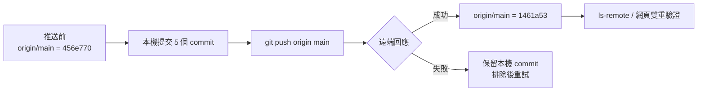
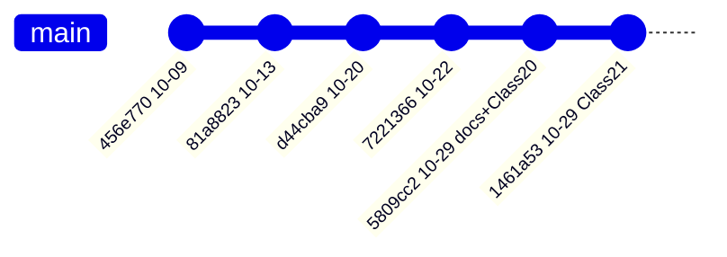
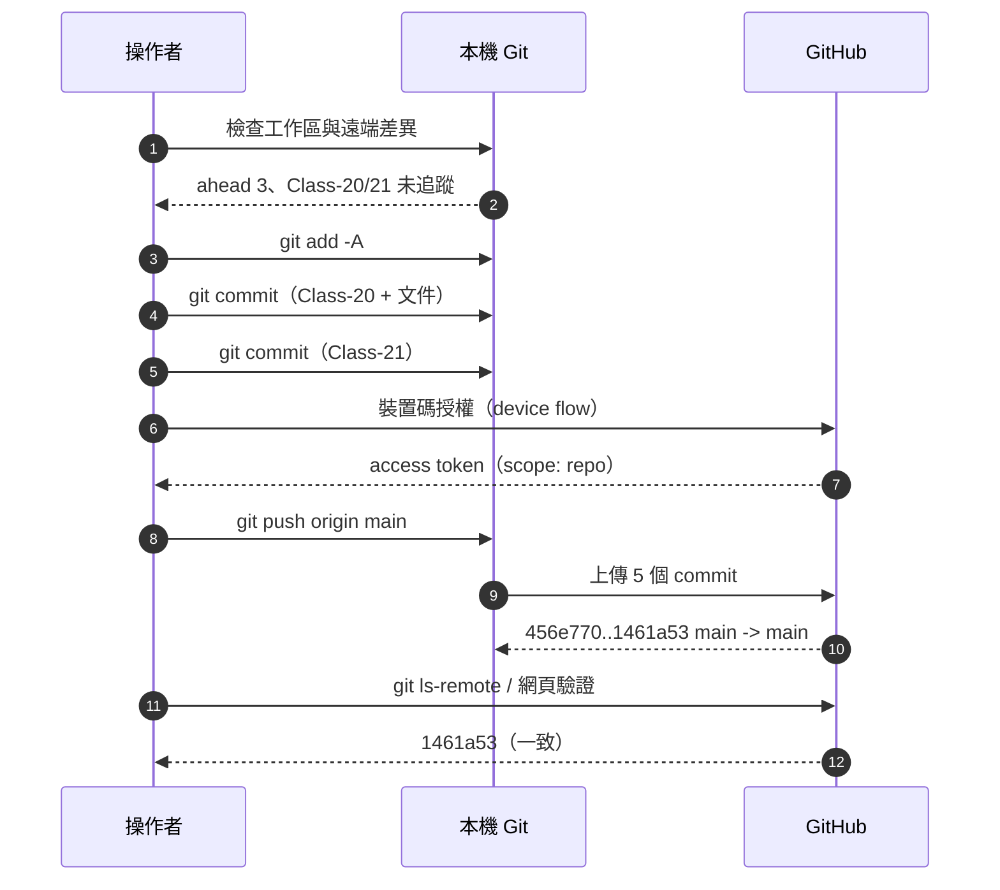
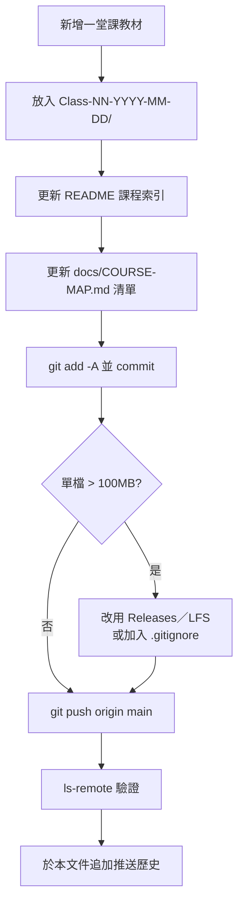

# 推送紀錄與檢核報告（Push Record）

本文件記錄 `D:\INDUSTRY-4.0` 推送至 GitHub 的完整過程、驗證結果與後續維護注意事項。
每次重大推送請在文末「推送歷史」追加一列。

---

## 1. 本次推送摘要

| 項目 | 內容 |
|---|---|
| 執行時間 | 2026-10-29 21:25（UTC+08:00） |
| 來源路徑 | `D:\INDUSTRY-4.0` |
| 遠端倉庫 | <https://github.com/yd7148/INDUSTRY-4.0> |
| 分支 | `main` → `origin/main` |
| 推送前遠端 | `456e770`（2026-10-09） |
| 推送後遠端 | **`1461a53`** |
| 推送範圍 | `456e770..1461a53`（5 個 commit） |
| 本次新增 | Class-20（56 檔）、Class-21（72 檔）、`README.md`、`docs/` |
| 傳輸結果 | **成功**；GitHub 回報 `456e770..1461a53  main -> main` |
| 遠端驗證 | `git ls-remote origin main` 回傳 `1461a53f3a3b8a52c7e481244ad1f710a6b098b6` |
| 工作區狀態 | clean，`main` 與 `origin/main` 同點 |



---

## 2. 提交歷史



| Commit | 日期時間 | 說明 |
|---|---|---|
| `456e770` | 2026-10-09 12:56 | 推送前遠端最新（Class-14） |
| `81a8823` | 2026-10-13 19:37 | 課程重新編號、新增 Class-16 |
| `d44cba9` | 2026-10-20 21:39 | 新增 Class-17、Class-18 |
| `7221366` | 2026-10-22 21:24 | 新增 Class-19（Node-RED、MQTT） |
| `5809cc2` | 2026-10-29 18:47 | 新增 Class-20、`README.md`、`docs/COURSE-MAP.md` |
| `1461a53` | 2026-10-29 21:24 | 新增 Class-21（Node-RED Flow、M2M） |

> 推送前本機已領先遠端 3 個 commit（`81a8823`、`d44cba9`、`7221366`），代表 Class-15～19 尚未上傳；
> 本次一併推送，並非只推最後一個 commit。

---

## 3. 執行流程



### 3.1 環境準備

本機未安裝 Git（`git` 不在 PATH、`cmdkey` 無 GitHub 憑證、無 SSH key），因此使用可攜版：

| 元件 | 版本 | 位置 |
|---|---|---|
| MinGit（可攜） | 2.56.0.4 64-bit | `%LOCALAPPDATA%\Temp\opencode\mingit` |
| GitHub CLI | 2.103.3（僅輔助） | `%LOCALAPPDATA%\Temp\opencode\gh` |
| 授權方式 | OAuth Device Flow | scope `repo`，未寫入 git config |

### 3.2 實際指令

```powershell
# 1. 檢視狀態（含被忽略的大型檔案）
git -c core.quotepath=false status --short --branch
git rev-list --left-right --count origin/main...HEAD

# 2. 加入與提交
git add -A
git -c user.name="yd7148" -c user.email="yd7148@users.noreply.github.com" `
    commit -m "Add Class-20 course materials and project documentation"
git -c user.name="yd7148" -c user.email="yd7148@users.noreply.github.com" `
    commit -m "Add Class-21-2026-10-29 Node-RED Flow and M2M materials"

# 3. 推送（一次性 askpass，令牌不落地到 repo）
$env:GIT_ASKPASS = "$env:LOCALAPPDATA\Temp\opencode\askpass.cmd"
$env:GIT_TERMINAL_PROMPT = "0"
git push origin main

# 4. 驗證
git ls-remote origin main
git status --short --branch
```

---

## 4. 檢核清單

| # | 檢核項目 | 方法 | 結果 |
|:--:|---|---|:--:|
| 1 | 提交內容完整 | `git status --short` 無殘留未追蹤教材 | ✅ |
| 2 | 暫存檔未入庫 | `git status --ignored` 確認 `~$*.doc`、`desktop.ini` 被排除 | ✅ |
| 3 | 超過 100 MB 的檔案未入庫 | `git ls-tree` 檢查，最大為 92.98 MB | ✅ |
| 4 | 大型安裝包已排除 | 兩個 1.69 GB 的 GX Works3 更新包被 `.gitignore` 排除 | ✅ |
| 5 | Mermaid 語法可渲染 | 以 Mermaid 11 實際渲染 `README.md`、`COURSE-MAP.md` | ✅ 7/7 |
| 6 | 文件無 TODO／佔位符 | 關鍵字掃描 `TODO`、`FIXME`、`待補` | ✅ |
| 7 | 遠端 HEAD 與本機一致 | `git ls-remote origin main` vs `git rev-parse HEAD` | ✅ 同為 `1461a53` |
| 8 | GitHub 網頁可見新 commit | 讀取 `/commits/main` 頁面 | ✅ |
| 9 | 推送後工作區乾淨 | `git status` | ✅ clean |
| 10 | 憑證未寫入版控 | 檢查 `.git/config`、`.git-credentials` | ✅ |

### 4.1 檔案規模

| 指標 | 數值 |
|---|---:|
| 追蹤檔案數 | 506 |
| 追蹤內容合計 | 1,449.9 MB |
| `.git` 目錄 | 430.3 MB |
| commit 總數 | 22 |
| 單檔最大 | 92.98 MB（`MQTT-Explorer-0.4.0-beta1.exe`） |

---

## 5. 已知警告與限制

| 項目 | 說明 | 建議 |
|---|---|---|
| 大檔案警告 `GH001` | GitHub 建議單檔 ≤ 50 MB；`MQTT-Explorer` 為 92.98 MB（仍低於硬性上限 100 MB） | 後續同類工具改用 Releases 或 Git LFS |
| 倉庫總量 | 約 1.45 GB，接近 GitHub 建議的 1 GB～5 GB 區間 | 定期清除重複 PDF，或改以文件索引取代複本 |
| 重複教材 | 多堂課各存一份相同 PDF／工具 | 見 [COURSE-MAP.md](COURSE-MAP.md) 第 5 節 |
| 憑證 | 本次使用一次性装置碼授權，未持久化 | 如需長期免互動，改用 Git Credential Manager |

> 本次 `git push` 在 PowerShell 中因遠端警告輸出到 stderr 而顯示 `Exited with code 1`，
> 但實際傳輸成功（`456e770..1461a53`），已用 `ls-remote` 與 GitHub 網頁雙重確認。

---

## 6. 推送歷史

| 日期 | 範圍 | 結果 | 備註 |
|---|---|---|---|
| 2026-10-29 | `456e770..1461a53` | 成功 | 新增 Class-20、Class-21、README 與 docs |

---

## 7. 後續維護



- 每次推送前後各執行一次 `git status --short --branch`。
- 新增教材後同步更新 `README.md` 的課程表與 `docs/COURSE-MAP.md`。
- 若加入 `.exe`、`.zip`，先確認大小；超過 100 MB 一律不進 Git。

---

*紀錄建立：2026-10-29*
